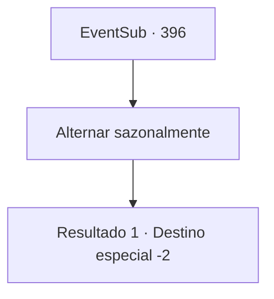

# Eventos secundários · 396

[Índice da tabela](index.md) · [Índice geral](../index.md)

ID: `pt:EventSub:396` · Fonte: `EventSub4` · Versão: 1.2.47.

Mapeamento estático dos arquivos; a disponibilidade e a execução dependem do estado da run.

## Texto do evento

*Sem texto no arquivo.*

## Dados de entrada

```json
{
  "id": 396,
  "grade": 1,
  "subEvent": "",
  "required": ""
}
```

## Mapa das escolhas



## Escolhas e resultados

### Escolha 1

Alternar sazonalmente

Requisitos e outros campos da escolha:

```json
{
  "required": ""
}
```

#### Resultado 1.1

Após ouvir os druidas e Amakar, você sugere que eles guardem a joia em turnos sazonais. Ambas as partes parecem incertas em relação à sua proposta. Syannathel fala primeiro. 

 "Justo. É melhor resolver essa questão sem derramar mais sangue. Sentimentos ruins... é melhor mantê-los contidos."

 Com suas palavras, os druidas acenam lentamente. Depois, Amakar também abre a boca. 

 "Parece ser um acordo excelente. Não vejo motivo para não aceitá-lo... No entanto, sugiro que assinemos um pacto. Em caso de violação dos termos, a parte culpada deve abrir mão da joia."

 Eles fazem um pacto na sua frente e marcam o pergaminho com seu sangue. Depois, os druidas retornam à Floresta de Silocient. Observando-os, Amakar fala. 

 "Muito obrigado por sua ajuda. Não mais sacrifícios. Por favor, aceite isso."

 Amakar agradece a você e entrega a luxuosa vestimenta que estava usando. É uma esplêndida túnica azul, bordada com estrelas prateadas. Você veste a 'Cortina de Estrelas' e se despede dele.

Continuação registrada: [Destino especial `-2`](../destinos-especiais.md).

```json
{
  "required": "",
  "chance": "1",
  "nextEvent": -2,
  "type": 2,
  "reward": "12_8_-1|3_242_1|14_8_0"
}
```

## Referências que chegam a este evento

- [Evento 393 · escolha 2 · resultado 1](0393.md#escolha-2)
- [Evento 393 · escolha 3 · resultado 2](0393.md#escolha-3)
