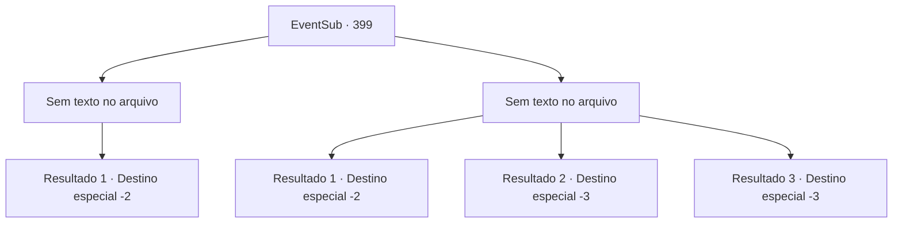

# Eventos secundários · 399

[Índice da tabela](index.md) · [Índice geral](../index.md)

ID: `pt:EventSub:399` · Fonte: `EventSub4` · Versão: 1.2.47.

Mapeamento estático dos arquivos; a disponibilidade e a execução dependem do estado da run.

## Texto do evento

*Sem texto no arquivo.*

## Dados de entrada

```json
{
  "id": 399,
  "grade": 1,
  "subEvent": "",
  "required": ""
}
```

## Mapa das escolhas



## Escolhas e resultados

### Escolha 1

*Sem texto no arquivo; o papel dessa opção depende da interface do jogo.*

Requisitos e outros campos da escolha:

```json
{
  "required": ""
}
```

#### Resultado 1.1

Você derrota o druida mais velho e olha ao redor. Enquanto ele cai, os druidas começam a fugir, e os soldados de Tomant os perseguem. Syannathel também é derrotado por Amakar. Amakar comanda os soldados a prenderem os druidas, incluindo Syannathel. Então ele se aproxima de você e fala. 

 "Muito obrigado pela sua ajuda. Não mais sacrifícios. Por favor, aceite isso."

 Amakar agradece a você e entrega a luxuosa vestimenta que estava usando. É uma esplêndida túnica azul, bordada com estrelas prateadas. Você veste a 'Cortina de Estrelas' e se despede dele.

Continuação registrada: [Destino especial `-2`](../destinos-especiais.md).

```json
{
  "required": "",
  "chance": "1",
  "nextEvent": -2,
  "type": 2,
  "reward": "12_8_-1|3_242_1|14_8_1|14_8_3"
}
```

### Escolha 2

*Sem texto no arquivo; o papel dessa opção depende da interface do jogo.*

Requisitos e outros campos da escolha:

```json
{
  "required": ""
}
```

#### Resultado 2.1

Atacado por um druida, você é derrubado. Soldados ao seu redor estão enfrentando circunstâncias semelhantes. O druida que derrotou você levanta um pessoal de madeira e atinge você na cabeça. 

 Você abre os olhos com uma forte dor de cabeça. Felizmente, você está vivo. Os cadáveres dos soldados estão espalhados por toda parte, e você vê Amakar deitado entre eles. Você se aproxima dele com esperança. No entanto, ele já está morto. Você fecha os olhos dele e cambaleia da floresta.

Continuação registrada: [Destino especial `-2`](../destinos-especiais.md).

```json
{
  "required": "1_0_2|1_1_2",
  "chance": "1",
  "nextEvent": -2,
  "type": 2,
  "reward": "0_0_-1|0_1_-1|14_8_8|14_8_11|12_8_-1"
}
```

#### Resultado 2.2

Atacado por um druida, você é derrubado. Soldados ao seu redor estão enfrentando circunstâncias semelhantes. O druida que te derrotou levanta um bastão de madeira e te acerta na cabeça.

Continuação registrada: [Destino especial `-3`](../destinos-especiais.md).

```json
{
  "required": "2_0_2",
  "chance": "1",
  "nextEvent": -3,
  "type": 2,
  "reward": "0_0_-1|0_1_-1"
}
```

#### Resultado 2.3

Atacado por um druida, você é derrubado. Soldados ao seu redor estão enfrentando circunstâncias semelhantes. O druida que te derrotou levanta um bastão de madeira e te acerta na cabeça.

Continuação registrada: [Destino especial `-3`](../destinos-especiais.md).

```json
{
  "required": "2_1_2",
  "chance": "1",
  "nextEvent": -3,
  "type": 2,
  "reward": "0_0_-1|0_1_-1"
}
```

## Referências que chegam a este evento

- [Evento 398 · escolha 1 · resultado 1](0398.md#escolha-1)
