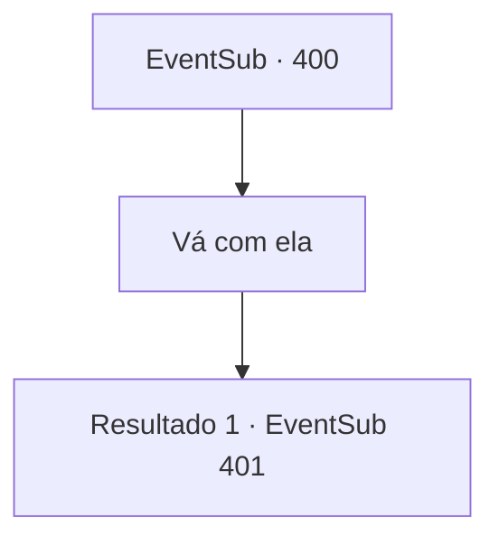

# Eventos secundários · 400

[Índice da tabela](index.md) · [Índice geral](../index.md)

ID: `pt:EventSub:400` · Fonte: `EventSub4` · Versão: 1.2.47.

Mapeamento estático dos arquivos; a disponibilidade e a execução dependem do estado da run.

## Texto do evento

Uma águia familiar voa até você. Ele fica em um galho, olha para você e move o bico. Ele fala com uma voz familiar, como esperado. 

 "Sou eu, Syannathel. As negociações ocorrerão em breve. Eu vim aqui para buscá-lo."

 Ela informa que as negociações entre a Floresta Silociente e Tomant começarão em breve e pede que você vá para as 'Planícies de Kiorov' com ela.

## Dados de entrada

```json
{
  "id": 400,
  "grade": 1,
  "subEvent": "",
  "required": "12_8_12"
}
```

## Mapa das escolhas



## Escolhas e resultados

### Escolha 1

Vá com ela

Requisitos e outros campos da escolha:

```json
{
  "required": ""
}
```

#### Resultado 1.1

Você vai para as planícies de Kiorov com Syannathel. 

 Chegando nas planícies de Kiorov, você percebe tendas com bandeiras de Tomant. Você entra em uma barraca e vê cerca de três druidas à mesa. No lado oposto, fica Amakar e seu oficial. Enquanto você e Syannathel se sentam, Amakar fala. 

 "Você é responsável pelos danos que nossa cidade causou durante o seu ataque."

 Por sua reivindicação, o oficial assente e Syannathel zomba. 

 "Você não deveria ter roubado a jóia em primeiro lugar."


Continuação registrada: [Evento 401](0401.md) na mesma tabela.

```json
{
  "required": "",
  "chance": "1",
  "nextEvent": 401,
  "type": 2,
  "reward": ""
}
```

## Referências que chegam a este evento

Nenhum `nextEvent` positivo da mesma tabela aponta para este nó. Isso não prova que seja inacessível: sorteio e estado de história podem selecioná-lo.

