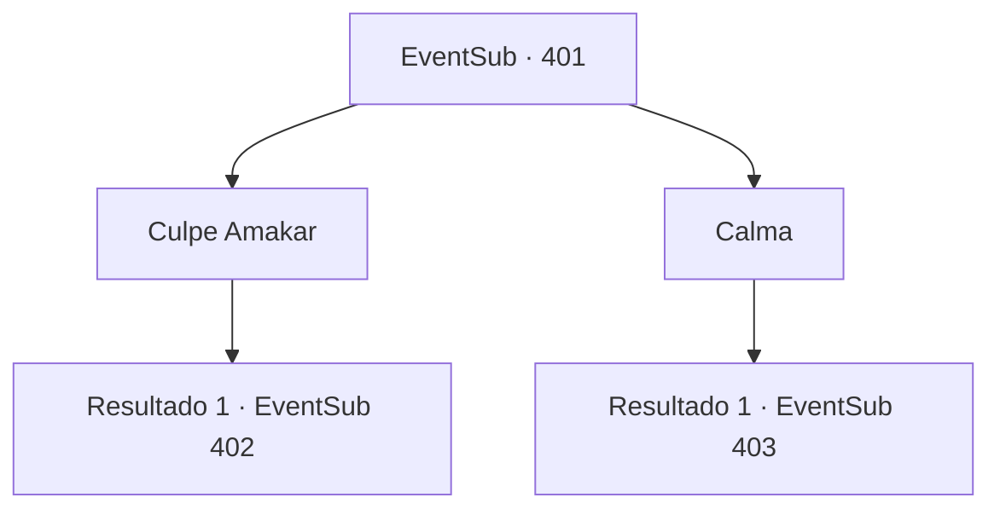

# Eventos secundários · 401

[Índice da tabela](index.md) · [Índice geral](../index.md)

ID: `pt:EventSub:401` · Fonte: `EventSub4` · Versão: 1.2.47.

Mapeamento estático dos arquivos; a disponibilidade e a execução dependem do estado da run.

## Texto do evento

*Sem texto no arquivo.*

## Dados de entrada

```json
{
  "id": 401,
  "grade": 1,
  "subEvent": "",
  "required": ""
}
```

## Mapa das escolhas



## Escolhas e resultados

### Escolha 1

Culpe Amakar

Requisitos e outros campos da escolha:

```json
{
  "required": ""
}
```

#### Resultado 1.1

Você apoia a afirmação de Syannathel culpando Amakar. O rosto de Amakar fica vermelho. Ele se levanta de sua cadeira. 

 "Entendi o que você quer dizer. Ouvir mais uma palavra será perda de tempo."

 Amakar chuta a mesa de negociação e sai da tenda. Então Syannathel abre a boca. 

 "As negociações fracassaram. É melhor voltarmos e nos prepararmos para a guerra..."

 Antes mesmo de terminar de falar, flechas de fogo voam, rasgando a tenda. O fogo se espalha rapidamente e queima a tenda, forçando você e os druidas a saírem correndo. Você enfrenta os soldados de Tomant em frente à tenda. 

 "Ele planejou isso desde o início..!!"

 Syannathel grita de raiva. Amakar ordena que seus homens avancem, em vez de responder.

Continuação registrada: [Evento 402](0402.md) na mesma tabela.

```json
{
  "required": "",
  "chance": "1",
  "nextEvent": 402,
  "type": 2,
  "reward": "6_0_136",
  "place": 0
}
```

### Escolha 2

Calma

Requisitos e outros campos da escolha:

```json
{
  "required": ""
}
```

#### Resultado 2.1

Você acalma Syannathel e retoma as negociações. Amakar fala logo em seguida. 

 "A joia também é um recurso crucial para nós. Dezenas de milhares de cidadãos vivem na cidade. Este assunto é muito importante para ser baseado em propriedades passadas. Além disso, você saqueou nossa cidade e causou problemas para os aldeões inocentes."

 O druida mais velho responde. 

 "Isso não teria acontecido se você não tivesse roubado a joia. Além disso, não podemos abrir mão do nosso tesouro apenas porque há mais habitantes vivendo em Tomant. Nossa floresta e nossa família são igualmente importantes."

 Com o argumento do druida mais velho, Amakar franze a testa.

Continuação registrada: [Evento 403](0403.md) na mesma tabela.

```json
{
  "required": "",
  "chance": "1",
  "nextEvent": 403,
  "type": 2,
  "reward": ""
}
```

## Referências que chegam a este evento

- [Evento 400 · escolha 1 · resultado 1](0400.md#escolha-1)
