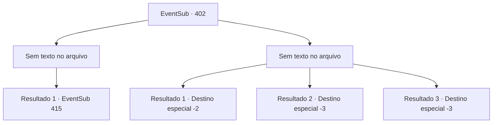

# Eventos secundários · 402

[Índice da tabela](index.md) · [Índice geral](../index.md)

ID: `pt:EventSub:402` · Fonte: `EventSub4` · Versão: 1.2.47.

Mapeamento estático dos arquivos; a disponibilidade e a execução dependem do estado da run.

## Texto do evento

*Sem texto no arquivo.*

## Dados de entrada

```json
{
  "id": 402,
  "grade": 1,
  "subEvent": "",
  "required": ""
}
```

## Mapa das escolhas



## Escolhas e resultados

### Escolha 1

*Sem texto no arquivo; o papel dessa opção depende da interface do jogo.*

Requisitos e outros campos da escolha:

```json
{
  "required": ""
}
```

#### Resultado 1.1

Você e os druidas funcionam como um e rompem o cerco dos soldados. Então você foge juntos para a floresta. O exército de Tomant o persegue até a floresta, mas o feitiço dos druidas os impede. 

 Somente depois de fugir por um tempo, você consegue recuperar o fôlego. O druida mais velho vem até você e fala. 

 "Sinto muito, mas não temos tempo para descansar. Devemos voltar à floresta silociente imediatamente."

 "Você tem razão. Eles vão perseguir a jóia. Vá de costas."

 Um dos druidas responde às palavras do druida mais velho e se ajoelha. Ele se transforma em um cavalo e você anda de costas. 

 "Apertar."

 Ele galopa como o vento e logo chega na floresta silociente. Os druidas, que estavam esperando para ouvir o resultado, recebem você. Ao dizer a eles o resultado das negociações, uma atmosfera séria paira no ar. Quebrando o silêncio, um druida fala. 

 "Devemos encontrar uma solução. Alguma sugestão?"


Continuação registrada: [Evento 415](0415.md) na mesma tabela.

```json
{
  "required": "",
  "chance": "1",
  "nextEvent": 415,
  "type": 2,
  "reward": ""
}
```

### Escolha 2

*Sem texto no arquivo; o papel dessa opção depende da interface do jogo.*

Requisitos e outros campos da escolha:

```json
{
  "required": ""
}
```

#### Resultado 2.1

Você e os druidas enfrentam os soldados de Tomant juntos. No entanto, uma arma franca voa do nada e bate em sua cabeça. Você é nocauteado. 

 Você perdeu o senso de tempo. Você abre os olhos com uma forte dor de cabeça. Você empurra o cadáver de um soldado de lado e se levanta. No entanto, os druidas não estão em lugar algum. Talvez eles sejam capturados por Amakar. Arrastando seu eu ferido, você sai correndo para fora do campo de batalha.

Continuação registrada: [Destino especial `-2`](../destinos-especiais.md).

```json
{
  "required": "1_0_2|1_1_2",
  "chance": "1",
  "nextEvent": -2,
  "type": 2,
  "reward": "0_0_-1|0_1_-1|12_8_13"
}
```

#### Resultado 2.2

Você está cercado pelos soldados de Tomant. Suas lanças e espadas te perfuram, e você cai no chão.

Continuação registrada: [Destino especial `-3`](../destinos-especiais.md).

```json
{
  "required": "2_0_2",
  "chance": "1",
  "nextEvent": -3,
  "type": 2,
  "reward": "0_0_-1|0_1_-1"
}
```

#### Resultado 2.3

Você está cercado pelos soldados de Tomant. Suas lanças e espadas te perfuram, e você cai no chão.

Continuação registrada: [Destino especial `-3`](../destinos-especiais.md).

```json
{
  "required": "2_1_2",
  "chance": "1",
  "nextEvent": -3,
  "type": 2,
  "reward": "0_0_-1|0_1_-1"
}
```

## Referências que chegam a este evento

- [Evento 401 · escolha 1 · resultado 1](0401.md#escolha-1)
- [Evento 403 · escolha 1 · resultado 1](0403.md#escolha-1)
