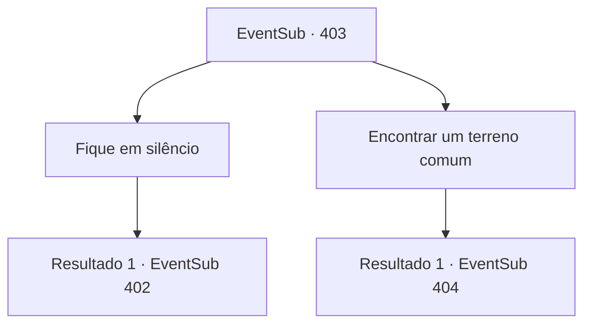

# Eventos secundários · 403

[Índice da tabela](index.md) · [Índice geral](../index.md)

ID: `pt:EventSub:403` · Fonte: `EventSub4` · Versão: 1.2.47.

Mapeamento estático dos arquivos; a disponibilidade e a execução dependem do estado da run.

## Texto do evento

*Sem texto no arquivo.*

## Dados de entrada

```json
{
  "id": 403,
  "grade": 1,
  "subEvent": "",
  "required": ""
}
```

## Mapa das escolhas



## Escolhas e resultados

### Escolha 1

Fique em silêncio

Requisitos e outros campos da escolha:

```json
{
  "required": ""
}
```

#### Resultado 1.1

Você observa a situação, em vez de cortar precipitadamente. No entanto, a discussão apenas revela a clara diferença entre as duas partes. O rosto de Amakar fica vermelho enquanto ele fala. 

 "Entendo o que você quer dizer. Ouvir mais uma palavra será perda de tempo."

 Amakar chuta a mesa de negociação e sai da tenda. Então Syannathel abre a boca. 

 "As negociações fracassaram. É melhor voltar e se preparar para a guerra..."

 Antes mesmo de terminar de falar, flechas de fogo voam, rasgando a tenda. O fogo se espalha rapidamente e queima a tenda, forçando você e os druidas a sair correndo. Você enfrenta os soldados de Tomant na frente da tenda. 

 "Ele planejou isso desde o início..!!"

 Syannathel grita de raiva. Amakar ordena que seus homens avancem, em vez de responder.

Continuação registrada: [Evento 402](0402.md) na mesma tabela.

```json
{
  "required": "",
  "chance": "1",
  "nextEvent": 402,
  "type": 2,
  "reward": "6_0_136",
  "place": 0
}
```

### Escolha 2

Encontrar um terreno comum

Requisitos e outros campos da escolha:

```json
{
  "required": "1_14_15"
}
```

#### Resultado 2.1

Você reflete sobre esse assunto e pergunta aos druidas quando eles usaram o poder da joia. Um druida de longa barba responde. 

 "Assim como qualquer outra floresta, a Floresta de Silocient começa a perder sua vitalidade no final do outono e, no inverno, as folhas secam. Com a força da joia, fomos capazes de manter a floresta verde o ano todo, como no verão. No entanto, nesses anos, não tivemos escolha senão implorar no inverno."

 Então, você pergunta a Amakar quando ele usou o poder da joia. 

 "Normalmente, usamos na primavera, quando as colheitas são plantadas, ou no verão para superar a seca..."


Continuação registrada: [Evento 404](0404.md) na mesma tabela.

```json
{
  "required": "",
  "chance": "1",
  "nextEvent": 404,
  "type": 2,
  "reward": ""
}
```

## Referências que chegam a este evento

- [Evento 401 · escolha 2 · resultado 1](0401.md#escolha-2)
