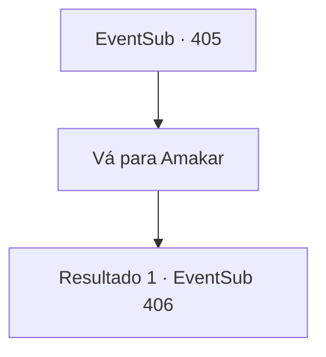

# Eventos secundários · 405

[Índice da tabela](index.md) · [Índice geral](../index.md)

ID: `pt:EventSub:405` · Fonte: `EventSub4` · Versão: 1.2.47.

Mapeamento estático dos arquivos; a disponibilidade e a execução dependem do estado da run.

## Texto do evento

Um corvo voa para você. Brilhando os olhos com um brilho verde, fala com a voz de Amakar. 

 "Chegou a hora, {1}. Por favor, ajude-nos a recuperar a joia."

 Amakar pede que você venha ao acampamento, que ficará fora da Floresta Silociente.

## Dados de entrada

```json
{
  "id": 405,
  "grade": 1,
  "subEvent": "",
  "required": "12_8_9"
}
```

## Mapa das escolhas



## Escolhas e resultados

### Escolha 1

Vá para Amakar

Requisitos e outros campos da escolha:

```json
{
  "required": ""
}
```

#### Resultado 1.1

Você visita Amakar, que montou um acampamento fora da Floresta de Silocient. A floresta se tornou densa, provavelmente com o poder da joia. Você chega à maior tenda, guiado por um soldado, e vê Amakar discutindo com seus homens. Amakar te avista e oferece um aperto de mão. 

 "Bem-vindo. Estávamos apenas tendo uma reunião. Por favor, entre."

 Ao entrar na tenda, a reunião estratégica continua. De acordo com o oficial, a força de Tomant está na quantidade de seu exército, com milhares de soldados. Como as tropas de Tomant superam em número os druidas, a maioria dos membros é a favor de marchar em direção ao inimigo. No entanto, Amakar hesita em decidir a estratégia, com uma expressão preocupada em seu rosto.

Continuação registrada: [Evento 406](0406.md) na mesma tabela.

```json
{
  "required": "",
  "chance": "1",
  "nextEvent": 406,
  "type": 2,
  "reward": ""
}
```

## Referências que chegam a este evento

Nenhum `nextEvent` positivo da mesma tabela aponta para este nó. Isso não prova que seja inacessível: sorteio e estado de história podem selecioná-lo.

