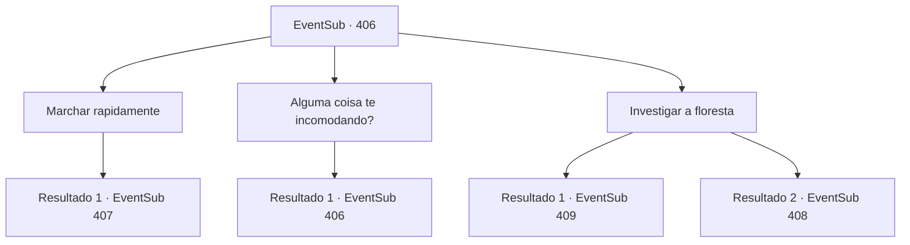

# Eventos secundários · 406

[Índice da tabela](index.md) · [Índice geral](../index.md)

ID: `pt:EventSub:406` · Fonte: `EventSub4` · Versão: 1.2.47.

Mapeamento estático dos arquivos; a disponibilidade e a execução dependem do estado da run.

## Texto do evento

*Sem texto no arquivo.*

## Dados de entrada

```json
{
  "id": 406,
  "grade": 1,
  "subEvent": "",
  "required": ""
}
```

## Mapa das escolhas



## Escolhas e resultados

### Escolha 1

Marchar rapidamente

Requisitos e outros campos da escolha:

```json
{
  "required": ""
}
```

#### Resultado 1.1

Sua opinião não é diferente dos outros. Você se junta a eles e sugere que o Exército cobre imediatamente. Amakar pensa bem e depois assente. 

 "Tudo bem. Assim que os olheiros localizam o inimigo, avançaremos em direção a eles."

 Logo depois, Akamar recebe uma mensagem dos escoteiros da floresta. Amakar e você entram na floresta com o exército. Enquanto entra, você ouve soldados gritando de todos os lugares. O chão afunda de repente, engolindo soldados caídos. Trunks de árvores subitamente voam por baixo, enrolando e estrangulando os homens de Amakar. O Exército de Tomant entrou nas armadilhas que os druidas definiram. No momento, os druidas emboscam o exército. 

 "VAI! Derrote os invasores !!"

 No grito do druida mais velho, os outros e seus familiares correm para os soldados. |drawing_warDruid|

Continuação registrada: [Evento 407](0407.md) na mesma tabela.

```json
{
  "required": "",
  "chance": "1",
  "nextEvent": 407,
  "type": 2,
  "reward": "6_3_138",
  "place": 1
}
```

### Escolha 2

Alguma coisa te incomodando?

Requisitos e outros campos da escolha:

```json
{
  "required": "5_332_0"
}
```

#### Resultado 2.1

Amakar pausa por um momento antes de responder à sua pergunta. 

 "Os druidas conhecem cada centímetro desta floresta. Eles devem ter estado totalmente preparados. Estou preocupado com os possíveis danos que podemos sofrer em uma guerra total."


Continuação registrada: [Evento 406](0406.md) na mesma tabela.

```json
{
  "required": "",
  "chance": "1",
  "nextEvent": 406,
  "type": 2,
  "reward": "5_332_1"
}
```

### Escolha 3

Investigar a floresta

Requisitos e outros campos da escolha:

```json
{
  "required": "5_332_1"
}
```

#### Resultado 3.1

Você se oferece para investigar a floresta. Amakar ordena que alguns batedores irem com você. Você e os escoteiros andam cuidadosamente pela floresta e descobrem uma variedade de armadilhas que os druidas definiram. Existem poços secretos básicos, pântanos escondidos com folhas e até troncos de árvores mágicas que se ativam na abordagem humana. Você passa pela área de armadilha e encontra o acampamento dos Druids. Depois de verificar o local, você e os escoteiros retornam à base e relatam tudo. 

 "Você fez um trabalho esplêndido."

 Amakar marche os soldados, evitando as armadilhas. Logo depois, a batalha começa com o ataque furtivo dos druidas. Você pula na luta, balançando sua arma neles. |drawing_warDruid|

Continuação registrada: [Evento 409](0409.md) na mesma tabela.

```json
{
  "required": "",
  "chance": "1|0_14_1",
  "nextEvent": 409,
  "type": 0,
  "reward": "6_0_138",
  "place": 1
}
```

#### Resultado 3.2

Você se voluntaria para investigar a floresta. Amakar ordena que alguns batedores vão com você. Você e os batedores caminham cuidadosamente pela floresta e procuram por armadilhas que os druidas tenham preparado. Não muito tempo depois de explorar a floresta, o chão sob seus pés desaba, revelando um buraco. O buraco, cheio de estacas de madeira afiadas, está prestes a engolir você.

Continuação registrada: [Evento 408](0408.md) na mesma tabela.

```json
{
  "required": "",
  "chance": "18",
  "nextEvent": 408,
  "type": 1,
  "reward": ""
}
```

## Referências que chegam a este evento

- [Evento 405 · escolha 1 · resultado 1](0405.md#escolha-1)
- [Evento 406 · escolha 2 · resultado 1](0406.md#escolha-2)
