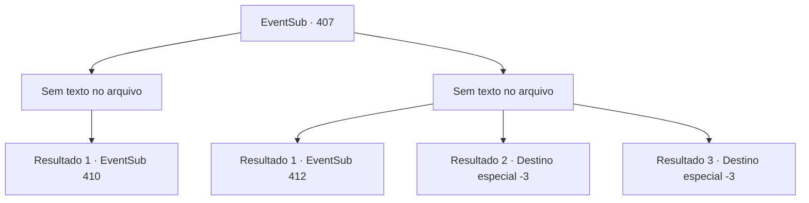

# Eventos secundários · 407

[Índice da tabela](index.md) · [Índice geral](../index.md)

ID: `pt:EventSub:407` · Fonte: `EventSub4` · Versão: 1.2.47.

Mapeamento estático dos arquivos; a disponibilidade e a execução dependem do estado da run.

## Texto do evento

*Sem texto no arquivo.*

## Dados de entrada

```json
{
  "id": 407,
  "grade": 1,
  "subEvent": "",
  "required": ""
}
```

## Mapa das escolhas



## Escolhas e resultados

### Escolha 1

*Sem texto no arquivo; o papel dessa opção depende da interface do jogo.*

Requisitos e outros campos da escolha:

```json
{
  "required": ""
}
```

#### Resultado 1.1

Enquanto você balança sua arma, outro druida perde vida. Olhando ao redor, você percebe que a floresta está encharcada de sangue, pois a maioria dos druidas foi morta. Os sobreviventes começam a fugir. 

 "DISPERSEM-SE! Todos se dispersem e corram!!"

 Você avista o druida mais velho com uma longa barba, entre os druidas em fuga. Ele segura a joia e lança um feitiço. Num instante, troncos de árvores surgem do chão, formando uma parede, protegendo os druidas dos soldados em perseguição.

Continuação registrada: [Evento 410](0410.md) na mesma tabela.

```json
{
  "required": "",
  "chance": "1",
  "nextEvent": 410,
  "type": 2,
  "reward": ""
}
```

### Escolha 2

*Sem texto no arquivo; o papel dessa opção depende da interface do jogo.*

Requisitos e outros campos da escolha:

```json
{
  "required": ""
}
```

#### Resultado 2.1

Pouco antes de ser derrubado por um druida, a espada de Amakar termina seu oponente. Você se levanta e vê os soldados lutando ferozmente, mas o dano parece imenso. Amakar olha em volta e ordena que os oficiais retirem o exército.

 'Dum-! DUM-! DUM-!'

 Enquanto o rolo da bateria anuncia retirada, os soldados lutam para escapar da floresta. Naquele momento, o druida mais velho aparece e grita. 

 "Agora, mate todos eles !!"

 Amakar corre para encontrá -los. 

 "Vamos lá, seus selvagens !!"


Continuação registrada: [Evento 412](0412.md) na mesma tabela.

```json
{
  "required": "1_0_2|1_1_2",
  "chance": "1",
  "nextEvent": 412,
  "type": 2,
  "reward": "0_0_-1|0_1_-1"
}
```

#### Resultado 2.2

Uma estaca de madeira penetra em seu pescoço. Você desaba no chão frio, sangrando até a morte.

Continuação registrada: [Destino especial `-3`](../destinos-especiais.md).

```json
{
  "required": "2_0_2",
  "chance": "1",
  "nextEvent": -3,
  "type": 2,
  "reward": "0_0_-1|0_1_-1"
}
```

#### Resultado 2.3

Uma estaca de madeira penetra em seu pescoço. Você desaba no chão frio, sangrando até a morte.

Continuação registrada: [Destino especial `-3`](../destinos-especiais.md).

```json
{
  "required": "2_1_2",
  "chance": "1",
  "nextEvent": -3,
  "type": 2,
  "reward": "0_0_-1|0_1_-1"
}
```

## Referências que chegam a este evento

- [Evento 406 · escolha 1 · resultado 1](0406.md#escolha-1)
