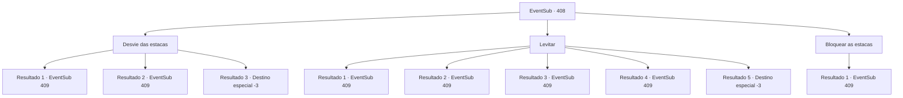

# Eventos secundários · 408

[Índice da tabela](index.md) · [Índice geral](../index.md)

ID: `pt:EventSub:408` · Fonte: `EventSub4` · Versão: 1.2.47.

Mapeamento estático dos arquivos; a disponibilidade e a execução dependem do estado da run.

## Texto do evento

*Sem texto no arquivo.*

## Dados de entrada

```json
{
  "id": 408,
  "grade": 1,
  "subEvent": "",
  "required": ""
}
```

## Mapa das escolhas



## Escolhas e resultados

### Escolha 1

Desvie das estacas

Requisitos e outros campos da escolha:

```json
{
  "required": ""
}
```

#### Resultado 1.1

Você mexe no ar, esquivando-se das apostas e depois pisa no poço. Você se afasta do poço como se nada tivesse acontecido. Passando pela área de armadilhas, você percebe traços de emboscada que os druidas foram embora. Você retorna à base com os escoteiros e relata tudo. 

 "Você fez um trabalho esplêndido."

 Amakar marche os soldados, evitando as armadilhas. Logo depois, a batalha começa com o ataque furtivo dos druidas. Você pula na luta, balançando sua arma neles. |drawing_warDruid|

Continuação registrada: [Evento 409](0409.md) na mesma tabela.

```json
{
  "required": "",
  "chance": "1|0_6_1",
  "nextEvent": 409,
  "type": 0,
  "reward": "6_0_138",
  "place": 1
}
```

#### Resultado 1.2

Você se mexe no ar, tentando evitar as apostas. No entanto, suas tentativas falham e você acaba sangrando. Você consegue sair do poço, com a ajuda dos escoteiros. Você retorna à base e relata que existem armadilhas. 

 "Oh querido ... vamos tratá -lo brevemente."

 Depois de examinar suas feridas, Amakar marcha os soldados, evitando as armadilhas. Logo depois, a batalha começa com o ataque furtivo dos druidas. Você pula na luta, balançando sua arma neles. |drawing_warDruid|

Continuação registrada: [Evento 409](0409.md) na mesma tabela.

```json
{
  "required": "1_0_2",
  "chance": "16",
  "nextEvent": 409,
  "type": 1,
  "reward": "6_3_138|0_0_-1",
  "place": 1
}
```

#### Resultado 1.3

Você se contorce no ar, tentando desviar das estacas. No entanto, suas tentativas falham e você acaba sangrando.

Continuação registrada: [Destino especial `-3`](../destinos-especiais.md).

```json
{
  "required": "2_0_2",
  "chance": "16",
  "nextEvent": -3,
  "type": 1,
  "reward": "0_0_-1"
}
```

### Escolha 2

Levitar

Requisitos e outros campos da escolha:

```json
{
  "required": "-1|20_0_1|20_10_1"
}
```

#### Resultado 2.1

Você calmamente lançou um feitiço e levita. Você escapa do poço como se nada tivesse acontecido. Passando pela área de armadilhas, você percebe traços de emboscada que os druidas foram embora. Você retorna à base com os escoteiros e relata tudo. 

 "Você fez um trabalho esplêndido."

 Amakar marche os soldados, evitando as armadilhas. Logo depois, a batalha começa com o ataque furtivo dos druidas. Você pula na luta, balançando sua arma neles. |drawing_warDruid|

Continuação registrada: [Evento 409](0409.md) na mesma tabela.

```json
{
  "required": "",
  "chance": "1|0_14_1",
  "nextEvent": 409,
  "type": 0,
  "reward": "6_0_138",
  "place": 1
}
```

#### Resultado 2.2

Você lança um feitiço e tenta levitar. No entanto, seu feitiço falha e você acaba sangrando. Você consegue sair do poço, com a ajuda dos escoteiros. Você retorna à base e relata que existem armadilhas. 

 "Oh querido ... vamos tratá -lo brevemente."

 Depois de examinar suas feridas, Amakar marcha os soldados, evitando as armadilhas. Logo depois, a batalha começa com o ataque furtivo dos druidas. Você pula na luta, balançando sua arma neles. |drawing_warDruid|

Continuação registrada: [Evento 409](0409.md) na mesma tabela.

```json
{
  "required": "1_0_2",
  "chance": "8",
  "nextEvent": 409,
  "type": 1,
  "reward": "6_3_138|0_0_-1",
  "place": 1
}
```

#### Resultado 2.3

Você voa para o ar e fuga do poço como se nada tivesse acontecido. Passando pela área de armadilhas, você percebe traços de emboscada que os druidas foram embora. Você retorna à base com os escoteiros e relata tudo. 

 "Você fez um trabalho esplêndido."

 Amakar marche os soldados, evitando as armadilhas. Logo depois, a batalha começa com o ataque furtivo dos druidas. Você pula na luta, balançando sua arma neles. |drawing_warDruid|

Continuação registrada: [Evento 409](0409.md) na mesma tabela.

```json
{
  "required": "20_10_1",
  "chance": "1",
  "nextEvent": 409,
  "type": 2,
  "reward": "6_0_138",
  "place": 1
}
```

#### Resultado 2.4

Você espera que possa flutuar no ar e escapar do poço. No entanto, o pensamento positivo não o ajuda e você acaba sangrando. Você consegue sair do poço, com a ajuda dos escoteiros. Você retorna à base e relata que existem armadilhas. 

 "Oh querido ... vamos tratá -lo brevemente."

 Depois de examinar suas feridas, Amakar marcha os soldados, evitando as armadilhas. Logo depois, a batalha começa com o ataque furtivo dos druidas. Você pula na luta, balançando sua arma neles. |drawing_warDruid|

Continuação registrada: [Evento 409](0409.md) na mesma tabela.

```json
{
  "required": "1_0_2",
  "chance": "8",
  "nextEvent": 409,
  "type": 1,
  "reward": "6_3_138|0_0_-1",
  "place": 1
}
```

#### Resultado 2.5

Você espera poder flutuar no ar e escapar do buraco. No entanto, pensamentos ilusórios não te ajudam e você acaba sangrando.

Continuação registrada: [Destino especial `-3`](../destinos-especiais.md).

```json
{
  "required": "2_0_2",
  "chance": "16",
  "nextEvent": -3,
  "type": 1,
  "reward": "0_0_-1"
}
```

### Escolha 3

Bloquear as estacas

Requisitos e outros campos da escolha:

```json
{
  "required": "20_9_2"
}
```

#### Resultado 3.1

Você bloqueia as apostas de madeira de perfurar você. Você se afasta do poço como se nada tivesse acontecido. Passando pela área de armadilhas, você percebe traços de emboscada que os druidas foram embora. Você retorna à base com os escoteiros e relata tudo. 

 "Você fez um trabalho esplêndido."

 Amakar marche os soldados, evitando as armadilhas. Logo depois, a batalha começa com o ataque furtivo dos druidas. Você pula na luta, balançando sua arma neles. |drawing_warDruid|

Continuação registrada: [Evento 409](0409.md) na mesma tabela.

```json
{
  "required": "",
  "chance": "1",
  "nextEvent": 409,
  "type": 2,
  "reward": "6_0_138",
  "place": 1
}
```

## Referências que chegam a este evento

- [Evento 406 · escolha 3 · resultado 2](0406.md#escolha-3)
