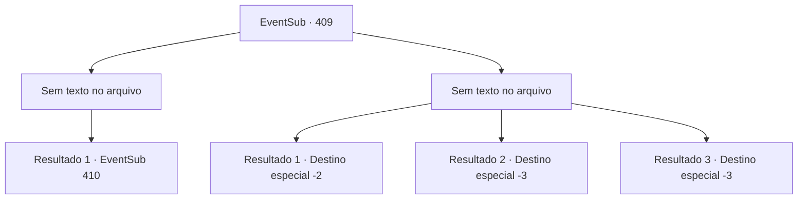

# Eventos secundários · 409

[Índice da tabela](index.md) · [Índice geral](../index.md)

ID: `pt:EventSub:409` · Fonte: `EventSub4` · Versão: 1.2.47.

Mapeamento estático dos arquivos; a disponibilidade e a execução dependem do estado da run.

## Texto do evento

*Sem texto no arquivo.*

## Dados de entrada

```json
{
  "id": 409,
  "grade": 1,
  "subEvent": "",
  "required": ""
}
```

## Mapa das escolhas



## Escolhas e resultados

### Escolha 1

*Sem texto no arquivo; o papel dessa opção depende da interface do jogo.*

Requisitos e outros campos da escolha:

```json
{
  "required": ""
}
```

#### Resultado 1.1

Enquanto você balança sua arma, outro druida perde vida. Olhando ao redor, você percebe que a floresta está encharcada de sangue, pois a maioria dos druidas foi morta. Os sobreviventes começam a fugir. 

 "DISPERSEM-SE! Todos se dispersem e corram!!"

 Você avista o druida mais velho com uma longa barba, entre os druidas em fuga. Ele segura a joia e lança um feitiço. Num instante, troncos de árvores surgem do chão, formando uma parede, protegendo os druidas dos soldados em perseguição.

Continuação registrada: [Evento 410](0410.md) na mesma tabela.

```json
{
  "required": "",
  "chance": "1",
  "nextEvent": 410,
  "type": 2,
  "reward": ""
}
```

### Escolha 2

*Sem texto no arquivo; o papel dessa opção depende da interface do jogo.*

Requisitos e outros campos da escolha:

```json
{
  "required": ""
}
```

#### Resultado 2.1

No meio de lutar contra os druidas, um clube voa do nada e atinge você na cabeça. À medida que você entra em colapso, sua visão fica confusa e você perde a consciência. 

 Você perdeu o senso de tempo. Depois de um tempo, você volta lentamente para si mesmo. Sua cabeça está batendo, mas você se levanta e olha em volta. Você está em um hospital de campo para os feridos. Os médicos estão ocupados se movendo e os soldados feridos gemem em agonia. Você pergunta a um médico como foi a guerra. Ele responde em um tom nervoso. 

 "Você ainda pede isso, depois de ver esse inferno?"

 Segundo ele, o exército de Tomant foi derrotado pelos druidas. Apenas alguns soldados sortudos conseguiram voltar, graças a Amakar, que parou por tempo. Enquanto você cambaleia, o médico lhe entrega uma poção e fala. 

 "Ei, é melhor aceitar isso."

 Você pega a pequena poção e deixa a tenda da agonia.

Continuação registrada: [Destino especial `-2`](../destinos-especiais.md).

```json
{
  "required": "1_0_2|1_1_2",
  "chance": "1",
  "nextEvent": -2,
  "type": 2,
  "reward": "0_0_-1|0_1_-1|3_190_1|12_8_-1|14_8_8"
}
```

#### Resultado 2.2

Os druidas lutam ferozmente, usando seu conhecimento do terreno da floresta. O solo se transforma em pântanos, bloqueando o avanço do exército, enquanto videiras mágicas estrangulam o pescoço dos soldados. Você também sofre muito com seus truques brilhantes. Enquanto luta para respirar, você afunda em um pântano sem fim.

Continuação registrada: [Destino especial `-3`](../destinos-especiais.md).

```json
{
  "required": "2_0_2",
  "chance": "1",
  "nextEvent": -3,
  "type": 2,
  "reward": "0_0_-1|0_1_-1"
}
```

#### Resultado 2.3

Os druidas lutam ferozmente, usando seu conhecimento do terreno da floresta. O solo se transforma em pântanos, bloqueando o avanço do exército, enquanto videiras mágicas estrangulam o pescoço dos soldados. Você também sofre muito com seus truques brilhantes. Enquanto luta para respirar, você afunda em um pântano sem fim.

Continuação registrada: [Destino especial `-3`](../destinos-especiais.md).

```json
{
  "required": "2_1_2",
  "chance": "1",
  "nextEvent": -3,
  "type": 2,
  "reward": "0_0_-1|0_1_-1"
}
```

## Referências que chegam a este evento

- [Evento 406 · escolha 3 · resultado 1](0406.md#escolha-3)
- [Evento 408 · escolha 1 · resultado 1](0408.md#escolha-1)
- [Evento 408 · escolha 1 · resultado 2](0408.md#escolha-1)
- [Evento 408 · escolha 2 · resultado 1](0408.md#escolha-2)
- [Evento 408 · escolha 2 · resultado 2](0408.md#escolha-2)
- [Evento 408 · escolha 2 · resultado 3](0408.md#escolha-2)
- [Evento 408 · escolha 2 · resultado 4](0408.md#escolha-2)
- [Evento 408 · escolha 3 · resultado 1](0408.md#escolha-3)
