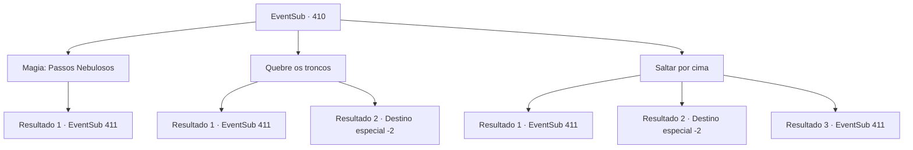

# Eventos secundários · 410

[Índice da tabela](index.md) · [Índice geral](../index.md)

ID: `pt:EventSub:410` · Fonte: `EventSub4` · Versão: 1.2.47.

Mapeamento estático dos arquivos; a disponibilidade e a execução dependem do estado da run.

## Texto do evento

*Sem texto no arquivo.*

## Dados de entrada

```json
{
  "id": 410,
  "grade": 1,
  "subEvent": "",
  "required": ""
}
```

## Mapa das escolhas



## Escolhas e resultados

### Escolha 1

Magia: Passos Nebulosos

Requisitos e outros campos da escolha:

```json
{
  "required": "20_0_1|1_1_2"
}
```

#### Resultado 1.1

Você se transforma em névoa e passa por um tronco de árvore, levantando-se do chão. Você fica em frente ao druida mais velho. Ele esconde a joia em suas roupas e empunha seu cajado. 

 "Urgh..! Você nunca colocará suas mãos na joia!!"

 Então ele corre em sua direção, arriscando sua vida.

Continuação registrada: [Evento 411](0411.md) na mesma tabela.

```json
{
  "required": "",
  "chance": "1",
  "nextEvent": 411,
  "type": 2,
  "reward": "6_3_141|0_1_-1",
  "place": 1
}
```

### Escolha 2

Quebre os troncos

Requisitos e outros campos da escolha:

```json
{
  "required": ""
}
```

#### Resultado 2.1

Você se lança com toda a sua força e colide com o tronco da árvore. Ele se despedaça com um som estalante. Você se choca com o druida mais velho, segurando a joia. Ele esconde a joia em suas roupas e empunha seu cajado. 

 "Urgh..! Você nunca colocará suas mãos na joia!!"

 Então ele se lança em sua direção, arriscando sua vida.

Continuação registrada: [Evento 411](0411.md) na mesma tabela.

```json
{
  "required": "",
  "chance": "1|0_5_1",
  "nextEvent": 411,
  "type": 0,
  "reward": "6_3_141",
  "place": 1
}
```

#### Resultado 2.2

Você se lança com toda a sua força e colide com o tronco da árvore. O tronco da árvore faz um som estalante, mas parece intacto. Mesmo naquele momento, a parede de troncos de árvores continua a crescer, até um estado impossível de quebrar. Você e os soldados contornam a parede de madeira e perseguem os druidas. No entanto, os druidas já desapareceram com a joia. A batalha acabou e Tomant conquista uma vitória. No entanto, os druidas levam a joia e conseguem escapar da perseguição do exército. No entanto, Amakar sorri e encoraja os soldados. Então ele vem até você para mostrar sua gratidão. 

 "Não conseguimos recuperar a joia desta vez, mas a recuperaremos em breve. Eles perderam muito com essa batalha. Obrigado pela sua ajuda."

 Amakar agradece a você e entrega a você a luxuosa vestimenta que estava usando. É uma esplêndida túnica azul, bordada com estrelas prateadas. Você veste a 'Cortina de Estrelas' e se despede dele.

Continuação registrada: [Destino especial `-2`](../destinos-especiais.md).

```json
{
  "required": "",
  "chance": "12",
  "nextEvent": -2,
  "type": 1,
  "reward": "12_8_-1|14_8_12|3_242_1"
}
```

### Escolha 3

Saltar por cima

Requisitos e outros campos da escolha:

```json
{
  "required": ""
}
```

#### Resultado 3.1

Você pula rapidamente sobre o tronco de árvore que está crescendo rapidamente. Então você fica em frente ao druida mais velho. Ele esconde a joia em suas roupas e empunha seu cajado. 

 "Urgh..! Você nunca colocará suas mãos na joia!!"

 Então ele corre em sua direção, arriscando sua vida.

Continuação registrada: [Evento 411](0411.md) na mesma tabela.

```json
{
  "required": "21_10_1",
  "chance": "1|0_6_1",
  "nextEvent": 411,
  "type": 0,
  "reward": "6_3_141",
  "place": 1
}
```

#### Resultado 3.2

Tentas saltar por cima do tronco de árvore em crescimento, mas ficas enredado. Alguns soldados ajudam-te, enquanto outros contornam a parede de madeira e perseguem os druidas. No entanto, os druidas já desapareceram com a jóia. A batalha acabou e Tomant ganha uma vitória. No entanto, os druidas levam a jóia e conseguem escapar da perseguição do exército. No entanto, Amakar sorri e encoraja os soldados. Depois, ele aproxima-se de ti para mostrar a sua gratidão. 

 "Não conseguimos recuperar a jóia desta vez, mas vamos recuperá-la em breve. Eles perderam muito nesta batalha. Obrigado pela tua ajuda."

 Amakar agradece-te e entrega-te a luxuosa vestimenta que estava a usar. É uma esplêndida túnica azul, bordada com estrelas prateadas. Vestes a 'Cortina de Estrelas' e despedes-te dele.

Continuação registrada: [Destino especial `-2`](../destinos-especiais.md).

```json
{
  "required": "21_10_1",
  "chance": "15",
  "nextEvent": -2,
  "type": 1,
  "reward": "12_8_-1|14_8_12|3_242_1"
}
```

#### Resultado 3.3

Você atravessa o ar e pula por cima do tronco de árvore em crescimento. Então você fica em frente ao druida mais velho. Ele esconde a joia em suas roupas e empunha seu cajado. 

 "Urgh..! Você nunca colocará suas mãos na joia!!"

 Então ele corre em sua direção, arriscando sua vida.

Continuação registrada: [Evento 411](0411.md) na mesma tabela.

```json
{
  "required": "20_10_1",
  "chance": "1",
  "nextEvent": 411,
  "type": 2,
  "reward": "6_3_141",
  "place": 1
}
```

## Referências que chegam a este evento

- [Evento 407 · escolha 1 · resultado 1](0407.md#escolha-1)
- [Evento 409 · escolha 1 · resultado 1](0409.md#escolha-1)
