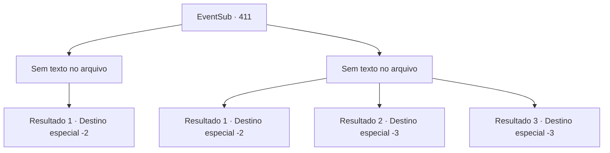

# Eventos secundários · 411

[Índice da tabela](index.md) · [Índice geral](../index.md)

ID: `pt:EventSub:411` · Fonte: `EventSub4` · Versão: 1.2.47.

Mapeamento estático dos arquivos; a disponibilidade e a execução dependem do estado da run.

## Texto do evento

*Sem texto no arquivo.*

## Dados de entrada

```json
{
  "id": 411,
  "grade": 1,
  "subEvent": "",
  "required": ""
}
```

## Mapa das escolhas



## Escolhas e resultados

### Escolha 1

*Sem texto no arquivo; o papel dessa opção depende da interface do jogo.*

Requisitos e outros campos da escolha:

```json
{
  "required": ""
}
```

#### Resultado 1.1

Você derrota o druida mais velho. Então, você pega a joia do druida inconsciente. Enquanto Amakar e seus homens se aproximam de você, você entrega a Joia da Vida para Amakar. Ele pega a joia, brilhando de exaltação, e grita para os soldados. 

 "Nós recuperamos nosso tesouro!! Vamos para casa!!!"

 Os soldados aplaudem em resposta. Amakar agradece a você e entrega a luxuosa vestimenta que estava usando. É uma esplêndida túnica azul, bordada com estrelas prateadas. 

 "Obrigado por sua ajuda. Este é um presente por sua contribuição."

 Ele acrescenta que você é bem-vindo para visitá-lo a qualquer momento. Você veste a 'Cortina de Estrelas' e se despede dele.

Continuação registrada: [Destino especial `-2`](../destinos-especiais.md).

```json
{
  "required": "",
  "chance": "1",
  "nextEvent": -2,
  "type": 2,
  "reward": "12_8_-1|14_8_3|3_242_1"
}
```

### Escolha 2

*Sem texto no arquivo; o papel dessa opção depende da interface do jogo.*

Requisitos e outros campos da escolha:

```json
{
  "required": ""
}
```

#### Resultado 2.1

O druida mais velho atinge seu estômago com esferas mágicas conjuradas de seu cajado. Suas pernas cedem e você perde o equilíbrio. Quando o druida mais velho levanta seu cajado, mirando em sua cabeça, você ouve um assobio de ar. A flecha de Amakar perfura seu peito. Amakar corre para o druida mais velho para pegar a joia. 

 "Urgh..! Eu NUNCA vou deixar você tê-la!!"

 O druida mais velho grita, enquanto cospe sangue. Então ele esmaga a joia em uma pedra. 

 "Não.. POR FAVOR NÃO!!"

 Apesar do grito de Amakar, a joia se despedaça com um som de tilintar. O druida mais velho desaba no local, depois de soltar uma mistura de tosse e risada. A batalha acabou. Tomant vence, mas não consegue recuperar a joia. Amakar encoraja os soldados, mas seu rosto está cheio de preocupação. Ele se aproxima de você com uma expressão cansada. 

 "Bem... Todo o trabalho árduo que passamos... é em vão."

 Ele agradece pela ajuda, de qualquer maneira. Como recompensa, você recebe uma bolsa de ouro. Então Amakar lidera seus homens de volta para Tomant.

Continuação registrada: [Destino especial `-2`](../destinos-especiais.md).

```json
{
  "required": "1_0_2|1_1_2",
  "chance": "1",
  "nextEvent": -2,
  "type": 2,
  "reward": "12_8_-1|14_8_2|0_4_100|0_0_-1|0_1_-1"
}
```

#### Resultado 2.2

O druida mais velho atinge o seu estômago com esferas mágicas conjuradas de seu cajado. Suas pernas cedem e você perde o equilíbrio. O druida mais velho balança seu cajado, mirando em sua cabeça. Você ouve seu crânio se chocando e o som ecoa em seus ouvidos. Algo quente escorre enquanto você perde a consciência.

Continuação registrada: [Destino especial `-3`](../destinos-especiais.md).

```json
{
  "required": "2_0_2",
  "chance": "1",
  "nextEvent": -3,
  "type": 2,
  "reward": "0_0_-1|0_1_-1"
}
```

#### Resultado 2.3

O druida mais velho atinge o seu estômago com esferas mágicas conjuradas de seu cajado. Suas pernas cedem e você perde o equilíbrio. O druida mais velho balança seu cajado, mirando em sua cabeça. Você ouve seu crânio se chocando e o som ecoa em seus ouvidos. Algo quente escorre enquanto você perde a consciência.

Continuação registrada: [Destino especial `-3`](../destinos-especiais.md).

```json
{
  "required": "2_1_2",
  "chance": "1",
  "nextEvent": -3,
  "type": 2,
  "reward": "0_0_-1|0_1_-1"
}
```

## Referências que chegam a este evento

- [Evento 410 · escolha 1 · resultado 1](0410.md#escolha-1)
- [Evento 410 · escolha 2 · resultado 1](0410.md#escolha-2)
- [Evento 410 · escolha 3 · resultado 1](0410.md#escolha-3)
- [Evento 410 · escolha 3 · resultado 3](0410.md#escolha-3)
