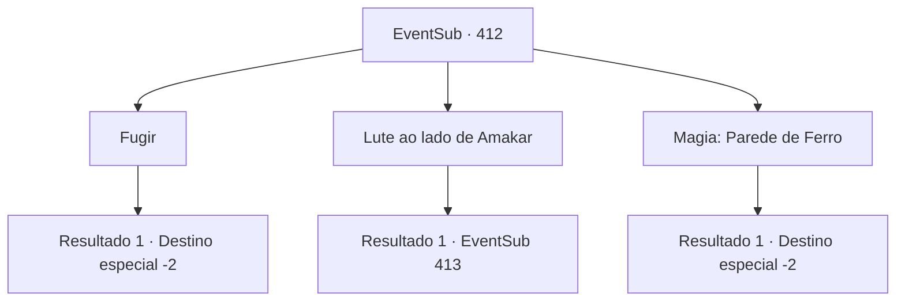

# Eventos secundários · 412

[Índice da tabela](index.md) · [Índice geral](../index.md)

ID: `pt:EventSub:412` · Fonte: `EventSub4` · Versão: 1.2.47.

Mapeamento estático dos arquivos; a disponibilidade e a execução dependem do estado da run.

## Texto do evento

*Sem texto no arquivo.*

## Dados de entrada

```json
{
  "id": 412,
  "grade": 1,
  "subEvent": "",
  "required": ""
}
```

## Mapa das escolhas



## Escolhas e resultados

### Escolha 1

Fugir

Requisitos e outros campos da escolha:

```json
{
  "required": ""
}
```

#### Resultado 1.1

Amakar se transforma em um urso gigante e luta ferozmente contra os druidas. Graças a ele ganhando tempo, você consegue fugir entre os soldados.

Continuação registrada: [Destino especial `-2`](../destinos-especiais.md).

```json
{
  "required": "",
  "chance": "1",
  "nextEvent": -2,
  "type": 2,
  "reward": "12_8_-1|14_8_8"
}
```

### Escolha 2

Lute ao lado de Amakar

Requisitos e outros campos da escolha:

```json
{
  "required": ""
}
```

#### Resultado 2.1

Amakar se transforma em um urso gigante e luta ferozmente contra os druidas. Você fica ao lado dele, enfrentando-os também. 

 "Por que você não fugiu?"

 Amakar pergunta, mas você está ocupado demais para responder, lutando contra os druidas.

Continuação registrada: [Evento 413](0413.md) na mesma tabela.

```json
{
  "required": "",
  "chance": "1",
  "nextEvent": 413,
  "type": 2,
  "reward": "6_3_138",
  "place": 1
}
```

### Escolha 3

Magia: Parede de Ferro

Requisitos e outros campos da escolha:

```json
{
  "required": "20_0_3|1_1_2"
}
```

#### Resultado 3.1

Você conjura uma parede mágica de ferro entre Amakar e os druidas. Graças a você, Amakar e seus homens conseguem escapar da Floresta de Silocient em segurança. Amakar se aproxima de você e agradece. 

 "*suspiro*... Suponho que fui muito impaciente... Obrigado por nos salvar."

 Ele agradece pela ajuda, de qualquer forma. Como recompensa, você recebe uma bolsa de ouro. Amakar olha para a floresta com um olhar de arrependimento, mas logo volta para Tomant.

Continuação registrada: [Destino especial `-2`](../destinos-especiais.md).

```json
{
  "required": "",
  "chance": "1",
  "nextEvent": -2,
  "type": 2,
  "reward": "12_8_-1|0_4_100|14_8_5|0_1_-1"
}
```

## Referências que chegam a este evento

- [Evento 407 · escolha 2 · resultado 1](0407.md#escolha-2)
