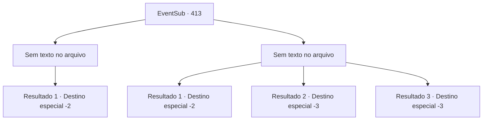

# Eventos secundários · 413

[Índice da tabela](index.md) · [Índice geral](../index.md)

ID: `pt:EventSub:413` · Fonte: `EventSub4` · Versão: 1.2.47.

Mapeamento estático dos arquivos; a disponibilidade e a execução dependem do estado da run.

## Texto do evento

*Sem texto no arquivo.*

## Dados de entrada

```json
{
  "id": 413,
  "grade": 1,
  "subEvent": "",
  "required": ""
}
```

## Mapa das escolhas



## Escolhas e resultados

### Escolha 1

*Sem texto no arquivo; o papel dessa opção depende da interface do jogo.*

Requisitos e outros campos da escolha:

```json
{
  "required": ""
}
```

#### Resultado 1.1

Você e Amakar conseguem se defender do ataque dos druidas e escapam com sucesso da Floresta de Silocient. Somente depois de correr por um tempo, você e Amakar conseguem recuperar o fôlego. Amakar abre a boca com uma expressão cansada. 

 "*suspiro*... Acho que fui muito impaciente... Obrigado por nos salvar."

 Ele agradece pela ajuda, de qualquer forma. Como recompensa, você recebe um saco de ouro. Amakar olha para trás para a floresta com um olhar de arrependimento, mas logo volta para Tomant.

Continuação registrada: [Destino especial `-2`](../destinos-especiais.md).

```json
{
  "required": "",
  "chance": "1",
  "nextEvent": -2,
  "type": 2,
  "reward": "12_8_-1|0_4_100|14_8_5"
}
```

### Escolha 2

*Sem texto no arquivo; o papel dessa opção depende da interface do jogo.*

Requisitos e outros campos da escolha:

```json
{
  "required": ""
}
```

#### Resultado 2.1


 "Você deve fugir..!!"

 Amakar, em perigo, grita para você correr. Você não tem escolha a não ser fugir, deixando-o para trás.

Continuação registrada: [Destino especial `-2`](../destinos-especiais.md).

```json
{
  "required": "1_0_2|1_1_2",
  "chance": "1",
  "nextEvent": -2,
  "type": 2,
  "reward": "0_0_-1|0_1_-1|12_8_-1|14_8_8"
}
```

#### Resultado 2.2

Um druida, transformado em lobo, morde seu tornozelo. Você perde o equilíbrio e cai. Então, outro druida, na forma de um treant, esmaga sua cabeça com seu punho.

Continuação registrada: [Destino especial `-3`](../destinos-especiais.md).

```json
{
  "required": "2_0_2",
  "chance": "1",
  "nextEvent": -3,
  "type": 2,
  "reward": "0_0_-1|0_1_-1"
}
```

#### Resultado 2.3

Um druida, transformado em lobo, morde seu tornozelo. Você perde o equilíbrio e cai. Então, outro druida, na forma de um treant, esmaga sua cabeça com seu punho.

Continuação registrada: [Destino especial `-3`](../destinos-especiais.md).

```json
{
  "required": "2_1_2",
  "chance": "1",
  "nextEvent": -3,
  "type": 2,
  "reward": "0_0_-1|0_1_-1"
}
```

## Referências que chegam a este evento

- [Evento 412 · escolha 2 · resultado 1](0412.md#escolha-2)
