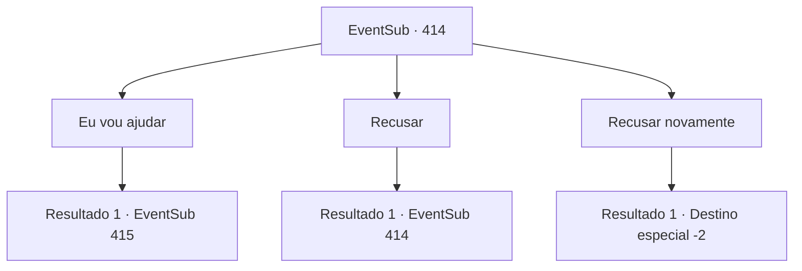

# Eventos secundários · 414

[Índice da tabela](index.md) · [Índice geral](../index.md)

ID: `pt:EventSub:414` · Fonte: `EventSub4` · Versão: 1.2.47.

Mapeamento estático dos arquivos; a disponibilidade e a execução dependem do estado da run.

## Texto do evento

Uma águia familiar voa até você. Ele fica em um galho, olha para você e move o bico. Ele fala com uma voz familiar, como esperado. 

 "Sou eu, Syannathel. O exército de Tomant está marchando em nossa direção. Por favor, lute ao nosso lado!"

 Ela informa que uma guerra entre Floresta Silociente e Tomant em breve começará e pede ajuda.

## Dados de entrada

```json
{
  "id": 414,
  "grade": 1,
  "subEvent": "",
  "required": "12_8_8"
}
```

## Mapa das escolhas



## Escolhas e resultados

### Escolha 1

Eu vou ajudar

Requisitos e outros campos da escolha:

```json
{
  "required": ""
}
```

#### Resultado 1.1

Você e Syannathel seguem direto para a Floresta de Silocient. Nuvens de guerra pairam sobre a vila dos druidas. Ao ver vocês, os druidas parecem estar contentes e preocupados ao mesmo tempo. 

 "Para começar, obrigado por virem aqui nos ajudar."

 O druida mais velho, com uma longa barba, cumprimenta vocês. Então ele traz o assunto à tona imediatamente. Milhares de soldados de Tomant, liderados por Amakar, estão se dirigindo para a floresta. O ataque começará em alguns dias. O druida mais velho quer juntar as cabeças e encontrar uma maneira de contra-atacar o exército.

Continuação registrada: [Evento 415](0415.md) na mesma tabela.

```json
{
  "required": "",
  "chance": "1",
  "nextEvent": 415,
  "type": 2,
  "reward": ""
}
```

### Escolha 2

Recusar

Requisitos e outros campos da escolha:

```json
{
  "required": "5_333_0"
}
```

#### Resultado 2.1

Você recusa o pedido dela. No entanto, ela não desiste facilmente e pergunta mais uma vez. 

 "Você nos encorajou a lutar. Você disse que temos que revidar. Mas por que... Você não pode mudar de ideia?"


Continuação registrada: [Evento 414](0414.md) na mesma tabela.

```json
{
  "required": "",
  "chance": "1",
  "nextEvent": 414,
  "type": 2,
  "reward": "5_333_1"
}
```

### Escolha 3

Recusar novamente

Requisitos e outros campos da escolha:

```json
{
  "required": "5_333_1"
}
```

#### Resultado 3.1

Você recusa o pedido dela novamente. Ela desiste e voa para a Floresta de Silocient.

Continuação registrada: [Destino especial `-2`](../destinos-especiais.md).

```json
{
  "required": "",
  "chance": "1",
  "nextEvent": -2,
  "type": 2,
  "reward": "12_8_-1"
}
```

## Referências que chegam a este evento

- [Evento 414 · escolha 2 · resultado 1](0414.md#escolha-2)
