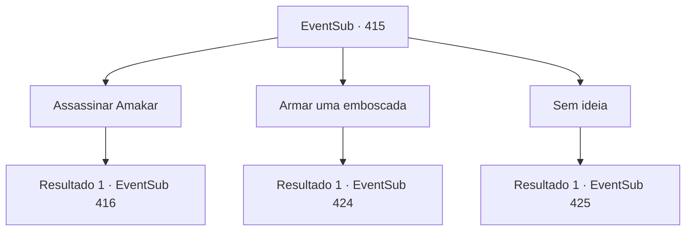

# Eventos secundários · 415

[Índice da tabela](index.md) · [Índice geral](../index.md)

ID: `pt:EventSub:415` · Fonte: `EventSub4` · Versão: 1.2.47.

Mapeamento estático dos arquivos; a disponibilidade e a execução dependem do estado da run.

## Texto do evento

*Sem texto no arquivo.*

## Dados de entrada

```json
{
  "id": 415,
  "grade": 1,
  "subEvent": "",
  "required": ""
}
```

## Mapa das escolhas



## Escolhas e resultados

### Escolha 1

Assassinar Amakar

Requisitos e outros campos da escolha:

```json
{
  "required": "1_7_10|2_3_15"
}
```

#### Resultado 1.1

Você sugere assassinar Amakar. Se o comandante desaparecer, a moral do inimigo cairá drasticamente e o exército se desintegrará na batalha. Então, um druida de meia-idade, provavelmente na casa dos 40 anos, protesta. 

 "Isso... parece um truque cruel. Não podemos lidar com isso de uma maneira menos radical?"

 Syannathel dá um passo à frente. 

 "Como já estamos em guerra, soluções moderadas estão fora de questão, Halladur. Sou a favor do assassinato. Se ninguém quiser fazer isso... eu irei."

 Apenas você e Syannathel se inscrevem para o esquadrão de assassinato. Os outros druidas concordam em preparar armadilhas, apenas por precaução, e esperam pelo seu retorno. Após algum tempo, o exército de Tomant aparece. Eles começam a montar postos avançados perto da floresta.

Continuação registrada: [Evento 416](0416.md) na mesma tabela.

```json
{
  "required": "",
  "chance": "1",
  "nextEvent": 416,
  "type": 2,
  "reward": ""
}
```

### Escolha 2

Armar uma emboscada

Requisitos e outros campos da escolha:

```json
{
  "required": "1_7_10"
}
```

#### Resultado 2.1

Você sugere um ataque sorrateiro. Como os druidas estão em grande desvantagem numérica, você afirma que eles deveriam armar armadilhas e se emboscar. Os druidas concordam, balançando a cabeça. Eles seguem suas instruções. Eles cavam buracos, fincam estacas de madeira no chão e cobrem os pântanos com folhas. Eles também procuram lugares adequados para se esconder, no caminho que o exército provavelmente seguirá. Eles até colocam seus familiares nesses pontos, para espionar o inimigo. Após se prepararem minuciosamente para a batalha, os druidas reafirmam sua determinação. 

 "Todos! Vamos ensiná-los uma lição. Eles NUNCA poderão levar nosso tesouro!"

 Após algum tempo, o exército de Tomant aparece. Eles começam a montar postos avançados perto da floresta. Então eles enviam alguns batedores para a floresta, provavelmente em busca de uma emboscada ou armadilha. O druida ao seu lado pergunta. 

 "Não deveríamos nos livrar deles agora?"


Continuação registrada: [Evento 424](0424.md) na mesma tabela.

```json
{
  "required": "",
  "chance": "1",
  "nextEvent": 424,
  "type": 2,
  "reward": ""
}
```

### Escolha 3

Sem ideia

Requisitos e outros campos da escolha:

```json
{
  "required": "2_7_10"
}
```

#### Resultado 3.1

Você diz aos druidas que não tem nenhuma ideia em particular. Ligeiramente perplexos, eles começam a reunião por conta própria. Os druidas concordam em se esconder na floresta e preparar uma emboscada. Eles também procuram lugares adequados para se esconder, no caminho que o exército provavelmente seguirá. Eles até colocam seus familiares nesses pontos, para espionar o inimigo. Após se prepararem para a batalha, os druidas reafirmam sua determinação. 

 "Todos! Vamos ensiná-los uma lição. Eles NUNCA poderão levar nosso tesouro!"

 Após algum tempo, o exército de Tomant aparece. Eles começam a montar postos avançados perto da floresta. Então eles enviam alguns batedores para a floresta, provavelmente para procurar uma emboscada ou uma armadilha. Escondidos nas moitas, vocês os atacam sem hesitação.

Continuação registrada: [Evento 425](0425.md) na mesma tabela.

```json
{
  "required": "",
  "chance": "1",
  "nextEvent": 425,
  "type": 2,
  "reward": "6_2_135",
  "place": 1
}
```

## Referências que chegam a este evento

- [Evento 402 · escolha 1 · resultado 1](0402.md#escolha-1)
- [Evento 414 · escolha 1 · resultado 1](0414.md#escolha-1)
