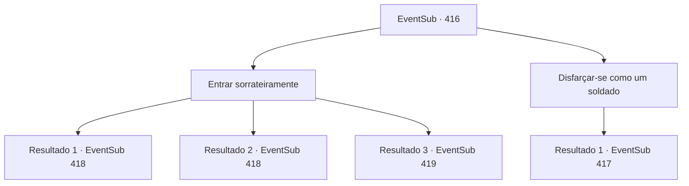

# Eventos secundários · 416

[Índice da tabela](index.md) · [Índice geral](../index.md)

ID: `pt:EventSub:416` · Fonte: `EventSub4` · Versão: 1.2.47.

Mapeamento estático dos arquivos; a disponibilidade e a execução dependem do estado da run.

## Texto do evento

*Sem texto no arquivo.*

## Dados de entrada

```json
{
  "id": 416,
  "grade": 1,
  "subEvent": "",
  "required": ""
}
```

## Mapa das escolhas



## Escolhas e resultados

### Escolha 1

Entrar sorrateiramente

Requisitos e outros campos da escolha:

```json
{
  "required": ""
}
```

#### Resultado 1.1

Syannathel se transforma em um pequeno esquilo e vem para os seus braços. Você segue para o posto avançado de Tomant com ela. Alguns soldados estão de guarda, enquanto outros montam tendas e barricadas. Você se aproxima silenciosamente e se infiltra no posto avançado. Então Syannathel sobe em seus ombros. 

 "Espere aqui por um momento. Vou descobrir onde Amakar está e voltar."

 O esquilo salta de seu ombro e começa a correr ao redor da tenda. Depois de um tempo, ela retorna e sussurra para você. 

 "Amakar e seu oficial estão na maior tenda. Parece que estão realizando uma reunião estratégica."

 Você e Syannathel se infiltram na tenda onde Amakar está. Amakar e seu oficial estão discutindo assuntos sérios sobre o mapa. 

 "O que você acha, Lophenbach?"

 Um homem chamado Lophenbach responde à pergunta de Amakar. 

 "Hmm... Teremos que enviar batedores aqui para ver se há emboscada."

 Eles não têm conhecimento de sua presença de forma alguma.

Continuação registrada: [Evento 418](0418.md) na mesma tabela.

```json
{
  "required": "",
  "chance": "1|0_6_1",
  "nextEvent": 418,
  "type": 0,
  "reward": ""
}
```

#### Resultado 1.2

Syannathel se transforma em um pequeno esquilo e vem para os seus braços. Você segue para o posto avançado de Tomant com ela. Alguns soldados estão de guarda, enquanto outros montam tendas e barricadas. Você se aproxima silenciosamente e se infiltra no posto avançado. Então Syannathel sobe em seus ombros. 

 "Espere aqui por um momento. Vou descobrir onde Amakar está e voltar."

 O esquilo salta de seu ombro e começa a correr ao redor da tenda. Depois de um tempo, ela retorna e sussurra para você. 

 "Amakar e seu oficial estão na maior tenda. Parece que estão realizando uma reunião estratégica."

 Você e Syannathel se infiltram na tenda onde Amakar está. Amakar e seu oficial estão discutindo assuntos sérios sobre o mapa. 

 "O que você acha, Lophenbach?"

 Um homem chamado Lophenbach responde à pergunta de Amakar. 

 "Hmm... Teremos que enviar batedores aqui para ver se há emboscada."

 Eles não têm conhecimento de sua presença de forma alguma.

Continuação registrada: [Evento 418](0418.md) na mesma tabela.

```json
{
  "required": "20_5_2",
  "chance": "1|0_6_1",
  "nextEvent": 418,
  "type": 0,
  "reward": ""
}
```

#### Resultado 1.3

Syannathel se transforma em um pequeno esquilo e vem para os seus braços. Você segue para o posto avançado de Tomant com ela. Alguns soldados estão de guarda, enquanto outros montam tendas e barricadas. Você tenta se mover silenciosamente, mas acaba encontrando um soldado que estava apenas urinando. 

 "ARRRRGH! Quem diabos...! Intruso!! Intruso!!!!"

 Ele rapidamente puxa suas calças de volta e grita. Ouvindo o barulho, os soldados ao redor correm para dentro.

Continuação registrada: [Evento 419](0419.md) na mesma tabela.

```json
{
  "required": "",
  "chance": "30",
  "nextEvent": 419,
  "type": 1,
  "reward": "6_0_135",
  "place": 0
}
```

### Escolha 2

Disfarçar-se como um soldado

Requisitos e outros campos da escolha:

```json
{
  "required": ""
}
```

#### Resultado 2.1

Syannathel se transforma em um pequeno esquilo e vem para os seus braços. Você segue para o posto avançado de Tomant com ela. Alguns soldados estão de guarda, enquanto outros montam tendas e barricadas. Nesse momento, você avista um soldado indo sozinho para a floresta. Ele está com pressa, provavelmente precisando atender ao chamado da natureza. Você o segue cuidadosamente. O soldado olha ao redor e faz suas necessidades. Você ouve um barulho de asas, como se fosse feito por uma pomba voando.

Continuação registrada: [Evento 417](0417.md) na mesma tabela.

```json
{
  "required": "",
  "chance": "1",
  "nextEvent": 417,
  "type": 2,
  "reward": ""
}
```

## Referências que chegam a este evento

- [Evento 415 · escolha 1 · resultado 1](0415.md#escolha-1)
