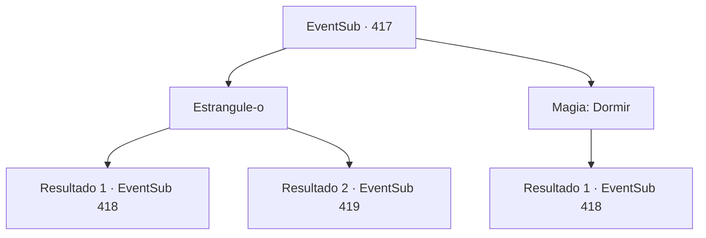

# Eventos secundários · 417

[Índice da tabela](index.md) · [Índice geral](../index.md)

ID: `pt:EventSub:417` · Fonte: `EventSub4` · Versão: 1.2.47.

Mapeamento estático dos arquivos; a disponibilidade e a execução dependem do estado da run.

## Texto do evento

*Sem texto no arquivo.*

## Dados de entrada

```json
{
  "id": 417,
  "grade": 1,
  "subEvent": "",
  "required": ""
}
```

## Mapa das escolhas



## Escolhas e resultados

### Escolha 1

Estrangule-o

Requisitos e outros campos da escolha:

```json
{
  "required": ""
}
```

#### Resultado 1.1

Você estrangula o soldado com seus braços, por trás dele. 

 "Urrrrgh...!"

 Ele perde a consciência instantaneamente e desaba. Você despe o soldado atordoado e veste sua armadura. Você retorna ao posto como se nada tivesse acontecido. 

 "Espere aqui por um momento. Vou descobrir onde Amakar está e voltar."

 O esquilo salta do seu ombro e começa a correr ao redor da tenda. Depois de um tempo, ela retorna e sussurra para você. 

 "Amakar e seu oficial estão na maior tenda. Parece que estão realizando uma reunião estratégica."

 Você e Syannathel se infiltram na tenda onde Amakar está. Amakar e seu oficial estão discutindo assuntos sérios sobre o mapa. 

 "O que você acha, Lophenbach?"

 Um homem chamado Lophenbach responde à pergunta de Amakar. 

 "Hmm... Teremos que enviar batedores aqui para ver se há emboscada."

 Eles não têm conhecimento de sua presença de forma alguma.

Continuação registrada: [Evento 418](0418.md) na mesma tabela.

```json
{
  "required": "",
  "chance": "1|0_5_1",
  "nextEvent": 418,
  "type": 0,
  "reward": "3_5_1|3_14_1"
}
```

#### Resultado 1.2

Você estrangula o soldado com seus braços, por trás dele. 

 "Urrrrgh...!"

 No entanto, ele resiste ferozmente e solta seu braço. 

 "Quem diabos é você!"

 Sem nem mesmo puxar suas calças para cima, ele saca sua espada. Ouvindo o barulho, os soldados ao redor correm para dentro.

Continuação registrada: [Evento 419](0419.md) na mesma tabela.

```json
{
  "required": "",
  "chance": "10",
  "nextEvent": 419,
  "type": 1,
  "reward": "6_2_135",
  "place": 0
}
```

### Escolha 2

Magia: Dormir

Requisitos e outros campos da escolha:

```json
{
  "required": "20_0_1|1_1_2"
}
```

#### Resultado 2.1

Você realiza um feitiço de sono no soldado e rouba seus equipamentos. Você retorna ao posto como se nada tivesse acontecido. 

 "Esperem aqui por um momento. Vou descobrir onde Amakar está e voltar."

 O esquilo salta do seu ombro e começa a correr ao redor da tenda. Depois de um tempo, ela retorna e sussurra para você. 

 "Amakar e seu oficial estão na maior tenda. Parece que estão realizando uma reunião estratégica."

 Você e Syannathel se infiltram na tenda onde Amakar está. Amakar e seu oficial estão discutindo assuntos sérios sobre o mapa. 

 "O que você acha, Lophenbach?"

 Um homem chamado Lophenbach responde à pergunta de Amakar. 

 "Hmm... Teremos que enviar batedores aqui para ver se há emboscada."

 Eles não têm conhecimento da sua presença de forma alguma.

Continuação registrada: [Evento 418](0418.md) na mesma tabela.

```json
{
  "required": "",
  "chance": "1",
  "nextEvent": 418,
  "type": 2,
  "reward": "3_5_1|3_14_1|0_1_-1"
}
```

## Referências que chegam a este evento

- [Evento 416 · escolha 2 · resultado 1](0416.md#escolha-2)
