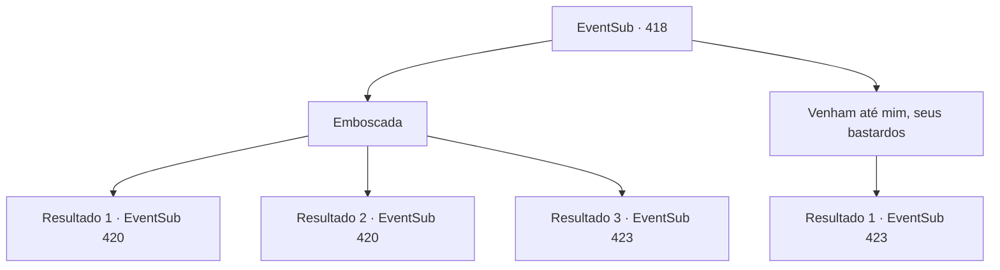

# Eventos secundários · 418

[Índice da tabela](index.md) · [Índice geral](../index.md)

ID: `pt:EventSub:418` · Fonte: `EventSub4` · Versão: 1.2.47.

Mapeamento estático dos arquivos; a disponibilidade e a execução dependem do estado da run.

## Texto do evento

*Sem texto no arquivo.*

## Dados de entrada

```json
{
  "id": 418,
  "grade": 1,
  "subEvent": "",
  "required": ""
}
```

## Mapa das escolhas



## Escolhas e resultados

### Escolha 1

Emboscada

Requisitos e outros campos da escolha:

```json
{
  "required": ""
}
```

#### Resultado 1.1

Você pega uma adaga que está sobre a mesa. Então, você se aproxima cautelosamente de Amakar e o esfaqueia na garganta. 

 "Urrrgh... Huh...!"

 Amakar te empurra para trás e rapidamente cuida de seu ferimento. 

 "Você está bem, senhor?! Guardas!! Guardas!!!"

 Lophenbach grita em choque, mas ninguém aparece. Syannathel retorna à sua forma original e explica o motivo. 

 "Não adianta lamentar. Este quarto está sob um feitiço que absorve qualquer barulho."

 Amakar tenta dizer algo, mas apenas sangue jorra de sua boca. Cercado por você e Syannathel, Lophenbach saca sua espada.

Continuação registrada: [Evento 420](0420.md) na mesma tabela.

```json
{
  "required": "",
  "chance": "1|0_6_1",
  "nextEvent": 420,
  "type": 0,
  "reward": "6_0_137",
  "place": 0
}
```

#### Resultado 1.2

Você pega uma adaga que está sobre a mesa. Então, você se aproxima cautelosamente de Amakar e o esfaqueia na garganta. 

 "Urrrgh... Huh...!"

 Amakar te empurra para trás e rapidamente cuida de seu ferimento. 

 "Você está bem, senhor?! Guardas!! Guardas!!!"

 Lophenbach grita em choque, mas ninguém aparece. Syannathel retorna à sua forma original e explica o motivo. 

 "Não adianta lamentar. Este quarto está sob um feitiço que absorve qualquer barulho."

 Amakar tenta dizer algo, mas apenas sangue jorra de sua boca. Cercado por você e Syannathel, Lophenbach saca sua espada.

Continuação registrada: [Evento 420](0420.md) na mesma tabela.

```json
{
  "required": "20_5_2",
  "chance": "1|0_6_1",
  "nextEvent": 420,
  "type": 0,
  "reward": "6_0_137",
  "place": 0
}
```

#### Resultado 1.3

Você pega uma adaga que está sobre a mesa. Você se aproxima cautelosamente de Amakar, mas logo é pego. 

 "Quem é você?! Guardas!! O que os guardas estão fazendo!!!"

 Lophenbach grita em choque, mas ninguém aparece. Syannathel retorna à sua forma original e explica o motivo. 

 "Não adianta choramingar. Este quarto está sob um feitiço que absorve qualquer barulho."

 Amakar responde com raiva. 

 "Jogando sujo, como sempre. Nem surpreende. Vocês são assim desde o começo!"

 Amakar se transforma em um urso e avança em cima de Syannathel. Lophenbach balança sua espada em sua direção. 

 "Malditos selvagens! Eu vou matar todos vocês!"


Continuação registrada: [Evento 423](0423.md) na mesma tabela.

```json
{
  "required": "",
  "chance": "34",
  "nextEvent": 423,
  "type": 1,
  "reward": "6_0_137",
  "place": 0
}
```

### Escolha 2

Venham até mim, seus bastardos

Requisitos e outros campos da escolha:

```json
{
  "required": ""
}
```

#### Resultado 2.1

Você grita orgulhosamente, de trás. Syannathel esfrega a testa. 

 "Quem é você?! Guardas!! O que os guardas estão fazendo!!!"

 Lophenbach grita em choque, mas ninguém aparece. Syannathel retorna à sua forma original e explica o motivo. 

 "Não adianta choramingar. Este quarto está sob um feitiço, que absorve qualquer barulho."

 Amakar responde com raiva. 

 "Jogando sujo, como sempre. Nem surpreende. Vocês eram assim desde o começo!"

 Amakar se transforma em um urso e salta em cima de Syannathel. Lophenbach balança sua espada em sua direção. 

 "Malditos selvagens! Eu vou matar todos vocês!"


Continuação registrada: [Evento 423](0423.md) na mesma tabela.

```json
{
  "required": "",
  "chance": "1",
  "nextEvent": 423,
  "type": 2,
  "reward": "6_0_137",
  "place": 0
}
```

## Referências que chegam a este evento

- [Evento 416 · escolha 1 · resultado 1](0416.md#escolha-1)
- [Evento 416 · escolha 1 · resultado 2](0416.md#escolha-1)
- [Evento 417 · escolha 1 · resultado 1](0417.md#escolha-1)
- [Evento 417 · escolha 2 · resultado 1](0417.md#escolha-2)
