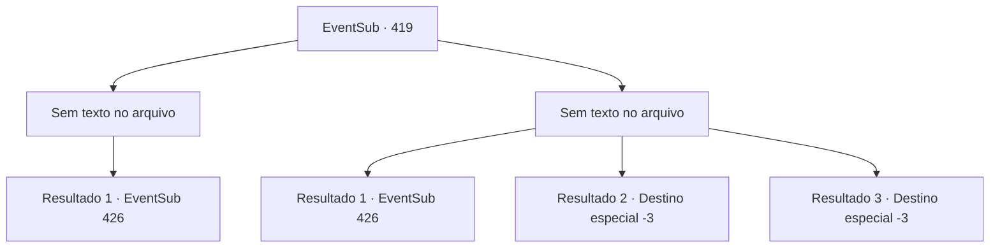

# Eventos secundários · 419

[Índice da tabela](index.md) · [Índice geral](../index.md)

ID: `pt:EventSub:419` · Fonte: `EventSub4` · Versão: 1.2.47.

Mapeamento estático dos arquivos; a disponibilidade e a execução dependem do estado da run.

## Texto do evento

*Sem texto no arquivo.*

## Dados de entrada

```json
{
  "id": 419,
  "grade": 1,
  "subEvent": "",
  "required": ""
}
```

## Mapa das escolhas



## Escolhas e resultados

### Escolha 1

*Sem texto no arquivo; o papel dessa opção depende da interface do jogo.*

Requisitos e outros campos da escolha:

```json
{
  "required": ""
}
```

#### Resultado 1.1

Você se livra facilmente de alguns soldados. No entanto, parece impossível tentar assassinar Amakar. Você e Syannathel são forçados a retornar à floresta silociente. 

 "... agora não temos escolha a não ser enfrentá-los de frente."

 Depois de um tempo, Amakar marcha o exército direto para a floresta. Os druidas se escondem na floresta e esperam que o inimigo se aproxime. Uma tensão silenciosa paira sobre a floresta. O exército de Tomant logo chega onde os druidas e você está se escondendo. Os soldados marcam com cuidado, observando seus arredores com vigilância. No entanto, eles não percebem as armadilhas sob os pés e entram neles. <link=shake> 

 "aaaaaahhhhhh !!!"

 </link> Gritos são ouvidos em todos os lugares.

Continuação registrada: [Evento 426](0426.md) na mesma tabela.

```json
{
  "required": "",
  "chance": "1",
  "nextEvent": 426,
  "type": 2,
  "reward": ""
}
```

### Escolha 2

*Sem texto no arquivo; o papel dessa opção depende da interface do jogo.*

Requisitos e outros campos da escolha:

```json
{
  "required": ""
}
```

#### Resultado 2.1

Você e Syannathel conseguem superar os soldados, mas você é forçado a retornar à floresta silociente. 

 "... agora não temos escolha a não ser enfrentá-los de frente."

 Depois de um tempo, Amakar marcha o exército direto para a floresta. Os druidas se escondem na floresta e esperam que o inimigo se aproxime. Uma tensão silenciosa paira sobre a floresta. O exército de Tomant logo chega onde os druidas e você está se escondendo. Os soldados marcam com cuidado, observando seus arredores com vigilância. No entanto, eles não percebem as armadilhas sob os pés e entram neles. <link=shake> 

 "aaaaaahhhhhh !!!"

 </link> Gritos são ouvidos em todos os lugares.

Continuação registrada: [Evento 426](0426.md) na mesma tabela.

```json
{
  "required": "1_0_2|1_1_2",
  "chance": "1",
  "nextEvent": 426,
  "type": 2,
  "reward": "0_0_-1|0_1_-1"
}
```

#### Resultado 2.2

Uma lança penetra o seu lado. Depois disso, mais e mais lanças te perfuram. Você respira o seu último suspiro, deixando a agonia para trás.

Continuação registrada: [Destino especial `-3`](../destinos-especiais.md).

```json
{
  "required": "2_0_2",
  "chance": "1",
  "nextEvent": -3,
  "type": 2,
  "reward": "0_0_-1|0_1_-1"
}
```

#### Resultado 2.3

Uma lança penetra o seu lado. Depois disso, mais e mais lanças te perfuram. Você respira o seu último suspiro, deixando a agonia para trás.

Continuação registrada: [Destino especial `-3`](../destinos-especiais.md).

```json
{
  "required": "2_1_2",
  "chance": "1",
  "nextEvent": -3,
  "type": 2,
  "reward": "0_0_-1|0_1_-1"
}
```

## Referências que chegam a este evento

- [Evento 416 · escolha 1 · resultado 3](0416.md#escolha-1)
- [Evento 417 · escolha 1 · resultado 2](0417.md#escolha-1)
