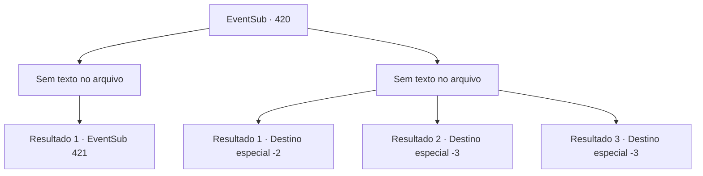

# Eventos secundários · 420

[Índice da tabela](index.md) · [Índice geral](../index.md)

ID: `pt:EventSub:420` · Fonte: `EventSub4` · Versão: 1.2.47.

Mapeamento estático dos arquivos; a disponibilidade e a execução dependem do estado da run.

## Texto do evento

*Sem texto no arquivo.*

## Dados de entrada

```json
{
  "id": 420,
  "grade": 1,
  "subEvent": "",
  "required": ""
}
```

## Mapa das escolhas



## Escolhas e resultados

### Escolha 1

*Sem texto no arquivo; o papel dessa opção depende da interface do jogo.*

Requisitos e outros campos da escolha:

```json
{
  "required": ""
}
```

#### Resultado 1.1


 "...Não poria um fim a esta batalha?"

 Lophenbach abaixa repentinamente sua espada e dá um passo para trás em silêncio. Syannathel pergunta, perplexo. 

 "Que tipo de truque é esse?"

 Lophenbach responde. 

 "Eu fui contra essa guerra desde o começo. Não quero mais sacrifícios sem sentido. Sem mencionar que não temos chances de vencer, de qualquer forma. Peço que recue agora, já que você matou o senhor Amakar."

 Amakar, deitado no chão, está respirando pesadamente com o rosto pálido.

Continuação registrada: [Evento 421](0421.md) na mesma tabela.

```json
{
  "required": "",
  "chance": "1",
  "nextEvent": 421,
  "type": 2,
  "reward": ""
}
```

### Escolha 2

*Sem texto no arquivo; o papel dessa opção depende da interface do jogo.*

Requisitos e outros campos da escolha:

```json
{
  "required": ""
}
```

#### Resultado 2.1

Enquanto você se ajoelha em um joelho, a espada de Lophenbach voa para você. Naquele momento, Syannathel borrifa areia no rosto. 

 "Aaaaahhhhh !!"

 Lophenbach cambaleia e grita, enquanto Syannathel grita. 

 "Fuja agora, agora!"

 Com a ajuda de Syannathel, que se transformou em uma águia, você consegue escapar do posto avançado voando. 

 "De qualquer forma, será difícil para Amakar sobreviver. No entanto, a pessoa ao lado dele marchá o exército para nós. Precisamos nos preparar rapidamente."

 Syannathel explica aos druidas o que aconteceu no posto avançado e diz para eles se prepararem para a batalha. Depois de um tempo, ao contrário das expectativas, o exército do Tomant começa a se retirar. Os druidas parecem duvidosos. Eles concordam em acompanhar os pés por um tempo e vigiar o inimigo. 

 Depois de algum tempo, o anoitecer chega. Syannathel observa o exército do céu e confirma que eles se retiraram completamente. Os druidas estão finalmente aliviados. 

 "Está tudo acabado agora. Obrigado por proteger a floresta e nossos parentes. Este é um presente do ancião."

 Ela entrega a você um círculo de madeira. Os outros druidas também mostram suas gratificações beijando sua bochecha ou dando um presente. Os druidas o enviam e você deixa a floresta silociente.

Continuação registrada: [Destino especial `-2`](../destinos-especiais.md).

```json
{
  "required": "1_0_2|1_1_2",
  "chance": "1",
  "nextEvent": -2,
  "type": 2,
  "reward": "0_0_-1|0_1_-1|3_241_1|3_237_1|12_8_-1|14_8_5|14_8_10"
}
```

#### Resultado 2.2

A espada de Lophenbach desaparece repentinamente. No momento seguinte, todo o seu corpo desaba.

Continuação registrada: [Destino especial `-3`](../destinos-especiais.md).

```json
{
  "required": "2_0_2",
  "chance": "1",
  "nextEvent": -3,
  "type": 2,
  "reward": "0_0_-1|0_1_-1"
}
```

#### Resultado 2.3

A espada de Lophenbach desaparece repentinamente. No momento seguinte, todo o seu corpo desaba.

Continuação registrada: [Destino especial `-3`](../destinos-especiais.md).

```json
{
  "required": "2_1_2",
  "chance": "1",
  "nextEvent": -3,
  "type": 2,
  "reward": "0_0_-1|0_1_-1"
}
```

## Referências que chegam a este evento

- [Evento 418 · escolha 1 · resultado 1](0418.md#escolha-1)
- [Evento 418 · escolha 1 · resultado 2](0418.md#escolha-1)
