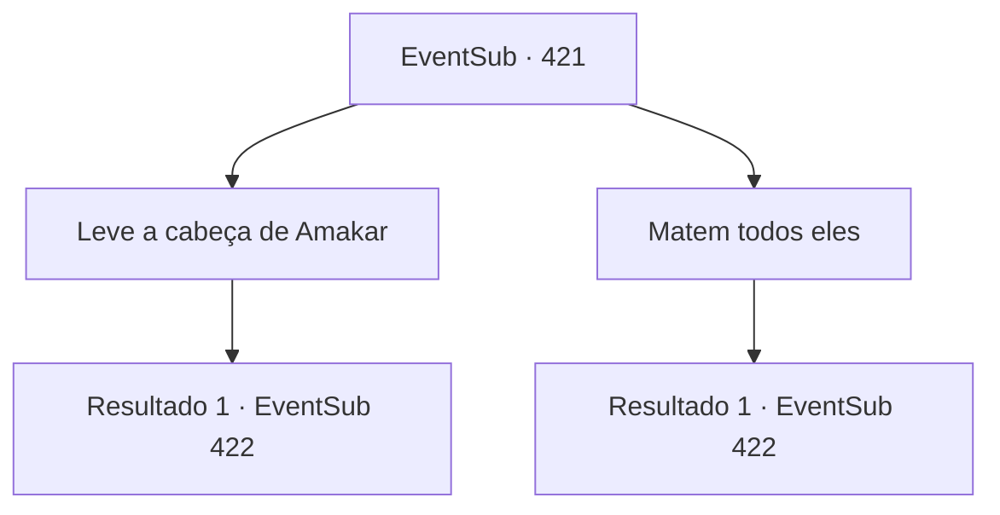

# Eventos secundários · 421

[Índice da tabela](index.md) · [Índice geral](../index.md)

ID: `pt:EventSub:421` · Fonte: `EventSub4` · Versão: 1.2.47.

Mapeamento estático dos arquivos; a disponibilidade e a execução dependem do estado da run.

## Texto do evento

*Sem texto no arquivo.*

## Dados de entrada

```json
{
  "id": 421,
  "grade": 1,
  "subEvent": "",
  "required": ""
}
```

## Mapa das escolhas



## Escolhas e resultados

### Escolha 1

Leve a cabeça de Amakar

Requisitos e outros campos da escolha:

```json
{
  "required": ""
}
```

#### Resultado 1.1

Você tem misericórdia de Amakar e põe fim ao seu sofrimento. Em seguida, você pega a sua cabeça. 

 "Siga por este caminho. Só vai te causar problemas encontrar os soldados."

 Você e Syannathel seguem o guia de Lophenbach e escapam do posto através dos pontos fracos. Vocês retornam em segurança para a Floresta de Silocient. 

 "O exército está recuando... Você conseguiu...?"

 Em vez de responder, você entrega a cabeça de Amakar ao druida mais velho. Ele olha para ela e estala a língua. 

 "Tut-tut... Como você acabou aqui assim... Mesmo que ele nos tenha traído, ainda devemos fazer um funeral para ele."


Continuação registrada: [Evento 422](0422.md) na mesma tabela.

```json
{
  "required": "",
  "chance": "1",
  "nextEvent": 422,
  "type": 2,
  "reward": "14_8_5|14_8_10"
}
```

### Escolha 2

Matem todos eles

Requisitos e outros campos da escolha:

```json
{
  "required": "2_3_0"
}
```

#### Resultado 2.1

Você pega a espada que Lophenbach deixou cair e golpeia o pescoço dele. Depois disso, você tira a vida de Amakar. Você sai da tenda com a cabeça de Amakar. Você está coberto de sangue, segurando a cabeça do comandante na mão. Os soldados estão aterrorizados ao te verem. 

 "O...o quê!!! ARRRRRGH!!!!"

 Eles nem ousam fazer nada além de congelar. Após deixar o posto avançado de Tomant, você e Syannathel retornam à Floresta de Silocient. 

 "O exército está recuando... Você conseguiu...?"

 Em vez de responder, você entrega a cabeça de Amakar ao druida mais velho. Ele olha para ela e estala a língua. 

 "Tut-tut... Como você acabou assim... Mesmo que ele nos tenha traído, ainda devemos fazer um funeral para ele."


Continuação registrada: [Evento 422](0422.md) na mesma tabela.

```json
{
  "required": "",
  "chance": "1",
  "nextEvent": 422,
  "type": 2,
  "reward": "3_76_1|0_3_-3|14_8_5|14_8_13"
}
```

## Referências que chegam a este evento

- [Evento 420 · escolha 1 · resultado 1](0420.md#escolha-1)
- [Evento 423 · escolha 1 · resultado 1](0423.md#escolha-1)
