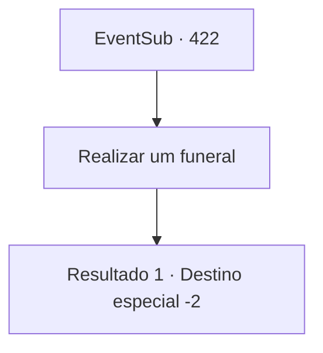

# Eventos secundários · 422

[Índice da tabela](index.md) · [Índice geral](../index.md)

ID: `pt:EventSub:422` · Fonte: `EventSub4` · Versão: 1.2.47.

Mapeamento estático dos arquivos; a disponibilidade e a execução dependem do estado da run.

## Texto do evento

*Sem texto no arquivo.*

## Dados de entrada

```json
{
  "id": 422,
  "grade": 1,
  "subEvent": "",
  "required": ""
}
```

## Mapa das escolhas



## Escolhas e resultados

### Escolha 1

Realizar um funeral

Requisitos e outros campos da escolha:

```json
{
  "required": ""
}
```

#### Resultado 1.1

Você e os druidas constroem um pequeno túmulo de pedra para Amakar. O funeral é realizado à sua maneira. Depois que termina, Syannathel e os druidas se aproximam. 

 "Tudo acabou agora. Obrigado por proteger a floresta e nosso povo. Este é um presente do ancião."

 Ela lhe entrega uma tiara de madeira. Os outros druidas também mostram sua gratidão beijando sua bochecha ou dando um presente. Os druidas lhe dão adeus, e você deixa a Floresta de Silocient.

Continuação registrada: [Destino especial `-2`](../destinos-especiais.md).

```json
{
  "required": "",
  "chance": "1",
  "nextEvent": -2,
  "type": 2,
  "reward": "12_8_-1|3_241_1|3_237_1"
}
```

## Referências que chegam a este evento

- [Evento 421 · escolha 1 · resultado 1](0421.md#escolha-1)
- [Evento 421 · escolha 2 · resultado 1](0421.md#escolha-2)
- [Evento 428 · escolha 1 · resultado 1](0428.md#escolha-1)
- [Evento 428 · escolha 2 · resultado 1](0428.md#escolha-2)
