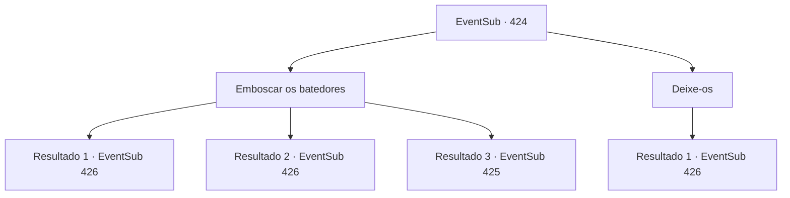

# Eventos secundários · 424

[Índice da tabela](index.md) · [Índice geral](../index.md)

ID: `pt:EventSub:424` · Fonte: `EventSub4` · Versão: 1.2.47.

Mapeamento estático dos arquivos; a disponibilidade e a execução dependem do estado da run.

## Texto do evento

*Sem texto no arquivo.*

## Dados de entrada

```json
{
  "id": 424,
  "grade": 1,
  "subEvent": "",
  "required": ""
}
```

## Mapa das escolhas



## Escolhas e resultados

### Escolha 1

Emboscar os batedores

Requisitos e outros campos da escolha:

```json
{
  "required": ""
}
```

#### Resultado 1.1

Você emboscou os batedores com os druidas. Eles perdem suas vidas, um por um, completamente inconscientes da sua presença. Você esconde seus cadáveres nos arbustos e está emboscada novamente. 

 Depois de um tempo, Amakar marcha o exército direto para a floresta.  Os druidas se escondem na floresta e esperam que o inimigo se aproxime.  Uma tensão silenciosa paira sobre a floresta.  O exército de Tomant logo chega onde os druidas e você está se escondendo.  Os soldados marcam com cuidado, observando seus arredores com vigilância.  No entanto, eles não percebem as armadilhas sob os pés e entram neles.  <link=shake>

 "aaaaaahhhhhh !!!"

</link>  Gritos são ouvidos em todos os lugares.

Continuação registrada: [Evento 426](0426.md) na mesma tabela.

```json
{
  "required": "",
  "chance": "1|0_6_1",
  "nextEvent": 426,
  "type": 0,
  "reward": ""
}
```

#### Resultado 1.2

Você emboscou os batedores com os druidas. Eles perdem suas vidas, um por um, completamente inconscientes da sua presença. Você esconde seus cadáveres nos arbustos e está emboscada novamente. 

 Depois de um tempo, Amakar marcha o exército direto para a floresta. Os druidas se escondem na floresta e esperam que o inimigo se aproxime. Uma tensão silenciosa paira sobre a floresta. O exército de Tomant logo chega onde os druidas e você está se escondendo. Os soldados marcam com cuidado, observando seus arredores com vigilância. No entanto, eles não percebem as armadilhas sob os pés e entram neles. <link=shake>

 "aaaaaahhhhhh !!!"

</link> Gritos são ouvidos em todos os lugares.

Continuação registrada: [Evento 426](0426.md) na mesma tabela.

```json
{
  "required": "20_5_2",
  "chance": "1|0_6_1",
  "nextEvent": 426,
  "type": 0,
  "reward": ""
}
```

#### Resultado 1.3

Você embosca os batedores com os druidas. No entanto, eles sentem sua presença e sacam suas armas.

Continuação registrada: [Evento 425](0425.md) na mesma tabela.

```json
{
  "required": "",
  "chance": "16",
  "nextEvent": 425,
  "type": 1,
  "reward": "6_0_135",
  "place": 1
}
```

### Escolha 2

Deixe-os

Requisitos e outros campos da escolha:

```json
{
  "required": ""
}
```

#### Resultado 2.1

Você decide deixar os batedores irem. Eles retornam à sua base, depois de pesquisar aqui e ali na floresta, 

 Depois de um tempo, Amakar marcha o exército direto para a floresta.  Os druidas se escondem na floresta e esperam que o inimigo se aproxime.  Uma tensão silenciosa paira sobre a floresta.  O exército de Tomant logo chega onde os druidas e você está se escondendo. Eles marcam com cuidado, esquivando -se ou destruindo as armadilhas. Os olheiros devem ter informado o exército das armadilhas.

Continuação registrada: [Evento 426](0426.md) na mesma tabela.

```json
{
  "required": "",
  "chance": "1",
  "nextEvent": 426,
  "type": 2,
  "reward": "5_334_1"
}
```

## Referências que chegam a este evento

- [Evento 415 · escolha 2 · resultado 1](0415.md#escolha-2)
