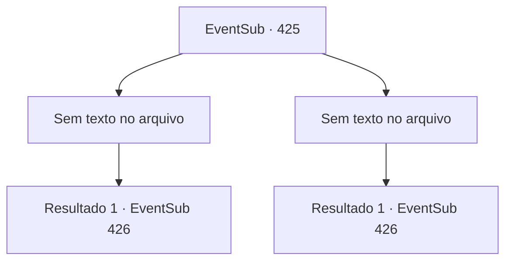

# Eventos secundários · 425

[Índice da tabela](index.md) · [Índice geral](../index.md)

ID: `pt:EventSub:425` · Fonte: `EventSub4` · Versão: 1.2.47.

Mapeamento estático dos arquivos; a disponibilidade e a execução dependem do estado da run.

## Texto do evento

*Sem texto no arquivo.*

## Dados de entrada

```json
{
  "id": 425,
  "grade": 1,
  "subEvent": "",
  "required": ""
}
```

## Mapa das escolhas



## Escolhas e resultados

### Escolha 1

*Sem texto no arquivo; o papel dessa opção depende da interface do jogo.*

Requisitos e outros campos da escolha:

```json
{
  "required": ""
}
```

#### Resultado 1.1

Você mata os batedores. Depois de esconder seus cadáveres nos arbustos, você fica baixo e espera por Amakar. 

 Depois de um tempo, Amakar marcha o exército direto para a floresta. Os druidas se escondem na floresta e esperam que o inimigo se aproxime. Uma tensão silenciosa paira sobre a floresta. O exército de Tomant logo chega onde os druidas e você está se escondendo. Os soldados marcam com cuidado, observando seus arredores com vigilância. No entanto, eles não percebem as armadilhas sob os pés e entram neles. <link=shake>

 "aaaaaahhhhhh !!!"

</link> Gritos são ouvidos em todos os lugares.

Continuação registrada: [Evento 426](0426.md) na mesma tabela.

```json
{
  "required": "",
  "chance": "1",
  "nextEvent": 426,
  "type": 2,
  "reward": ""
}
```

### Escolha 2

*Sem texto no arquivo; o papel dessa opção depende da interface do jogo.*

Requisitos e outros campos da escolha:

```json
{
  "required": ""
}
```

#### Resultado 2.1

Os batedores fogem depois de combater seu ataque. 

 "Eles nos viram. Melhor mudar o esconderijo ..."

 Os druidas desistem das armadilhas que definiram e passam para outro lugar para ficar em emboscada. 

 Depois de um tempo, Amakar marcha o exército direto para a floresta. Os druidas se escondem na floresta e esperam que o inimigo se aproxime. Uma tensão silenciosa paira sobre a floresta. O exército de Tomant logo chega onde os druidas e você está se escondendo.

Continuação registrada: [Evento 426](0426.md) na mesma tabela.

```json
{
  "required": "",
  "chance": "1",
  "nextEvent": 426,
  "type": 2,
  "reward": "5_334_1"
}
```

## Referências que chegam a este evento

- [Evento 415 · escolha 3 · resultado 1](0415.md#escolha-3)
- [Evento 424 · escolha 1 · resultado 3](0424.md#escolha-1)
