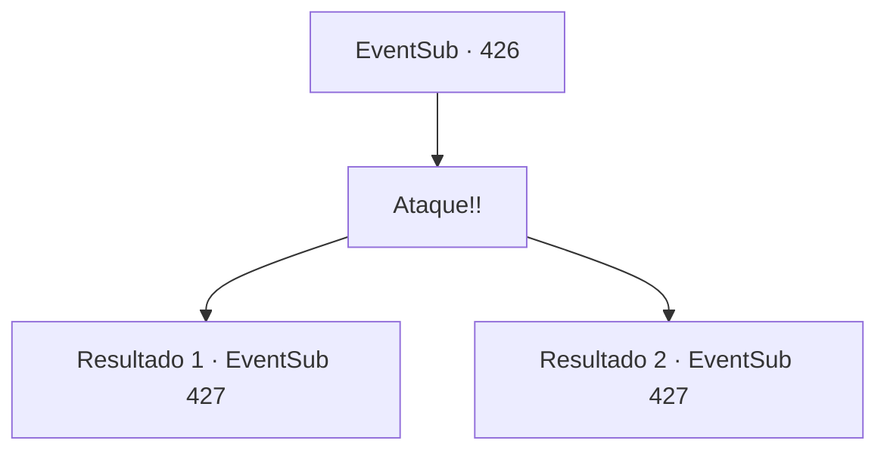

# Eventos secundários · 426

[Índice da tabela](index.md) · [Índice geral](../index.md)

ID: `pt:EventSub:426` · Fonte: `EventSub4` · Versão: 1.2.47.

Mapeamento estático dos arquivos; a disponibilidade e a execução dependem do estado da run.

## Texto do evento

*Sem texto no arquivo.*

## Dados de entrada

```json
{
  "id": 426,
  "grade": 1,
  "subEvent": "",
  "required": ""
}
```

## Mapa das escolhas



## Escolhas e resultados

### Escolha 1

Ataque!!

Requisitos e outros campos da escolha:

```json
{
  "required": ""
}
```

#### Resultado 1.1

Você percebe que é o momento perfeito para atacar. Você desenha sua arma e grita aos druidas para atacar. Os druidas correm para os soldados com um rugido. Os soldados de Tomant se debatem e depois começam a travar uma batalha difícil contra os druidas. |drawing_warDruid|

Continuação registrada: [Evento 427](0427.md) na mesma tabela.

```json
{
  "required": "18_334_1",
  "chance": "1",
  "nextEvent": 427,
  "type": 2,
  "reward": "6_2_136",
  "place": 1
}
```

#### Resultado 1.2

Você percebe que é o momento perfeito para atacar. Você desenha sua arma e grita aos druidas para atacar. Os druidas correm para os soldados com um rugido. |drawing_warDruid|

Continuação registrada: [Evento 427](0427.md) na mesma tabela.

```json
{
  "required": "5_334_1",
  "chance": "1",
  "nextEvent": 427,
  "type": 2,
  "reward": "6_0_136",
  "place": 1
}
```

## Referências que chegam a este evento

- [Evento 419 · escolha 1 · resultado 1](0419.md#escolha-1)
- [Evento 419 · escolha 2 · resultado 1](0419.md#escolha-2)
- [Evento 423 · escolha 2 · resultado 1](0423.md#escolha-2)
- [Evento 424 · escolha 1 · resultado 1](0424.md#escolha-1)
- [Evento 424 · escolha 1 · resultado 2](0424.md#escolha-1)
- [Evento 424 · escolha 2 · resultado 1](0424.md#escolha-2)
- [Evento 425 · escolha 1 · resultado 1](0425.md#escolha-1)
- [Evento 425 · escolha 2 · resultado 1](0425.md#escolha-2)
