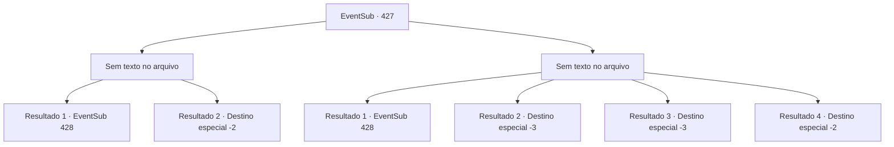

# Eventos secundários · 427

[Índice da tabela](index.md) · [Índice geral](../index.md)

ID: `pt:EventSub:427` · Fonte: `EventSub4` · Versão: 1.2.47.

Mapeamento estático dos arquivos; a disponibilidade e a execução dependem do estado da run.

## Texto do evento

*Sem texto no arquivo.*

## Dados de entrada

```json
{
  "id": 427,
  "grade": 1,
  "subEvent": "",
  "required": ""
}
```

## Mapa das escolhas



## Escolhas e resultados

### Escolha 1

*Sem texto no arquivo; o papel dessa opção depende da interface do jogo.*

Requisitos e outros campos da escolha:

```json
{
  "required": ""
}
```

#### Resultado 1.1

Os druidas conquistam uma vitória desequilibrada. A maioria dos soldados de Tomant perdeu suas vidas, e apenas alguns sobreviventes tentam fugir. 

 "Persigam-nos e livrem-se de todos eles!"

 Os druidas respondem ao grito de Syannathel, aplaudindo e gritando de alegria. Nesse momento, Amakar aparece na frente deles e ruge. 

 "Venham até mim, selvagens!"

 Ele já parece cansado, mas não desiste. Ele avança em você e nos druidas, depois de se transformar em um urso.

Continuação registrada: [Evento 428](0428.md) na mesma tabela.

```json
{
  "required": "18_334_1",
  "chance": "1",
  "nextEvent": 428,
  "type": 2,
  "reward": "6_2_133",
  "place": 1
}
```

#### Resultado 1.2

Quando a feroz batalha termina, restam apenas alguns que conseguem se levantar. Amakar é forçado a retirar seu exército, já que a batalha causou um preço mais alto a Tomant. 

 "NÓS GANHAMOS!!"

 Como um druida ruge com alegria, outros seguem o exemplo. Depois de gritar com os inimigos em fuga, para nunca mais voltar, eles afundam no chão, completamente exaustos. 

 Após a batalha, os druidas celebram sua vitória curando suas feridas e compartilhando bebidas. No meio da festa, Syannathel chega a você e fala. 

 "Está tudo acabado agora. Obrigado por proteger a floresta e nossos parentes. Este é um presente do ancião."

 Ela entrega a você um círculo de madeira. Os outros druidas também mostram suas gratificações beijando sua bochecha ou dando um presente. Os druidas o enviam e você deixa a floresta silociente.

Continuação registrada: [Destino especial `-2`](../destinos-especiais.md).

```json
{
  "required": "5_334_1",
  "chance": "1",
  "nextEvent": -2,
  "type": 2,
  "reward": "3_241_1|3_237_1|12_8_-1|14_8_5"
}
```

### Escolha 2

*Sem texto no arquivo; o papel dessa opção depende da interface do jogo.*

Requisitos e outros campos da escolha:

```json
{
  "required": ""
}
```

#### Resultado 2.1

Apesar da sua derrota, os druidas conquistam uma vitória esmagadora. A maioria dos soldados de Tomant perdeu suas vidas, e apenas alguns sobreviventes tentam fugir. 

 "Persigam-nos e livrem-se de todos eles!"

 Os druidas respondem ao grito de Syannathel, aplaudindo e gritando de alegria. Nesse momento, Amakar aparece na frente deles e ruge. 

 "Venham até mim, selvagens!"

 Ele já parece cansado, mas não desiste. Ele avança em você e nos druidas, depois de se transformar em um urso.

Continuação registrada: [Evento 428](0428.md) na mesma tabela.

```json
{
  "required": "18_334_1|1_0_2|1_1_2",
  "chance": "1",
  "nextEvent": 428,
  "type": 2,
  "reward": "6_2_133|0_0_-1|0_1_-1",
  "place": 1
}
```

#### Resultado 2.2

Você falha em desviar das lanças dos soldados. Como resultado, você perde sua vida.

Continuação registrada: [Destino especial `-3`](../destinos-especiais.md).

```json
{
  "required": "2_0_2",
  "chance": "1",
  "nextEvent": -3,
  "type": 2,
  "reward": "0_0_-1|0_1_-1"
}
```

#### Resultado 2.3

Você falha em desviar das lanças dos soldados. Como resultado, você perde sua vida.

Continuação registrada: [Destino especial `-3`](../destinos-especiais.md).

```json
{
  "required": "2_1_2",
  "chance": "1",
  "nextEvent": -3,
  "type": 2,
  "reward": "0_0_-1|0_1_-1"
}
```

#### Resultado 2.4

Os druidas resistem ferozmente, mas acabam perdendo a batalha. Os poucos sobreviventes tentam fugir, e o exército de Tomant os persegue. 

 "Vou ganhar algum tempo! Todos, fujam! Vocês devem sobreviver!!"

 O druida mais velho segura a joia e lança um feitiço. Num instante, troncos de árvores surgem do chão, formando uma parede na frente dos soldados que perseguem os druidas. Você escapa da Floresta de Silocient, deixando o druida mais velho para trás.

Continuação registrada: [Destino especial `-2`](../destinos-especiais.md).

```json
{
  "required": "5_334_1|1_0_2|1_1_2",
  "chance": "1",
  "nextEvent": -2,
  "type": 2,
  "reward": "0_0_-1|0_1_-1|12_8_-1|14_8_2"
}
```

## Referências que chegam a este evento

- [Evento 426 · escolha 1 · resultado 1](0426.md#escolha-1)
- [Evento 426 · escolha 1 · resultado 2](0426.md#escolha-1)
