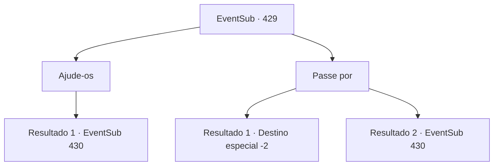

# Eventos secundários · 429

[Índice da tabela](index.md) · [Índice geral](../index.md)

ID: `pt:EventSub:429` · Fonte: `EventSub4` · Versão: 1.2.47.

Mapeamento estático dos arquivos; a disponibilidade e a execução dependem do estado da run.

## Texto do evento

A montanha em que você está trilhando é chamada de 'Trollium', recebendo o nome da infestação de trolls. Faz jus ao nome, ao que parece. Você já se deparou com vários trolls, que você afugentou ou se esgueirou. Então, você ouve um barulho vindo de algum lugar. |drawing_DiretrollWithDruid| 

 "MANTENHAM SEUS POSTOS! NÓS PROTEGEMOS ESTE LUGAR, A TODO CUSTO!"

 Ao seguir o barulho, você descobre um troll com muitos braços lutando contra um grupo de pessoas. Você dá uma olhada mais de perto e percebe que eles são os druidas que você viu na Floresta Silociente.

## Dados de entrada

```json
{
  "id": 429,
  "grade": 1,
  "subEvent": "",
  "required": "12_8_6|1_2_50"
}
```

## Mapa das escolhas



## Escolhas e resultados

### Escolha 1

Ajude-os

Requisitos e outros campos da escolha:

```json
{
  "required": ""
}
```

#### Resultado 1.1

Você avança em direção ao troll dire para ajudar os druidas. O troll dire reage à sua repentina aparição balançando os braços amplamente e soltando um rugido horrendo.

Continuação registrada: [Evento 430](0430.md) na mesma tabela.

```json
{
  "required": "",
  "chance": "1",
  "nextEvent": 430,
  "type": 2,
  "reward": "6_0_140",
  "place": 1
}
```

### Escolha 2

Passe por

Requisitos e outros campos da escolha:

```json
{
  "required": ""
}
```

#### Resultado 2.1

Você poderia se importar menos com a briga. Você ainda pode ouvir o rosnado do troll dire e os gritos de batalha dos druidas, mas isso não é da sua conta.

Continuação registrada: [Destino especial `-2`](../destinos-especiais.md).

```json
{
  "required": "",
  "chance": "1|0_6_1",
  "nextEvent": -2,
  "type": 0,
  "reward": "14_8_6|12_8_-1"
}
```

#### Resultado 2.2

Incapaz de resistir à fúria dos druidas, o troll terrível foge. Mas no caminho do troll terrível está você. Ai de você, você prepara sua arma e se prepara para lutar contra a criatura de múltiplos braços.

Continuação registrada: [Evento 430](0430.md) na mesma tabela.

```json
{
  "required": "",
  "chance": "14",
  "nextEvent": 430,
  "type": 1,
  "reward": "6_0_140",
  "place": 1
}
```

## Referências que chegam a este evento

Nenhum `nextEvent` positivo da mesma tabela aponta para este nó. Isso não prova que seja inacessível: sorteio e estado de história podem selecioná-lo.

