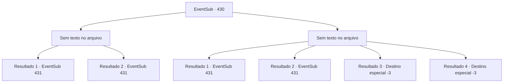

# Eventos secundários · 430

[Índice da tabela](index.md) · [Índice geral](../index.md)

ID: `pt:EventSub:430` · Fonte: `EventSub4` · Versão: 1.2.47.

Mapeamento estático dos arquivos; a disponibilidade e a execução dependem do estado da run.

## Texto do evento

*Sem texto no arquivo.*

## Dados de entrada

```json
{
  "id": 430,
  "grade": 1,
  "subEvent": "",
  "required": ""
}
```

## Mapa das escolhas



## Escolhas e resultados

### Escolha 1

*Sem texto no arquivo; o papel dessa opção depende da interface do jogo.*

Requisitos e outros campos da escolha:

```json
{
  "required": ""
}
```

#### Resultado 1.1

A brutalidade do troll dire é incomparável à dos trolls comuns. Além disso, ele continuou a se regenerar mesmo depois de ser ferido. Mas, finalmente, o troll dire decide fugir. Os druidas parecem surpresos por terem recebido sua ajuda, enquanto um deles fala com um olhar cauteloso no rosto. 

 "...Nunca esperávamos encontrá-lo novamente."


Continuação registrada: [Evento 431](0431.md) na mesma tabela.

```json
{
  "required": "5_329_1",
  "chance": "1",
  "nextEvent": 431,
  "type": 2,
  "reward": ""
}
```

#### Resultado 1.2

A brutalidade do troll dire é incomparável à dos trolls comuns. Além disso, ele se regenera infinitamente, então você simplesmente o expulsa. Os druidas te veem e te cumprimentam calorosamente. 

 "Olha só quem está aqui..! Que coincidência te encontrar aqui."


Continuação registrada: [Evento 431](0431.md) na mesma tabela.

```json
{
  "required": "18_329_1",
  "chance": "1",
  "nextEvent": 431,
  "type": 2,
  "reward": ""
}
```

### Escolha 2

*Sem texto no arquivo; o papel dessa opção depende da interface do jogo.*

Requisitos e outros campos da escolha:

```json
{
  "required": ""
}
```

#### Resultado 2.1

A brutalidade do troll dire é incomparável à dos trolls comuns. Além disso, ele se regenera infinitamente, então você simplesmente o expulsa. De qualquer forma, você não pode fazer mais nada com sua lesão. Os druidas parecem nervosos ao te ver. 

 "Bem... Não esperávamos te ver novamente."


Continuação registrada: [Evento 431](0431.md) na mesma tabela.

```json
{
  "required": "1_0_2|1_1_2|5_329_1",
  "chance": "1",
  "nextEvent": 431,
  "type": 2,
  "reward": "0_0_-1|0_1_-1"
}
```

#### Resultado 2.2

A brutalidade do troll dire é incomparável à dos trolls comuns. Além disso, ele se regenera infinitamente, então você simplesmente o expulsa. De qualquer forma, você não pode fazer mais nada com sua lesão. Os druidas te veem e te cumprimentam calorosamente. 

 "Olha só quem está aqui..! Que coincidência te encontrar aqui."


Continuação registrada: [Evento 431](0431.md) na mesma tabela.

```json
{
  "required": "1_0_2|1_1_2|18_329_1",
  "chance": "1",
  "nextEvent": 431,
  "type": 2,
  "reward": "0_0_-1|0_1_-1"
}
```

#### Resultado 2.3

A brutalidade do troll dire é incomparável à dos trolls comuns. Agarrado por seus pares de braços, você é despedaçado em pedaços de carne.

Continuação registrada: [Destino especial `-3`](../destinos-especiais.md).

```json
{
  "required": "2_0_2",
  "chance": "1",
  "nextEvent": -3,
  "type": 2,
  "reward": "0_0_-1|0_1_-1"
}
```

#### Resultado 2.4

A brutalidade do troll dire é incomparável à dos trolls comuns. Agarrado por seus pares de braços, você é despedaçado em pedaços de carne.

Continuação registrada: [Destino especial `-3`](../destinos-especiais.md).

```json
{
  "required": "2_1_2",
  "chance": "1",
  "nextEvent": -3,
  "type": 2,
  "reward": "0_0_-1|0_1_-1"
}
```

## Referências que chegam a este evento

- [Evento 429 · escolha 1 · resultado 1](0429.md#escolha-1)
- [Evento 429 · escolha 2 · resultado 2](0429.md#escolha-2)
