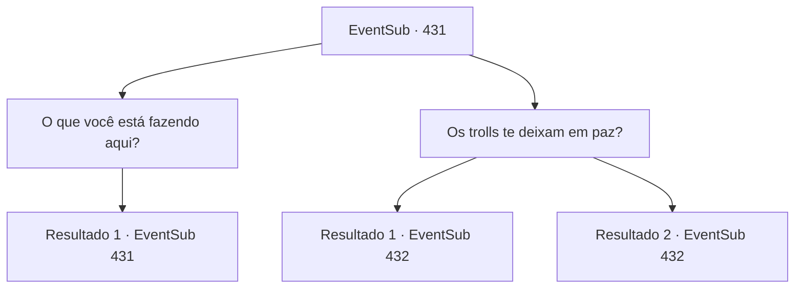

# Eventos secundários · 431

[Índice da tabela](index.md) · [Índice geral](../index.md)

ID: `pt:EventSub:431` · Fonte: `EventSub4` · Versão: 1.2.47.

Mapeamento estático dos arquivos; a disponibilidade e a execução dependem do estado da run.

## Texto do evento

*Sem texto no arquivo.*

## Dados de entrada

```json
{
  "id": 431,
  "grade": 1,
  "subEvent": "",
  "required": ""
}
```

## Mapa das escolhas



## Escolhas e resultados

### Escolha 1

O que você está fazendo aqui?

Requisitos e outros campos da escolha:

```json
{
  "required": "5_325_0"
}
```

#### Resultado 1.1

Syananthel é quem te responde. 

 "Estamos começando de novo, longe de Silocient."

 Ela te diz que eles decidiram esquecer o passado e se estabelecer neste novo lugar. 

 "Quero dizer, a joia e nossa casa... Tudo é importante para nós, é claro, mas precisamos sobreviver..."


Continuação registrada: [Evento 431](0431.md) na mesma tabela.

```json
{
  "required": "",
  "chance": "1",
  "nextEvent": 431,
  "type": 2,
  "reward": "5_325_1"
}
```

### Escolha 2

Os trolls te deixam em paz?

Requisitos e outros campos da escolha:

```json
{
  "required": "5_325_1"
}
```

#### Resultado 2.1

Você os avisa que a área pode ser um pouco perigosa. Syannathel balança a cabeça e responde. 

 "Heh. Claro que não. Mas... eles não são tão perigosos para nós como os humanos. E isso não é da sua conta, não é?"


Continuação registrada: [Evento 432](0432.md) na mesma tabela.

```json
{
  "required": "5_329_1",
  "chance": "1",
  "nextEvent": 432,
  "type": 2,
  "reward": ""
}
```

#### Resultado 2.2

Você os avisa que a área pode ser um pouco perigosa. Syannathel balança a cabeça e responde. 

 "Heh. Claro que não. Mas... eles não são tão perigosos para nós como os humanos."


Continuação registrada: [Evento 432](0432.md) na mesma tabela.

```json
{
  "required": "18_329_1",
  "chance": "1",
  "nextEvent": 432,
  "type": 2,
  "reward": ""
}
```

## Referências que chegam a este evento

- [Evento 430 · escolha 1 · resultado 1](0430.md#escolha-1)
- [Evento 430 · escolha 1 · resultado 2](0430.md#escolha-1)
- [Evento 430 · escolha 2 · resultado 1](0430.md#escolha-2)
- [Evento 430 · escolha 2 · resultado 2](0430.md#escolha-2)
- [Evento 431 · escolha 1 · resultado 1](0431.md#escolha-1)
