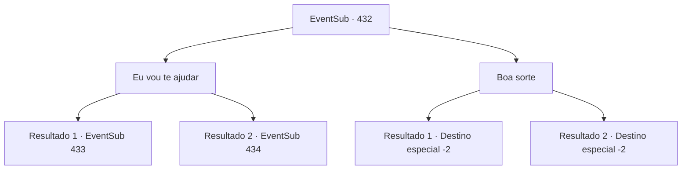

# Eventos secundários · 432

[Índice da tabela](index.md) · [Índice geral](../index.md)

ID: `pt:EventSub:432` · Fonte: `EventSub4` · Versão: 1.2.47.

Mapeamento estático dos arquivos; a disponibilidade e a execução dependem do estado da run.

## Texto do evento

*Sem texto no arquivo.*

## Dados de entrada

```json
{
  "id": 432,
  "grade": 1,
  "subEvent": "",
  "required": ""
}
```

## Mapa das escolhas



## Escolhas e resultados

### Escolha 1

Eu vou te ajudar

Requisitos e outros campos da escolha:

```json
{
  "required": ""
}
```

#### Resultado 1.1

Você oferece sua ajuda a eles. Os druidas murmuram brevemente, mas finalmente decidem aceitar sua ajuda. Syannathel cruza os braços e fala. 

 "Tudo bem. Então mate o troll feroz e traga-nos sua cabeça como evidência."

 Ela acrescenta que você terá que fazer isso o mais rápido possível.

Continuação registrada: [Evento 433](0433.md) na mesma tabela.

```json
{
  "required": "5_329_1",
  "chance": "1",
  "nextEvent": 433,
  "type": 2,
  "reward": ""
}
```

#### Resultado 1.2

Você oferece ajuda a eles, e os druidas a aceitam com prazer. Syannathel aponta o dedo para o topo da montanha. 

 "Então você pode se livrar daquele troll terrível para nós?"


Continuação registrada: [Evento 434](0434.md) na mesma tabela.

```json
{
  "required": "18_329_1",
  "chance": "1",
  "nextEvent": 434,
  "type": 2,
  "reward": ""
}
```

### Escolha 2

Boa sorte

Requisitos e outros campos da escolha:

```json
{
  "required": ""
}
```

#### Resultado 2.1

Deseja-lhes sorte e deixa a aldeia dos druidas.

Continuação registrada: [Destino especial `-2`](../destinos-especiais.md).

```json
{
  "required": "5_329_1",
  "chance": "1",
  "nextEvent": -2,
  "type": 2,
  "reward": "14_8_6|12_8_-1"
}
```

#### Resultado 2.2

Syannathel responde com um sorriso. 

 "Claro. De alguma forma, vamos sobreviver."

 Você se despede deles e vai embora.

Continuação registrada: [Destino especial `-2`](../destinos-especiais.md).

```json
{
  "required": "18_329_1",
  "chance": "1",
  "nextEvent": -2,
  "type": 2,
  "reward": "14_8_6|12_8_-1"
}
```

## Referências que chegam a este evento

- [Evento 431 · escolha 2 · resultado 1](0431.md#escolha-2)
- [Evento 431 · escolha 2 · resultado 2](0431.md#escolha-2)
