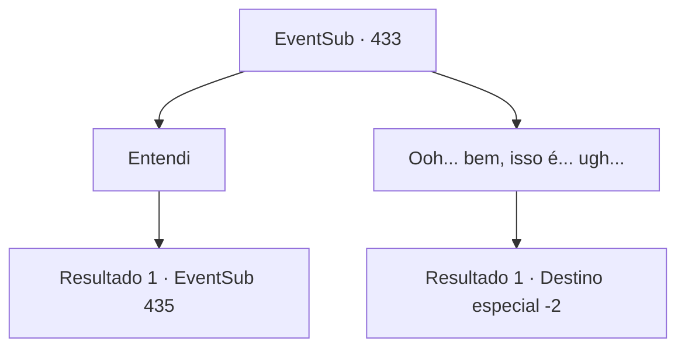

# Eventos secundários · 433

[Índice da tabela](index.md) · [Índice geral](../index.md)

ID: `pt:EventSub:433` · Fonte: `EventSub4` · Versão: 1.2.47.

Mapeamento estático dos arquivos; a disponibilidade e a execução dependem do estado da run.

## Texto do evento

*Sem texto no arquivo.*

## Dados de entrada

```json
{
  "id": 433,
  "grade": 1,
  "subEvent": "",
  "required": ""
}
```

## Mapa das escolhas



## Escolhas e resultados

### Escolha 1

Entendi

Requisitos e outros campos da escolha:

```json
{
  "required": ""
}
```

#### Resultado 1.1

Enquanto você acena, Syannathel diz onde o troll terrível pode ser encontrado e acrescenta. 

 "... Hmph. Não sabia que você aceitaria tão facilmente. A criatura pode ser encontrada ao redor dos picos das montanhas. Vá ali."

 Você ouve as palavras dela e depois segue o caminho para encontrar o terrível troll. 

 Ao seguir o caminho em direção ao pico da montanha, onde se presume que o terrível troll, você percebe que as pilhas de ossos no chão estão aumentando constantemente. Então, um troll blindado aparece na sua frente. Parece severamente ferido e também preocupado.

Continuação registrada: [Evento 435](0435.md) na mesma tabela.

```json
{
  "required": "",
  "chance": "1",
  "nextEvent": 435,
  "type": 2,
  "reward": ""
}
```

### Escolha 2

Ooh... bem, isso é... ugh...

Requisitos e outros campos da escolha:

```json
{
  "required": ""
}
```

#### Resultado 2.1

Vendo sua resposta, Syannathel responde. 

 "Sim. Sabia disso. Nos deixe em paz e siga seu caminho."

 Ela e os outros druidas se viram e você faz o mesmo.

Continuação registrada: [Destino especial `-2`](../destinos-especiais.md).

```json
{
  "required": "",
  "chance": "1",
  "nextEvent": -2,
  "type": 2,
  "reward": "14_8_6|12_8_-1"
}
```

## Referências que chegam a este evento

- [Evento 432 · escolha 1 · resultado 1](0432.md#escolha-1)
