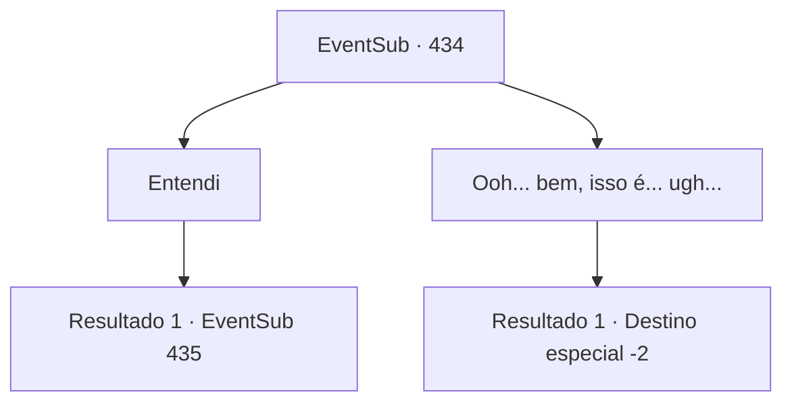

# Eventos secundários · 434

[Índice da tabela](index.md) · [Índice geral](../index.md)

ID: `pt:EventSub:434` · Fonte: `EventSub4` · Versão: 1.2.47.

Mapeamento estático dos arquivos; a disponibilidade e a execução dependem do estado da run.

## Texto do evento

*Sem texto no arquivo.*

## Dados de entrada

```json
{
  "id": 434,
  "grade": 1,
  "subEvent": "",
  "required": ""
}
```

## Mapa das escolhas



## Escolhas e resultados

### Escolha 1

Entendi

Requisitos e outros campos da escolha:

```json
{
  "required": ""
}
```

#### Resultado 1.1

Enquanto você acena, Syannathel diz onde o troll terrível pode ser encontrado e acrescenta. 

 "Trolls terríveis podem ser encontrados ao redor dos picos das montanhas, então tente lá. Seja especialmente cuidadoso, pois eles têm uma tremenda capacidade de regeneração. Acho que ouvi dizer que eles são fracos para disparar. Então, se você queimar a ferida, poderá matar um."

 Você ouve as palavras dela e depois segue o caminho para encontrar o terrível troll. 

 Ao seguir o caminho em direção ao pico da montanha, onde se presume que o terrível troll, você percebe que as pilhas de ossos no chão estão aumentando constantemente. Então, um troll blindado aparece na sua frente. Parece severamente ferido e também preocupado.

Continuação registrada: [Evento 435](0435.md) na mesma tabela.

```json
{
  "required": "",
  "chance": "1",
  "nextEvent": 435,
  "type": 2,
  "reward": ""
}
```

### Escolha 2

Ooh... bem, isso é... ugh...

Requisitos e outros campos da escolha:

```json
{
  "required": ""
}
```

#### Resultado 2.1

Enquanto você faz uma expressão incerta, ela acena com a mão dizendo que está tudo bem. 

 "Eu sei que é um pedido desafiador. Não se preocupe. De alguma forma, encontraremos uma solução, então esqueça isso."

 Ela e os druidas oferecem uma refeição, já que vocês não se veem há muito tempo. Você desfruta de uma comida deliciosa e de uma conversa agradável com eles. Então você os deixa.

Continuação registrada: [Destino especial `-2`](../destinos-especiais.md).

```json
{
  "required": "",
  "chance": "1",
  "nextEvent": -2,
  "type": 2,
  "reward": "14_8_6|12_8_-1|0_0_1"
}
```

## Referências que chegam a este evento

- [Evento 432 · escolha 1 · resultado 2](0432.md#escolha-1)
