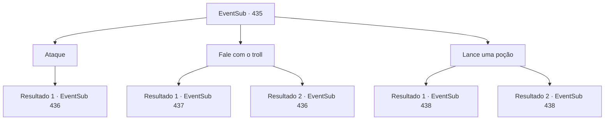

# Eventos secundários · 435

[Índice da tabela](index.md) · [Índice geral](../index.md)

ID: `pt:EventSub:435` · Fonte: `EventSub4` · Versão: 1.2.47.

Mapeamento estático dos arquivos; a disponibilidade e a execução dependem do estado da run.

## Texto do evento

*Sem texto no arquivo.*

## Dados de entrada

```json
{
  "id": 435,
  "grade": 1,
  "subEvent": "",
  "required": ""
}
```

## Mapa das escolhas



## Escolhas e resultados

### Escolha 1

Ataque

Requisitos e outros campos da escolha:

```json
{
  "required": ""
}
```

#### Resultado 1.1

Você decide não perder a oportunidade de matar o troll. Você avança em direção ao troll ferido com sua arma. Dominado pelo medo, o troll começa a balançar sua arma em pânico.

Continuação registrada: [Evento 436](0436.md) na mesma tabela.

```json
{
  "required": "",
  "chance": "1",
  "nextEvent": 436,
  "type": 2,
  "reward": "6_2_39",
  "place": 1
}
```

### Escolha 2

Fale com o troll

Requisitos e outros campos da escolha:

```json
{
  "required": ""
}
```

#### Resultado 2.1

Você se aproxima cuidadosamente do troll assustado, tentando conversar com ele. Ele tenta recuperar o fôlego e então fala. 

 "Muitos braços. Esse troll. Meus amigos. Ele comeu... Meu braço. Ele pegou. Ele adicionou! Eu fugi..."

 Do que você consegue entender, você acha que ele está tentando dizer que seus amigos foram mortos pelo troll terrível, e apenas ele conseguiu fugir. Quando você pergunta onde o troll terrível está, ele aponta para o topo da montanha. 

 "Aquela caverna. Dentro."

 Você segue para a caverna que ele apontou. Assim que você entra na enorme caverna, um cheiro repugnante invade suas narinas. Você vê muitas estalactites e estalagmites quebradas. Nas partes mais profundas da caverna, você vê ainda mais pilhas de ossos espalhados pelo chão. Conforme você avança mais para dentro, você descobre o troll terrível devorando outro troll. Ele parece concentrado em sua refeição e ainda não percebeu sua presença.

Continuação registrada: [Evento 437](0437.md) na mesma tabela.

```json
{
  "required": "21_1_2",
  "chance": "1",
  "nextEvent": 437,
  "type": 2,
  "reward": ""
}
```

#### Resultado 2.2

Você se aproxima cuidadosamente do troll assustado, tentando conversar com ele. Dominado pelo medo, o troll começa a balançar sua arma em pânico.

Continuação registrada: [Evento 436](0436.md) na mesma tabela.

```json
{
  "required": "20_1_2",
  "chance": "1",
  "nextEvent": 436,
  "type": 2,
  "reward": "6_2_39",
  "place": 1
}
```

### Escolha 3

Lance uma poção

Requisitos e outros campos da escolha:

```json
{
  "required": "-1|8_36_1|8_130_1"
}
```

#### Resultado 3.1

Você joga uma garrafa de poção para o troll ferido. Enquanto a garrafa quebra, a poção assume o troll e, com as feridas curadas, o troll se aproxima de você, acena com a cabeça e fala. 

 "Humano, obrigado. Nome Brully. Comer humanos antes. Mas não mais. Eu sei quem me salva. Você fala, ajuda abundante."

 Você diz a Brully que está procurando um troll com muitos braços. Depois de ouvir o que você disse, Brully fumaça com raiva e respostas. 

 "Muitos braços. Aquele troll! Meus amigos ... comem. Meu braço. É preciso. Meus amigos. Eu pago de volta!"

 Brully então começa a andar. Você o segue e chega a uma caverna perto do pico da montanha. Assim que você entra na caverna enorme, um fedor nojento invade suas narinas. Você vê muitos estalactites e estalagmites quebrados. Dentro das partes mais profundas da caverna, você vê ainda mais pilhas de ossos espalhados no chão. À medida que você se aprofunda, você descobre o terrível troll, devorando outro troll. <link=shake> 

 "roooooooooooooooo --- !!!"

 </link> Brully alcança sua arma, consumida pela raiva, e cobra no terrível troll. Você faz o mesmo, e vocês dois atacam o terrível troll.

Continuação registrada: [Evento 438](0438.md) na mesma tabela.

```json
{
  "required": "8_36_1",
  "chance": "1",
  "nextEvent": 438,
  "type": 2,
  "reward": "5_335_1|6_2_140|4_36_1",
  "place": 6
}
```

#### Resultado 3.2

Você joga uma garrafa de poção para o troll ferido. Enquanto a garrafa quebra, a poção assume o troll e, com as feridas curadas, o troll se aproxima de você, acena com a cabeça e fala. 

 "Humano, obrigado. Nome Brully. Comer humanos antes. Mas não mais. Eu sei quem me salva. Você fala, ajuda abundante."

 Você diz a Brully que está procurando um troll com muitos braços. Depois de ouvir o que você disse, Brully fumaça com raiva e respostas. 

 "Muitos braços. Aquele troll! Meus amigos ... comem. Meu braço. É preciso. Meus amigos. Eu pago de volta!"

 Brully então começa a andar. Você o segue e chega a uma caverna perto do pico da montanha. Assim que você entra na caverna enorme, um fedor nojento invade suas narinas. Você vê muitos estalactites e estalagmites quebrados. Dentro das partes mais profundas da caverna, você vê ainda mais pilhas de ossos espalhados no chão. À medida que você se aprofunda, você descobre o terrível troll, devorando outro troll. <link=shake> 

 "roooooooooooooooo --- !!!"

 </link> Brully alcança sua arma, consumida pela raiva, e cobra no terrível troll. Você faz o mesmo, e vocês dois atacam o terrível troll.

Continuação registrada: [Evento 438](0438.md) na mesma tabela.

```json
{
  "required": "10_36_1",
  "chance": "1",
  "nextEvent": 438,
  "type": 2,
  "reward": "5_335_1|6_2_140|4_130_1",
  "place": 6
}
```

## Referências que chegam a este evento

- [Evento 433 · escolha 1 · resultado 1](0433.md#escolha-1)
- [Evento 434 · escolha 1 · resultado 1](0434.md#escolha-1)
