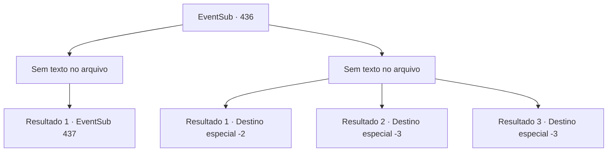

# Eventos secundários · 436

[Índice da tabela](index.md) · [Índice geral](../index.md)

ID: `pt:EventSub:436` · Fonte: `EventSub4` · Versão: 1.2.47.

Mapeamento estático dos arquivos; a disponibilidade e a execução dependem do estado da run.

## Texto do evento

*Sem texto no arquivo.*

## Dados de entrada

```json
{
  "id": 436,
  "grade": 1,
  "subEvent": "",
  "required": ""
}
```

## Mapa das escolhas



## Escolhas e resultados

### Escolha 1

*Sem texto no arquivo; o papel dessa opção depende da interface do jogo.*

Requisitos e outros campos da escolha:

```json
{
  "required": ""
}
```

#### Resultado 1.1

Você termina de matar o troll ferido e segue os ossos de animais até o topo da montanha. Assim que você entra em uma enorme caverna, um cheiro repugnante invade suas narinas. Você vê muitas estalactites e estalagmites quebradas. Nas partes mais profundas da caverna, você vê ainda mais pilhas de ossos espalhados pelo chão. Conforme você avança mais para dentro, você descobre o troll feroz devorando outro troll. Ele parece estar concentrado em sua refeição e ainda não percebeu sua presença.

Continuação registrada: [Evento 437](0437.md) na mesma tabela.

```json
{
  "required": "",
  "chance": "1",
  "nextEvent": 437,
  "type": 2,
  "reward": ""
}
```

### Escolha 2

*Sem texto no arquivo; o papel dessa opção depende da interface do jogo.*

Requisitos e outros campos da escolha:

```json
{
  "required": ""
}
```

#### Resultado 2.1

Após levar uma surra do troll ferido, você retorna da montanha. Syannathel aparece na sua frente. 

 "...Ah, o que eu esperava. Admiro sua coragem, no entanto."

 Ela passa alguns ungüentos feitos com ervas e coloca um curativo simples em suas feridas. Em seguida, ela se transforma em uma águia e voa para longe.

Continuação registrada: [Destino especial `-2`](../destinos-especiais.md).

```json
{
  "required": "1_0_2|1_1_2",
  "chance": "1",
  "nextEvent": -2,
  "type": 2,
  "reward": "14_8_6|12_8_-1|0_1_-1"
}
```

#### Resultado 2.2

O troll ferido te derruba, e você não consegue se levantar novamente.

Continuação registrada: [Destino especial `-3`](../destinos-especiais.md).

```json
{
  "required": "2_0_2",
  "chance": "1",
  "nextEvent": -3,
  "type": 2,
  "reward": "0_0_-1|0_1_-1"
}
```

#### Resultado 2.3

O troll ferido te derruba, e você não consegue se levantar novamente.

Continuação registrada: [Destino especial `-3`](../destinos-especiais.md).

```json
{
  "required": "2_1_2",
  "chance": "1",
  "nextEvent": -3,
  "type": 2,
  "reward": "0_0_-1|0_1_-1"
}
```

## Referências que chegam a este evento

- [Evento 435 · escolha 1 · resultado 1](0435.md#escolha-1)
- [Evento 435 · escolha 2 · resultado 2](0435.md#escolha-2)
