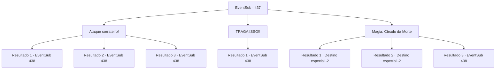

# Eventos secundários · 437

[Índice da tabela](index.md) · [Índice geral](../index.md)

ID: `pt:EventSub:437` · Fonte: `EventSub4` · Versão: 1.2.47.

Mapeamento estático dos arquivos; a disponibilidade e a execução dependem do estado da run.

## Texto do evento

*Sem texto no arquivo.*

## Dados de entrada

```json
{
  "id": 437,
  "grade": 1,
  "subEvent": "",
  "required": ""
}
```

## Mapa das escolhas



## Escolhas e resultados

### Escolha 1

Ataque sorrateiro!

Requisitos e outros campos da escolha:

```json
{
  "required": ""
}
```

#### Resultado 1.1

Você se aproxima sorrateiramente do troll feroz. Em seguida, você atinge cuidadosamente sua garganta com sua arma. A emboscada é bem-sucedida. Você sente o pescoço do troll feroz se quebrando, mas de alguma forma ele avança de volta em sua direção com o pescoço quebrado.

Continuação registrada: [Evento 438](0438.md) na mesma tabela.

```json
{
  "required": "",
  "chance": "1|0_6_1",
  "nextEvent": 438,
  "type": 0,
  "reward": "6_0_140",
  "place": 6
}
```

#### Resultado 1.2

Você se aproxima sorrateiramente do troll feroz. Em seguida, você atinge cuidadosamente sua garganta com sua arma. A emboscada é bem-sucedida. Você sente o pescoço do troll feroz se quebrando, mas de alguma forma ele avança de volta em sua direção com o pescoço quebrado.

Continuação registrada: [Evento 438](0438.md) na mesma tabela.

```json
{
  "required": "20_5_2",
  "chance": "1|0_6_1",
  "nextEvent": 438,
  "type": 0,
  "reward": "6_0_140",
  "place": 6
}
```

#### Resultado 1.3

Você se aproxima sorrateiramente do troll feroz. Mas ele percebe você se aproximando sorrateiramente e então joga o troll que estava comendo em você. Em seguida, solta um rugido horrendo, correndo em sua direção.

Continuação registrada: [Evento 438](0438.md) na mesma tabela.

```json
{
  "required": "",
  "chance": "20",
  "nextEvent": 438,
  "type": 1,
  "reward": "6_3_140",
  "place": 6
}
```

### Escolha 2

TRAGA ISSO!!

Requisitos e outros campos da escolha:

```json
{
  "required": ""
}
```

#### Resultado 2.1

Você provoca o troll terrível em voz alta. Foi super eficaz! O troll terrível larga o troll em que estava se alimentando, solta um rugido horrendo e avança em sua direção.

Continuação registrada: [Evento 438](0438.md) na mesma tabela.

```json
{
  "required": "",
  "chance": "1",
  "nextEvent": 438,
  "type": 2,
  "reward": "6_3_140",
  "place": 6
}
```

### Escolha 3

Magia: Círculo da Morte

Requisitos e outros campos da escolha:

```json
{
  "required": "20_0_3|1_1_2"
}
```

#### Resultado 3.1

Você pensa em uma maneira de acabar com a vida do troll maligno de uma vez por todas. Você se lembra de um certo feitiço que drena a essência vital das criaturas. Leva muito tempo para preparar o feitiço, então não é apropriado para situações desesperadoras, mas contra um inimigo ocupado se alimentando, deve ser perfeito. Conforme o feitiço se aproxima da conclusão, o troll maligno percebe algo estranho e se levanta. Mas é tarde demais. O círculo da morte drena sua força vital. O troll maligno grita com suas muitas faces e logo desaba no chão como uma múmia ressecada. Você corta a cabeça do troll maligno do corpo, coloca-a na mochila e sai da caverna. Então, uma águia voa do céu e se transforma em um humano. 

 "Você... o matou?"

 Você orgulhosamente tira a cabeça do troll maligno da mochila. Ela ainda parece não acreditar em você, enquanto ela mesma entra na caverna. Após alguns segundos, Syannathel sai da caverna, tentando esconder a expressão surpresa em seu rosto, e então fala. 

 "Então você realmente matou um troll maligno, hein... Bom trabalho."

 Ela estende a mão para um aperto de mão. Você aceita felizmente. 

 "Não tenho muito para te dar, mas... pelo menos vou te dar uma oração. Que as bênçãos dos deuses da natureza estejam com você."

 Após terminar sua oração, ela se transforma novamente em uma águia e voa para longe.

Continuação registrada: [Destino especial `-2`](../destinos-especiais.md).

```json
{
  "required": "5_329_1",
  "chance": "1|0_7_1|0_12_1",
  "nextEvent": -2,
  "type": 0,
  "reward": "0_1_-1|14_8_7|12_8_-1|0_14_1"
}
```

#### Resultado 3.2

Você pensa em uma maneira de acabar com a vida do troll maligno de uma vez por todas. Você se lembra de um certo feitiço que drena a essência vital das criaturas. Leva muito tempo para preparar o feitiço, então não é apropriado para situações desesperadoras, mas contra um inimigo ocupado se alimentando, deve ser perfeito. Conforme o feitiço se aproxima da conclusão, o troll maligno percebe algo estranho e se levanta. Mas é tarde demais. O círculo da morte drena sua força vital. O troll maligno grita com suas muitas faces e logo desaba no chão como uma múmia ressecada. Você corta a cabeça do troll maligno do corpo, coloca-a na mochila e sai da caverna. Então, uma águia voa do céu e se transforma em um humano. 

 "Você... matou ele?"

 Você orgulhosamente tira a cabeça do troll maligno da mochila. Ela fica encantada ao vê-la. 

 "Obrigada por lidar com isso. Ótimo trabalho!"

 Ela estende a mão, pedindo um aperto de mão. Você pega a mão dela. Então ela fecha os olhos e reza sinceramente por você. 

 "Que as bênçãos dos deuses da natureza estejam com você."

 Após terminar sua oração, ela o acompanha montanha abaixo. Ela acena com a mão até você não poder mais vê-la.

Continuação registrada: [Destino especial `-2`](../destinos-especiais.md).

```json
{
  "required": "18_329_1",
  "chance": "1|0_7_1|0_12_1",
  "nextEvent": -2,
  "type": 0,
  "reward": "0_1_-1|14_8_7|12_8_-1|0_14_1"
}
```

#### Resultado 3.3

Você pensa em uma maneira de acabar com a vida do troll maligno de uma vez por todas. Você se lembra de um certo feitiço, que drena a essência vital das criaturas. Leva muito tempo para preparar o feitiço, então não é apropriado para situações desesperadoras, mas contra um inimigo ocupado se alimentando, deve ser perfeito. Conforme o feitiço se aproxima da conclusão, o troll maligno percebe algo estranho e se levanta. O círculo da morte começa a cumprir seu papel, consumindo a força vital do troll. O troll maligno começa a gritar de dor com suas muitas faces, mas logo escapa do círculo do feitiço. Ele então avança furiosamente em sua direção.

Continuação registrada: [Evento 438](0438.md) na mesma tabela.

```json
{
  "required": "",
  "chance": "30",
  "nextEvent": 438,
  "type": 1,
  "reward": "6_2_140|0_1_-1",
  "place": 6
}
```

## Referências que chegam a este evento

- [Evento 435 · escolha 2 · resultado 1](0435.md#escolha-2)
- [Evento 436 · escolha 1 · resultado 1](0436.md#escolha-1)
