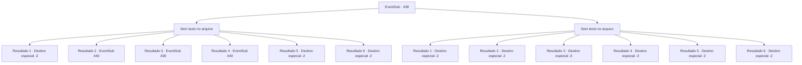

# Eventos secundários · 438

[Índice da tabela](index.md) · [Índice geral](../index.md)

ID: `pt:EventSub:438` · Fonte: `EventSub4` · Versão: 1.2.47.

Mapeamento estático dos arquivos; a disponibilidade e a execução dependem do estado da run.

## Texto do evento

*Sem texto no arquivo.*

## Dados de entrada

```json
{
  "id": 438,
  "grade": 1,
  "subEvent": "",
  "required": ""
}
```

## Mapa das escolhas



## Escolhas e resultados

### Escolha 1

*Sem texto no arquivo; o papel dessa opção depende da interface do jogo.*

Requisitos e outros campos da escolha:

```json
{
  "required": ""
}
```

#### Resultado 1.1

O troll terrível cai antes de você. Você corta a cabeça do troll de terrível corpo, coloca -o na mochila e deixa a caverna. Então, uma águia voa do céu e depois se transforma em um humano. 

 "Você ... matou?"

 Você orgulhosamente puxa a cabeça do troll da sua mochila. Mas então, o corpo do Dire Troll vem correndo da caverna. Já cresceu uma nova cabeça. 

 "Ainda está vivo ..!"

 Depois de fugir por um longo tempo, você e Syannathel mal conseguem perder de vista o terrível troll. Syannathel fala, ofegando. 

 "*Uf*....*Uff*.... caramba, eu não sei o que eu esperava. Por que .. você mentiria?!"

 Ela grita com você e depois desaparece na floresta sem esperar sua resposta.

Continuação registrada: [Destino especial `-2`](../destinos-especiais.md).

```json
{
  "required": "18_335_1|5_329_1|10_68_1",
  "chance": "1",
  "nextEvent": -2,
  "type": 2,
  "reward": "12_8_-1|14_8_6"
}
```

#### Resultado 1.2

O troll terrível cai antes de você. Então, o conselho de Syannathel chega à sua mente.
 'Então, se você queimar a ferida, poderá matar um.'


Continuação registrada: [Evento 440](0440.md) na mesma tabela.

```json
{
  "required": "18_335_1|18_329_1|10_68_1",
  "chance": "1",
  "nextEvent": 440,
  "type": 2,
  "reward": ""
}
```

#### Resultado 1.3

O troll feroz cai ao chão. Então, Brully grita desesperadamente. 

 "Isso aí. Levante-se logo! Ele se cura rápido! Mate-o agora!"

 Agora você deve encontrar uma maneira de impedi-lo de se curar e presenteá-lo com um descanso eterno.

Continuação registrada: [Evento 439](0439.md) na mesma tabela.

```json
{
  "required": "5_335_1|5_329_1|10_68_1",
  "chance": "1",
  "nextEvent": 439,
  "type": 2,
  "reward": ""
}
```

#### Resultado 1.4

O terrível troll cai no chão. Então, Brully grita desesperadamente. 

 "Essa coisa. Levante -se logo! Cura rápido! Mate agora!"

 Então, o conselho de Syannathel chega à sua mente.
 'Então, se você queimar a ferida, poderá matar um.'


Continuação registrada: [Evento 440](0440.md) na mesma tabela.

```json
{
  "required": "5_335_1|18_329_1|10_68_1",
  "chance": "1",
  "nextEvent": 440,
  "type": 2,
  "reward": ""
}
```

#### Resultado 1.5

Você puxa uma arma imbuida com a maldição de bloqueio de cura e despedaça o coração do troll feroz com ela. 

 "Humano... incrível! Vingança. Obrigado. Eu te dou isso!"

 Brully te entrega seu martelo. Você pega o martelo e se despede de Brully. Em seguida, sai da caverna. Então, uma águia voa do céu e se transforma em um humano. 

 "Você... matou ele?"

 Você acena com a cabeça em resposta. Ela ainda parece não acreditar em você, pois ela mesma entra na caverna. Após alguns segundos, Syannathel sai da caverna, tentando esconder a expressão surpresa em seu rosto, e então fala. 

 "Então você realmente matou um troll feroz, hein... Bom trabalho."

 Ela estende a mão para um aperto de mãos. Você aceita felizmente. 

 "Não tenho muito para te dar, mas... pelo menos vou te dar uma oração. Que as bênçãos dos deuses da natureza estejam com você."

 Após terminar sua oração, ela se transforma novamente em uma águia e voa para longe.

Continuação registrada: [Destino especial `-2`](../destinos-especiais.md).

```json
{
  "required": "8_68_1|5_335_1",
  "chance": "1",
  "nextEvent": -2,
  "type": 2,
  "reward": ""
}
```

#### Resultado 1.6

Você puxa uma arma imbuida com a maldição de bloqueio de cura e despedaça o coração do troll maligno com ela. Você separa a cabeça do troll maligno do seu corpo, coloca-a na mochila e sai da caverna. Então, uma águia voa do céu e se transforma em um humano. 

 "Você... o matou?"

 Você orgulhosamente tira a cabeça do troll maligno da sua mochila. Ela fica encantada ao vê-la. 

 "Obrigada por lidar com isso. Ótimo trabalho!"

 Ela estende a mão, pedindo um aperto de mãos. Você pega a mão dela. Então ela fecha os olhos e reza sinceramente por você. 

 "Que as bênçãos dos deuses da natureza estejam com você."

 Após terminar sua oração, ela te acompanha descendo a montanha. Ela acena com a mão até você não poder mais vê-la.

Continuação registrada: [Destino especial `-2`](../destinos-especiais.md).

```json
{
  "required": "8_68_1|18_335_1",
  "chance": "1",
  "nextEvent": -2,
  "type": 2,
  "reward": ""
}
```

### Escolha 2

*Sem texto no arquivo; o papel dessa opção depende da interface do jogo.*

Requisitos e outros campos da escolha:

```json
{
  "required": ""
}
```

#### Resultado 2.1

Você é lançado ao ar pelo punho do troll maligno. Você mal consegue sair vivo da caverna, evitando seus ataques. O troll maligno não te persegue fora da caverna. Depois de levar uma surra do troll maligno, você retorna da montanha. Syannathel aparece na sua frente. 

 "...Oh, o que eu esperava. Admiro sua coragem, no entanto."

 Ela olhou para baixo para você do céu e voou para longe.

Continuação registrada: [Destino especial `-2`](../destinos-especiais.md).

```json
{
  "required": "1_0_2|1_1_2|18_335_1|5_329_1",
  "chance": "1",
  "nextEvent": -2,
  "type": 2,
  "reward": "14_8_6|12_8_-1|0_0_-1|0_1_-1"
}
```

#### Resultado 2.2

Você é lançado ao ar pelo punho do troll maligno. Logo, o troll maligno vem para acabar com você com seus pés. Mas então, Brully bloqueia o troll maligno. 

 "Humano...! Corra!"

 Depois de levar uma surra do troll maligno e ser salvo por Brully, você retorna da montanha. Syannathel aparece na sua frente. 

 "...Ah, o que eu esperava. Admiro sua coragem, no entanto."

 Ela olhou para baixo para você do céu e voou para longe.

Continuação registrada: [Destino especial `-2`](../destinos-especiais.md).

```json
{
  "required": "1_0_2|1_1_2|5_335_1|5_329_1",
  "chance": "1",
  "nextEvent": -2,
  "type": 2,
  "reward": "14_8_6|12_8_-1|0_0_-1|0_1_-1"
}
```

#### Resultado 2.3

O punho do troll feroz te atinge. Arremessado contra as paredes da caverna, você se torna um com ela.

Continuação registrada: [Destino especial `-3`](../destinos-especiais.md).

```json
{
  "required": "2_0_2",
  "chance": "1",
  "nextEvent": -3,
  "type": 2,
  "reward": "0_0_-1|0_1_-1"
}
```

#### Resultado 2.4

O punho do troll feroz te atinge. Arremessado contra as paredes da caverna, você se torna um com ela.

Continuação registrada: [Destino especial `-3`](../destinos-especiais.md).

```json
{
  "required": "2_1_2",
  "chance": "1",
  "nextEvent": -3,
  "type": 2,
  "reward": "0_0_-1|0_1_-1"
}
```

#### Resultado 2.5

Você é lançado ao ar pelo punho do troll maligno. Você mal consegue sair vivo da caverna, evitando seus ataques. O troll maligno não te persegue fora da caverna. Depois de levar uma surra do troll maligno, você retorna da montanha. Syannathel aparece na sua frente. 

 "...Você está bem? Desculpe pelo problema que te causei..."

 Ela cura suas feridas e te acompanha descendo a montanha. Ela acena com a mão até você não conseguir mais vê-la.

Continuação registrada: [Destino especial `-2`](../destinos-especiais.md).

```json
{
  "required": "1_0_2|1_1_2|18_335_1|18_329_1",
  "chance": "1",
  "nextEvent": -2,
  "type": 2,
  "reward": "14_8_6|12_8_-1|0_1_-1"
}
```

#### Resultado 2.6

Você é lançado ao ar pelo punho do troll maligno. Logo, o troll maligno vem para acabar com você com seus pés. Mas então, Brully bloqueia o troll maligno. 

 "Humano...! Corra!"

 Depois de levar uma surra do troll maligno e ser salvo por Brully, você retorna da montanha. Syannathel aparece na sua frente. 

 "...Você está bem? Desculpe pelo problema que causei a você..."

 Ela cura suas feridas e te acompanha descendo a montanha. Ela acena com a mão até você não conseguir mais vê-la.

Continuação registrada: [Destino especial `-2`](../destinos-especiais.md).

```json
{
  "required": "1_0_2|1_1_2|5_335_1|18_329_1",
  "chance": "1",
  "nextEvent": -2,
  "type": 2,
  "reward": "14_8_6|12_8_-1|0_1_-1"
}
```

## Referências que chegam a este evento

- [Evento 435 · escolha 3 · resultado 1](0435.md#escolha-3)
- [Evento 435 · escolha 3 · resultado 2](0435.md#escolha-3)
- [Evento 437 · escolha 1 · resultado 1](0437.md#escolha-1)
- [Evento 437 · escolha 1 · resultado 2](0437.md#escolha-1)
- [Evento 437 · escolha 1 · resultado 3](0437.md#escolha-1)
- [Evento 437 · escolha 2 · resultado 1](0437.md#escolha-2)
- [Evento 437 · escolha 3 · resultado 3](0437.md#escolha-3)
