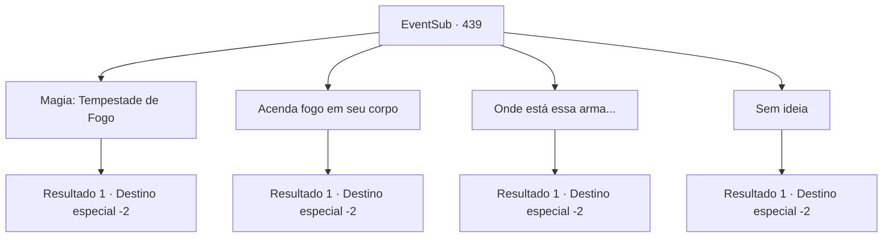

# Eventos secundários · 439

[Índice da tabela](index.md) · [Índice geral](../index.md)

ID: `pt:EventSub:439` · Fonte: `EventSub4` · Versão: 1.2.47.

Mapeamento estático dos arquivos; a disponibilidade e a execução dependem do estado da run.

## Texto do evento

*Sem texto no arquivo.*

## Dados de entrada

```json
{
  "id": 439,
  "grade": 1,
  "subEvent": "",
  "required": ""
}
```

## Mapa das escolhas



## Escolhas e resultados

### Escolha 1

Magia: Tempestade de Fogo

Requisitos e outros campos da escolha:

```json
{
  "required": "20_0_4|1_1_2"
}
```

#### Resultado 1.1

Você lança um feitiço, invocando uma tempestade de fogo dentro da caverna. O fogo consome o corpo do troll terrível, transformando-o rapidamente em um monte de cinzas. 

 "Humano... incrível! Vingança. Obrigado. Eu te dou isso!"

 Brully te entrega seu martelo. Você pega o martelo e se despede de Brully. Em seguida, sai da caverna. Então, uma águia voa do céu e se transforma em um humano. 

 "Você... matou ele?"

 Você orgulhosamente tira a bolsa cheia de cinzas. Ela ainda parece não acreditar em você, enquanto ela entra na caverna. Após alguns segundos, Syannathel sai da caverna, tentando esconder a expressão surpresa em seu rosto, e então fala. 

 "Então você realmente matou um troll feroz, hein... Bom trabalho."

 Ela estende a mão para um aperto de mão. Você aceita felizmente. 

 "Não tenho muito para te dar, mas... pelo menos vou te dar uma oração. Que as bênçãos dos deuses da natureza estejam com você."

 Depois de terminar sua oração, ela se transforma novamente em uma águia e voa para longe.

Continuação registrada: [Destino especial `-2`](../destinos-especiais.md).

```json
{
  "required": "",
  "chance": "1",
  "nextEvent": -2,
  "type": 2,
  "reward": "3_18_1|14_8_7|12_8_-1|0_14_1|0_1_-1"
}
```

### Escolha 2

Acenda fogo em seu corpo

Requisitos e outros campos da escolha:

```json
{
  "required": "8_47_1"
}
```

#### Resultado 2.1

Você pega todos os seus fósforos e acende o troll direto no fogo. O fogo envolve o corpo do troll direto, transformando-o em um monte de cinzas em breve. 

 "Humano... incrível! Vingança. Obrigado. Eu te dou isso!"

 Brully te entrega seu martelo. Você pega o martelo e se despede de Brully. Em seguida, sai da caverna. Então, uma águia voa do céu e se transforma em um humano. 

 "Você... matou ele?"

 Você acena com a cabeça em resposta. Ela ainda parece não acreditar em você, enquanto ela mesma entra na caverna. Após alguns segundos, Syannathel sai da caverna, tentando esconder a expressão surpresa em seu rosto, e então fala. 

 "Então você realmente matou um troll direto, hein... Bom trabalho."

 Ela estende a mão para um aperto de mão. Você aceita felizmente. 

 "Não tenho muito para te dar, mas... pelo menos vou te dar uma oração. Que as bênçãos dos deuses da natureza estejam com você."

 Após terminar sua oração, ela se transforma novamente em uma águia e voa para longe.

Continuação registrada: [Destino especial `-2`](../destinos-especiais.md).

```json
{
  "required": "",
  "chance": "1",
  "nextEvent": -2,
  "type": 2,
  "reward": "3_18_1|14_8_7|12_8_-1|0_14_1|4_47_1"
}
```

### Escolha 3

Onde está essa arma...

Requisitos e outros campos da escolha:

```json
{
  "required": "8_68_1"
}
```

#### Resultado 3.1

Você puxa uma arma imbuida com a maldição de bloqueio de cura e despedaça o coração do troll feroz com ela. 

 "Humano... incrível! Vingança. Obrigado. Eu te dou isso!"

 Brully te entrega seu martelo. Você pega o martelo e se despede de Brully. Em seguida, sai da caverna. Então, uma águia voa do céu e se transforma em um humano. 

 "Você... matou ele?"

 Você acena com a cabeça em resposta. Ela ainda parece não acreditar em você, pois ela mesma entra na caverna. Após alguns segundos, Syannathel sai da caverna, tentando esconder a expressão surpresa em seu rosto, e então fala. 

 "Então você realmente matou um troll feroz, hein... Bom trabalho."

 Ela estende a mão para um aperto de mãos. Você aceita felizmente. 

 "Não tenho muito para te dar, mas... pelo menos vou te dar uma oração. Que as bênçãos dos deuses da natureza estejam com você."

 Após terminar sua oração, ela se transforma novamente em uma águia e voa para longe.

Continuação registrada: [Destino especial `-2`](../destinos-especiais.md).

```json
{
  "required": "",
  "chance": "1",
  "nextEvent": -2,
  "type": 2,
  "reward": "3_18_1|14_8_7|12_8_-1|0_14_1"
}
```

### Escolha 4

Sem ideia

Requisitos e outros campos da escolha:

```json
{
  "required": ""
}
```

#### Resultado 4.1

Enquanto você está tentando encontrar uma maneira de derrotar o troll terrível, ele cura suas feridas novamente e se levanta. Ele avança em sua direção novamente com seu tamanho enorme, e você mal consegue sair da caverna com vida. O troll terrível não persegue fora da caverna. 

 "Tão perto, humano. Ainda agradeço. Esse troll merece. Brully te dá isso."

 Brully te entrega um cogumelo vermelho. Você se despede de Brully e desce da montanha.

Continuação registrada: [Destino especial `-2`](../destinos-especiais.md).

```json
{
  "required": "",
  "chance": "1",
  "nextEvent": -2,
  "type": 2,
  "reward": "14_8_6|12_8_-1|3_134_1"
}
```

## Referências que chegam a este evento

- [Evento 438 · escolha 1 · resultado 3](0438.md#escolha-1)
