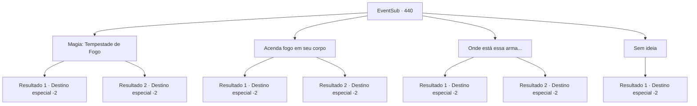

# Eventos secundários · 440

[Índice da tabela](index.md) · [Índice geral](../index.md)

ID: `pt:EventSub:440` · Fonte: `EventSub4` · Versão: 1.2.47.

Mapeamento estático dos arquivos; a disponibilidade e a execução dependem do estado da run.

## Texto do evento

*Sem texto no arquivo.*

## Dados de entrada

```json
{
  "id": 440,
  "grade": 1,
  "subEvent": "",
  "required": ""
}
```

## Mapa das escolhas



## Escolhas e resultados

### Escolha 1

Magia: Tempestade de Fogo

Requisitos e outros campos da escolha:

```json
{
  "required": "20_0_4|1_1_2"
}
```

#### Resultado 1.1

Você lança um feitiço, convocando uma tempestade de fogo dentro da caverna. O fogo envolve o corpo do troll feroz, logo transformando-o em um monte de cinzas. Você recolhe as cinzas em uma bolsa e sai da caverna. Então, uma águia voa do céu, em seguida, se transforma em um humano. 

 "Você... o matou?"

 Você orgulhosamente tira a bolsa cheia de cinzas. Ela fica encantada ao vê-la. 

 "Obrigada por lidar com isso. Ótimo trabalho!"

 Ela estende a mão, pedindo um aperto de mão. Você pega sua mão. Então ela fecha os olhos e reza por você com sinceridade. 

 "Que as bênçãos dos deuses da natureza estejam com você."

 Após terminar sua oração, ela o acompanha até a base da montanha. Ela acena com a mão até você não poder mais vê-la.

Continuação registrada: [Destino especial `-2`](../destinos-especiais.md).

```json
{
  "required": "18_335_1",
  "chance": "1",
  "nextEvent": -2,
  "type": 2,
  "reward": "14_8_7|12_8_-1|0_14_1|0_1_-1"
}
```

#### Resultado 1.2

Você lança um feitiço, convocando uma tempestade de fogo dentro da caverna. O fogo envolve o corpo do troll feroz, logo transformando-o em um monte de cinzas. Você recolhe as cinzas em uma bolsa. 

 "Humano... incrível! Vingança. Obrigado. Eu te dou isso!"

 Brully te entrega seu martelo. Você pega o martelo e se despede de Brully. Em seguida, sai da caverna. Então, uma águia voa do céu e se transforma em um humano. 

 "Você... matou ele?"

 Você orgulhosamente mostra a bolsa cheia de cinzas. Ela fica encantada ao vê-la. 

 "Obrigada por lidar com isso. Ótimo trabalho!"

 Ela estende a mão, pedindo um aperto de mão. Você pega sua mão. Então ela fecha os olhos e reza por você com sinceridade. 

 "Que as bênçãos dos deuses da natureza estejam com você."

 Após terminar sua oração, ela te acompanha descendo a montanha. Ela acena com a mão até você não poder mais vê-la.

Continuação registrada: [Destino especial `-2`](../destinos-especiais.md).

```json
{
  "required": "5_335_1",
  "chance": "1",
  "nextEvent": -2,
  "type": 2,
  "reward": "3_18_1|14_8_7|12_8_-1|0_14_1|0_1_-1"
}
```

### Escolha 2

Acenda fogo em seu corpo

Requisitos e outros campos da escolha:

```json
{
  "required": "8_47_1"
}
```

#### Resultado 2.1

Você pega todos os seus fósforos e acende o troll direto no fogo. O fogo envolve o corpo do troll direto, transformando-o em um monte de cinzas em breve. Você coleta as cinzas em uma bolsa. Então, uma águia voa do céu e se transforma em um humano. 

 "Você... o matou?"

 Você orgulhosamente pega a bolsa cheia de cinzas. Ela fica encantada ao vê-la. 

 "Obrigada por lidar com isso. Ótimo trabalho!"

 Ela estende a mão, pedindo um aperto de mão. Você pega a mão dela. Então ela fecha os olhos e reza sinceramente por você. 

 "Que as bênçãos dos deuses da natureza estejam com você."

 Após terminar sua oração, ela te acompanha descendo a montanha. Ela acena com a mão até você não poder mais vê-la.

Continuação registrada: [Destino especial `-2`](../destinos-especiais.md).

```json
{
  "required": "18_335_1",
  "chance": "1",
  "nextEvent": -2,
  "type": 2,
  "reward": "14_8_7|12_8_-1|0_14_1"
}
```

#### Resultado 2.2

Você pega todos os seus fósforos e acende o troll direto no fogo. O fogo envolve o corpo do troll direto, transformando-o em um monte de cinzas em breve. Você coleta as cinzas em uma bolsa. 

 "Humano... incrível! Vingança. Obrigado. Eu te dou isso!"

 Brully te entrega seu martelo. Você pega o martelo e se despede de Brully. Em seguida, sai da caverna. Então, uma águia voa do céu e se transforma em um humano. 

 "Você... matou ele?"

 Você orgulhosamente pega a bolsa cheia de cinzas. Ela fica encantada ao vê-la. 

 "Obrigada por lidar com isso. Ótimo trabalho!"

 Ela estende a mão, pedindo um aperto de mão. Você pega sua mão. Então ela fecha os olhos e reza por você com sinceridade. 

 "Que as bênçãos dos deuses da natureza estejam com você."

 Após terminar sua oração, ela te acompanha descendo a montanha. Ela acena com a mão até você não poder mais vê-la.

Continuação registrada: [Destino especial `-2`](../destinos-especiais.md).

```json
{
  "required": "5_335_1",
  "chance": "1",
  "nextEvent": -2,
  "type": 2,
  "reward": "3_18_1|14_8_7|12_8_-1|0_14_1|4_47_1"
}
```

### Escolha 3

Onde está essa arma...

Requisitos e outros campos da escolha:

```json
{
  "required": "8_68_1"
}
```

#### Resultado 3.1

Você puxa uma arma imbuida com a maldição de bloqueio de cura e despedaça o coração do troll maligno com ela. Você separa a cabeça do troll maligno do seu corpo, coloca-a na sua mochila e sai da caverna. Então, uma águia voa do céu e se transforma em um humano. 

 "Você... o matou?"

 Você orgulhosamente tira a cabeça do troll maligno da sua mochila. Ela fica encantada ao vê-la. 

 "Obrigada por lidar com isso. Ótimo trabalho!"

 Ela estende a mão, pedindo um aperto de mão. Você pega a mão dela. Então ela fecha os olhos e reza sinceramente por você. 

 "Que as bênçãos dos deuses da natureza estejam com você."

 Após terminar sua oração, ela te acompanha descendo a montanha. Ela acena com a mão até você não poder mais vê-la.

Continuação registrada: [Destino especial `-2`](../destinos-especiais.md).

```json
{
  "required": "18_335_1",
  "chance": "1",
  "nextEvent": -2,
  "type": 2,
  "reward": "14_8_7|12_8_-1|0_14_1"
}
```

#### Resultado 3.2

Você puxa uma arma imbuida com a maldição de bloqueio de cura e despedaça o coração do troll maligno com ela. Você separa a cabeça do troll maligno do seu corpo. 

 "Humano... incrível! Vingança. Obrigado. Eu te dou isso!"

 Brully te entrega seu martelo. Você pega o martelo e se despede de Brully. Em seguida, sai da caverna. Então, uma águia voa do céu e se transforma em um humano. 

 "Você... matou ele?"

 Você orgulhosamente tira a cabeça do troll maligno da sua mochila. Ela fica encantada ao vê-la. 

 "Obrigado por lidar com isso. Ótimo trabalho!"

 Ela estende a mão, pedindo um aperto de mão. Você pega sua mão. Então ela fecha os olhos e reza sinceramente por você. 

 "Que as bênçãos dos deuses da natureza estejam com você."

 Após terminar sua oração, ela te acompanha descendo a montanha. Ela acena com a mão até você não poder mais vê-la.

Continuação registrada: [Destino especial `-2`](../destinos-especiais.md).

```json
{
  "required": "5_335_1",
  "chance": "1",
  "nextEvent": -2,
  "type": 2,
  "reward": "3_18_1|14_8_7|12_8_-1|0_14_1"
}
```

### Escolha 4

Sem ideia

Requisitos e outros campos da escolha:

```json
{
  "required": ""
}
```

#### Resultado 4.1

Enquanto você está tentando encontrar uma maneira de derrotar o troll terrível, ele cura suas feridas novamente e se levanta. Ele avança em sua direção novamente com seu tamanho enorme, e você mal consegue sair da caverna com vida. O troll terrível não persegue fora da caverna. Você desce a montanha o mais rápido que pode.

Continuação registrada: [Destino especial `-2`](../destinos-especiais.md).

```json
{
  "required": "",
  "chance": "1",
  "nextEvent": -2,
  "type": 2,
  "reward": "14_8_6|12_8_-1"
}
```

## Referências que chegam a este evento

- [Evento 438 · escolha 1 · resultado 2](0438.md#escolha-1)
- [Evento 438 · escolha 1 · resultado 4](0438.md#escolha-1)
