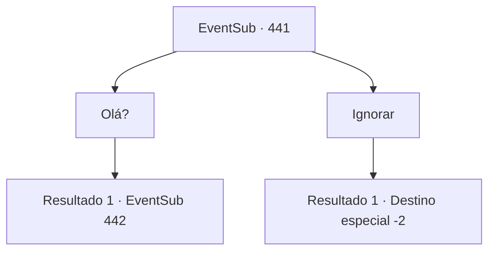

# Eventos secundários · 441

[Índice da tabela](index.md) · [Índice geral](../index.md)

ID: `pt:EventSub:441` · Fonte: `EventSub4` · Versão: 1.2.47.

Mapeamento estático dos arquivos; a disponibilidade e a execução dependem do estado da run.

## Texto do evento

Enquanto você vagueia por uma montanha sem nome, você vê uma pequena cabana. Ela está localizada em uma área completamente deserta. Parece estranhamente misteriosa, como se não pertencesse à paisagem. Várias plantas estão crescendo ao redor da cabana, que parece estar em boas mãos. O dono da cabana é provavelmente um excelente jardineiro.

## Dados de entrada

```json
{
  "id": 441,
  "grade": 1,
  "subEvent": "",
  "required": "12_8_10"
}
```

## Mapa das escolhas



## Escolhas e resultados

### Escolha 1

Olá?

Requisitos e outros campos da escolha:

```json
{
  "required": ""
}
```

#### Resultado 1.1

Você se aproxima da cabana misteriosa e chama o dono. A porta se abre e você encontra alguém que já conheceu antes. Syannathel. Ela está morando aqui. Ela te encara com uma surpresa de olhos arregalados. 

 "...Como você encontrou este lugar?"

 Depois de um momento de admiração, ela sai correndo da casa e te agarra pela gola. 

 "Você traidor!!!"


Continuação registrada: [Evento 442](0442.md) na mesma tabela.

```json
{
  "required": "",
  "chance": "1",
  "nextEvent": 442,
  "type": 2,
  "reward": "12_8_-1"
}
```

### Escolha 2

Ignorar

Requisitos e outros campos da escolha:

```json
{
  "required": ""
}
```

#### Resultado 2.1

Você passa pela cabana misteriosa.

Continuação registrada: [Destino especial `-2`](../destinos-especiais.md).

```json
{
  "required": "",
  "chance": "1",
  "nextEvent": -2,
  "type": 2,
  "reward": "12_8_-1|14_8_4"
}
```

## Referências que chegam a este evento

Nenhum `nextEvent` positivo da mesma tabela aponta para este nó. Isso não prova que seja inacessível: sorteio e estado de história podem selecioná-lo.

