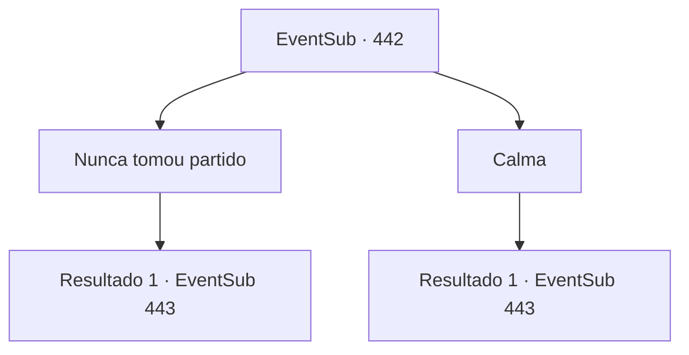

# Eventos secundários · 442

[Índice da tabela](index.md) · [Índice geral](../index.md)

ID: `pt:EventSub:442` · Fonte: `EventSub4` · Versão: 1.2.47.

Mapeamento estático dos arquivos; a disponibilidade e a execução dependem do estado da run.

## Texto do evento

*Sem texto no arquivo.*

## Dados de entrada

```json
{
  "id": 442,
  "grade": 1,
  "subEvent": "",
  "required": ""
}
```

## Mapa das escolhas



## Escolhas e resultados

### Escolha 1

Nunca tomou partido

Requisitos e outros campos da escolha:

```json
{
  "required": ""
}
```

#### Resultado 1.1

Você afirma que não tomou partido algum. No entanto, suas palavras só acabam inflamando sua raiva. 

 "Se você tivesse nos ajudado... Poderíamos ter defendido nossa casa e nossa família! Acreditamos em você, mas você traiu nossa confiança. Isso é tão bom quanto tomar partido com Amakar!"


Continuação registrada: [Evento 443](0443.md) na mesma tabela.

```json
{
  "required": "",
  "chance": "1",
  "nextEvent": 443,
  "type": 2,
  "reward": ""
}
```

### Escolha 2

Calma

Requisitos e outros campos da escolha:

```json
{
  "required": ""
}
```

#### Resultado 2.1

Tentas acalmá-la e conversar sobre isso. No entanto, as tuas palavras só acabam por aumentar a sua raiva. 

 "Calma...? Se nos tivesses ajudado... Poderíamos ter defendido a nossa casa e a nossa família! E tu tentas acalmar-me?"


Continuação registrada: [Evento 443](0443.md) na mesma tabela.

```json
{
  "required": "",
  "chance": "1",
  "nextEvent": 443,
  "type": 2,
  "reward": ""
}
```

## Referências que chegam a este evento

- [Evento 441 · escolha 1 · resultado 1](0441.md#escolha-1)
