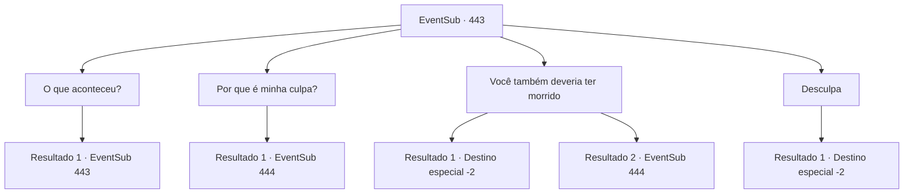

# Eventos secundários · 443

[Índice da tabela](index.md) · [Índice geral](../index.md)

ID: `pt:EventSub:443` · Fonte: `EventSub4` · Versão: 1.2.47.

Mapeamento estático dos arquivos; a disponibilidade e a execução dependem do estado da run.

## Texto do evento

*Sem texto no arquivo.*

## Dados de entrada

```json
{
  "id": 443,
  "grade": 1,
  "subEvent": "",
  "required": ""
}
```

## Mapa das escolhas



## Escolhas e resultados

### Escolha 1

O que aconteceu?

Requisitos e outros campos da escolha:

```json
{
  "required": "5_336_0"
}
```

#### Resultado 1.1

Você pergunta a Syannathel o que aconteceu com ela. Ela responde com lágrimas nos olhos. 

 "Tentamos recuperar a joia, mas falhamos... No final, muitos de nossos parentes foram capturados ou morreram."


Continuação registrada: [Evento 443](0443.md) na mesma tabela.

```json
{
  "required": "",
  "chance": "1",
  "nextEvent": 443,
  "type": 2,
  "reward": "5_336_1"
}
```

### Escolha 2

Por que é minha culpa?

Requisitos e outros campos da escolha:

```json
{
  "required": "5_336_1"
}
```

#### Resultado 2.1

Ela parece precisar de alguém para culpar pela derrota. Você aponta isso para ela, acrescentando que os druidas não morreram por ela, mas foi apenas escolha deles lutar na guerra. Syannathel fica ainda mais corada, agora começando a tremer. 

 "Absurdo!!! Não ouse falar comigo assim!"

 Syannathel grita bruscamente e balança sua arma em sua direção.

Continuação registrada: [Evento 444](0444.md) na mesma tabela.

```json
{
  "required": "",
  "chance": "1",
  "nextEvent": 444,
  "type": 2,
  "reward": "6_3_139",
  "place": 1
}
```

### Escolha 3

Você também deveria ter morrido

Requisitos e outros campos da escolha:

```json
{
  "required": "5_336_1|2_3_-14"
}
```

#### Resultado 3.1

Você sussurra em seus ouvidos como um demônio. Por que você sobreviveu sozinho? Você deveria ter morrido com seus parentes. Você está culpando outra pessoa por sua culpa? Você decidiu ignorar sua consciência? Então ela fica pálida e afunda. 

 "Ah... Não...! Eu não fiz... Eu não fiz..."

 Lágrimas escorrem de seus olhos vazios. Você deixa Syannathel e segue para outro lugar.

Continuação registrada: [Destino especial `-2`](../destinos-especiais.md).

```json
{
  "required": "",
  "chance": "1|0_12_1",
  "nextEvent": -2,
  "type": 0,
  "reward": "14_8_14"
}
```

#### Resultado 3.2

Você responde indiferentemente, mexendo a orelha com o dedo. Syannathel fica ainda mais corada, começando a tremer. 

 "Maldito!!! É melhor você cuidar da sua língua suja!"

 Syannathel grita bruscamente e balança sua arma em sua direção.

Continuação registrada: [Evento 444](0444.md) na mesma tabela.

```json
{
  "required": "",
  "chance": "24",
  "nextEvent": 444,
  "type": 1,
  "reward": "6_3_139",
  "place": 1
}
```

### Escolha 4

Desculpa

Requisitos e outros campos da escolha:

```json
{
  "required": "5_336_1"
}
```

#### Resultado 4.1

Você se desculpa com ela. Syannathel olha nos seus olhos por um tempo e depois te solta. Ela abre a boca com uma expressão sombria. 

 "...Para que serve tudo isso? Eu quero ficar sozinha."

 Ela entra na casa e fecha a porta. Você deixa a cabana para trás e parte.

Continuação registrada: [Destino especial `-2`](../destinos-especiais.md).

```json
{
  "required": "",
  "chance": "1",
  "nextEvent": -2,
  "type": 2,
  "reward": "14_8_4"
}
```

## Referências que chegam a este evento

- [Evento 442 · escolha 1 · resultado 1](0442.md#escolha-1)
- [Evento 442 · escolha 2 · resultado 1](0442.md#escolha-2)
- [Evento 443 · escolha 1 · resultado 1](0443.md#escolha-1)
