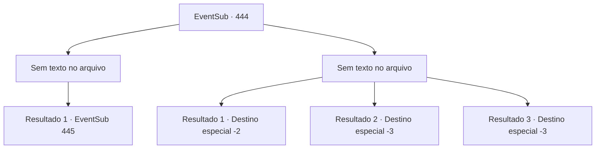

# Eventos secundários · 444

[Índice da tabela](index.md) · [Índice geral](../index.md)

ID: `pt:EventSub:444` · Fonte: `EventSub4` · Versão: 1.2.47.

Mapeamento estático dos arquivos; a disponibilidade e a execução dependem do estado da run.

## Texto do evento

*Sem texto no arquivo.*

## Dados de entrada

```json
{
  "id": 444,
  "grade": 1,
  "subEvent": "",
  "required": ""
}
```

## Mapa das escolhas



## Escolhas e resultados

### Escolha 1

*Sem texto no arquivo; o papel dessa opção depende da interface do jogo.*

Requisitos e outros campos da escolha:

```json
{
  "required": ""
}
```

#### Resultado 1.1

No seu ataque, Syannathel cai ao chão. Deitada no chão, ela murmura. 

 "...Para que serve tudo isso? Apenas me mate, por favor? Eu não me importo mais com nada. Não me importarei nem mesmo se este for o último dia da minha vida."


Continuação registrada: [Evento 445](0445.md) na mesma tabela.

```json
{
  "required": "",
  "chance": "1",
  "nextEvent": 445,
  "type": 2,
  "reward": ""
}
```

### Escolha 2

*Sem texto no arquivo; o papel dessa opção depende da interface do jogo.*

Requisitos e outros campos da escolha:

```json
{
  "required": ""
}
```

#### Resultado 2.1

Enquanto desvia do cajado de Syannathel, você rola pelo penhasco. Felizmente, você sobrevive com apenas algumas feridas, já que o penhasco não é tão íngreme. Você consegue mancar para longe de Syannathel.

Continuação registrada: [Destino especial `-2`](../destinos-especiais.md).

```json
{
  "required": "1_0_2|1_1_2",
  "chance": "1",
  "nextEvent": -2,
  "type": 2,
  "reward": "0_0_-1|0_1_-1|14_8_4"
}
```

#### Resultado 2.2

Enquanto desvia do cajado de Syannathel, você rola pela falésia

Continuação registrada: [Destino especial `-3`](../destinos-especiais.md).

```json
{
  "required": "2_0_2",
  "chance": "1",
  "nextEvent": -3,
  "type": 2,
  "reward": "0_0_-1|0_1_-1"
}
```

#### Resultado 2.3

Enquanto desvia do cajado de Syannathel, você rola pela falésia

Continuação registrada: [Destino especial `-3`](../destinos-especiais.md).

```json
{
  "required": "2_1_2",
  "chance": "1",
  "nextEvent": -3,
  "type": 2,
  "reward": "0_0_-1|0_1_-1"
}
```

## Referências que chegam a este evento

- [Evento 443 · escolha 2 · resultado 1](0443.md#escolha-2)
- [Evento 443 · escolha 3 · resultado 2](0443.md#escolha-3)
