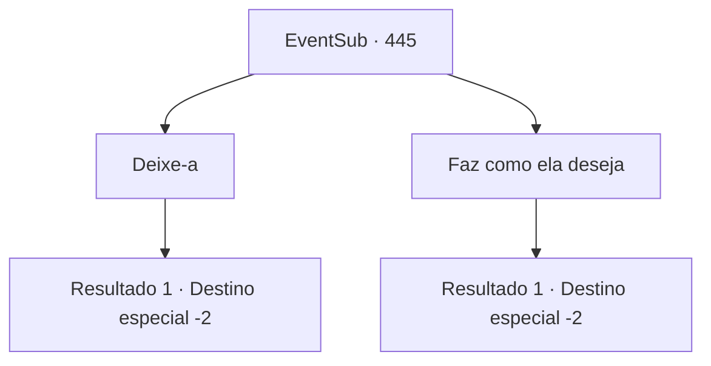

# Eventos secundários · 445

[Índice da tabela](index.md) · [Índice geral](../index.md)

ID: `pt:EventSub:445` · Fonte: `EventSub4` · Versão: 1.2.47.

Mapeamento estático dos arquivos; a disponibilidade e a execução dependem do estado da run.

## Texto do evento

*Sem texto no arquivo.*

## Dados de entrada

```json
{
  "id": 445,
  "grade": 1,
  "subEvent": "",
  "required": ""
}
```

## Mapa das escolhas



## Escolhas e resultados

### Escolha 1

Deixe-a

Requisitos e outros campos da escolha:

```json
{
  "required": ""
}
```

#### Resultado 1.1

Você vira as costas para Syannathel. Você ouve o choro dela, mas ignora e segue em frente.

Continuação registrada: [Destino especial `-2`](../destinos-especiais.md).

```json
{
  "required": "",
  "chance": "1",
  "nextEvent": -2,
  "type": 2,
  "reward": "14_8_4"
}
```

### Escolha 2

Faz como ela deseja

Requisitos e outros campos da escolha:

```json
{
  "required": "2_3_-14"
}
```

#### Resultado 2.1

Você faz o que Syannathel pede. Você tira a vida dela com sua arma e joga o corpo dela na floresta, perto da cabana.

Continuação registrada: [Destino especial `-2`](../destinos-especiais.md).

```json
{
  "required": "",
  "chance": "1",
  "nextEvent": -2,
  "type": 2,
  "reward": "14_8_14"
}
```

## Referências que chegam a este evento

- [Evento 444 · escolha 1 · resultado 1](0444.md#escolha-1)
