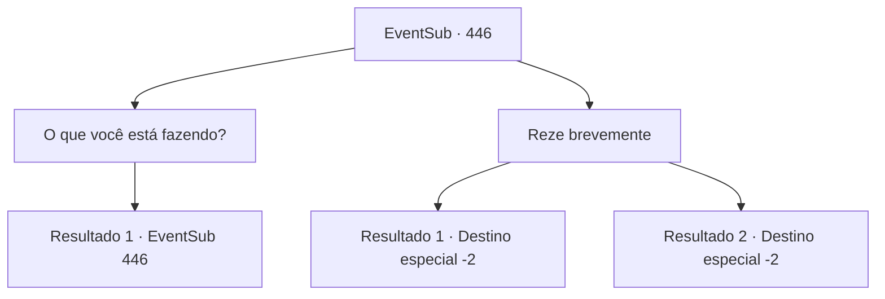

# Eventos secundários · 446

[Índice da tabela](index.md) · [Índice geral](../index.md)

ID: `pt:EventSub:446` · Fonte: `EventSub4` · Versão: 1.2.47.

Mapeamento estático dos arquivos; a disponibilidade e a execução dependem do estado da run.

## Texto do evento

Depois de algum tempo, você passa por Tomant. A cidade tem mais ou menos o mesmo tamanho de antes, mas parece estranhamente menos animada. Ao caminhar pelo mercado, você percebe uma enorme estátua construída na praça da cidade. A estátua, no topo da fonte, lembra a aparência de ninguém menos que 'Amakar'. Você vê uma mulher jogando uma moeda na fonte. Então ela junta as mãos e reza.

## Dados de entrada

```json
{
  "id": 446,
  "grade": 1,
  "subEvent": "",
  "required": "12_8_11"
}
```

## Mapa das escolhas



## Escolhas e resultados

### Escolha 1

O que você está fazendo?

Requisitos e outros campos da escolha:

```json
{
  "required": "5_337_0"
}
```

#### Resultado 1.1

Ela responde à sua pergunta com uma voz suave. 

 "Oh... Vejo que você é um aventureiro. Essa é uma estátua do senhor Amakar. Ele costumava ser o marido do senhorio. Ele deveria ser o senhorio, mas morreu defendendo Tomant."

 A mulher olha para a estátua e fala. 

 "Eu orei a ele, esperando que ele nos protegesse."


Continuação registrada: [Evento 446](0446.md) na mesma tabela.

```json
{
  "required": "",
  "chance": "1",
  "nextEvent": 446,
  "type": 2,
  "reward": "5_337_1|12_8_-1"
}
```

### Escolha 2

Reze brevemente

Requisitos e outros campos da escolha:

```json
{
  "required": "5_337_1"
}
```

#### Resultado 2.1

Você joga uma moeda na fonte, assim como a mulher fez. Então você junta as mãos e reza brevemente. Você não tem certeza do seu efeito, mas parece que se sente melhor de alguma forma.

Continuação registrada: [Destino especial `-2`](../destinos-especiais.md).

```json
{
  "required": "1_4_1",
  "chance": "1",
  "nextEvent": -2,
  "type": 2,
  "reward": "14_8_9|0_4_-1"
}
```

#### Resultado 2.2

Você junta as mãos e reza brevemente, em vez de jogar uma moeda na fonte. Você não tem certeza do seu efeito, mas parece que se sente melhor de alguma forma.

Continuação registrada: [Destino especial `-2`](../destinos-especiais.md).

```json
{
  "required": "2_4_1",
  "chance": "1",
  "nextEvent": -2,
  "type": 2,
  "reward": "14_8_9"
}
```

## Referências que chegam a este evento

- [Evento 446 · escolha 1 · resultado 1](0446.md#escolha-1)
