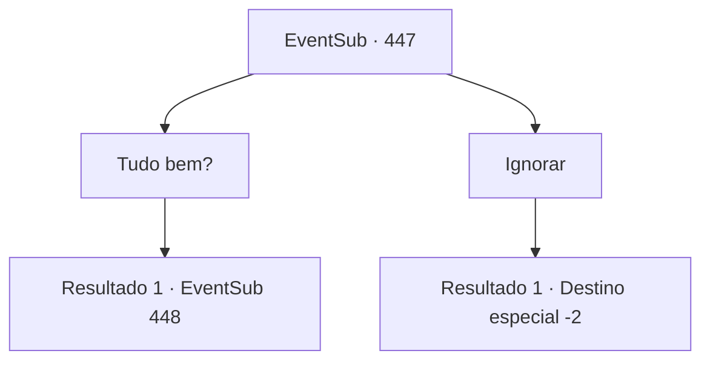

# Eventos secundários · 447

[Índice da tabela](index.md) · [Índice geral](../index.md)

ID: `pt:EventSub:447` · Fonte: `EventSub4` · Versão: 1.2.47.

Mapeamento estático dos arquivos; a disponibilidade e a execução dependem do estado da run.

## Texto do evento

Ao subir uma montanha, você se depara com um menino com roupas únicas. Ele está vestindo uma capa de pele de urso e um capacete com chifres. Essas são as roupas de um druida. Ele se senta com uma expressão extremamente sombria. Ele percebe sua presença e olha para cima.

## Dados de entrada

```json
{
  "id": 447,
  "grade": 1,
  "subEvent": "",
  "required": "12_8_13"
}
```

## Mapa das escolhas



## Escolhas e resultados

### Escolha 1

Tudo bem?

Requisitos e outros campos da escolha:

```json
{
  "required": ""
}
```

#### Resultado 1.1


 "Oh... {1}? É você?"

 Lágrimas enchem seus olhos. 

 "Eu sou 'Lorutu' da Floresta de Silocient. Por favor, me ajude. Eu imploro a você."

 Ele explica o que aconteceu. De acordo com ele, os druidas que foram para as negociações foram levados para Tomant. Ele diz que seus corpos estão pendurados na parede. Lorutu quer trazer os corpos de volta, para enterrá-los adequadamente.

Continuação registrada: [Evento 448](0448.md) na mesma tabela.

```json
{
  "required": "",
  "chance": "1",
  "nextEvent": 448,
  "type": 2,
  "reward": ""
}
```

### Escolha 2

Ignorar

Requisitos e outros campos da escolha:

```json
{
  "required": ""
}
```

#### Resultado 2.1

Você ignora o druida no chão e passa por ele.

Continuação registrada: [Destino especial `-2`](../destinos-especiais.md).

```json
{
  "required": "",
  "chance": "1",
  "nextEvent": -2,
  "type": 2,
  "reward": "12_8_-1"
}
```

## Referências que chegam a este evento

Nenhum `nextEvent` positivo da mesma tabela aponta para este nó. Isso não prova que seja inacessível: sorteio e estado de história podem selecioná-lo.

