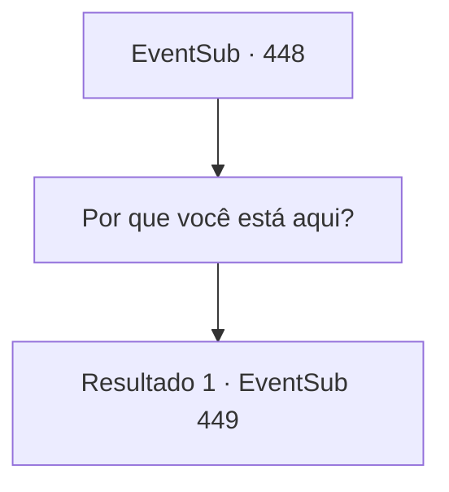

# Eventos secundários · 448

[Índice da tabela](index.md) · [Índice geral](../index.md)

ID: `pt:EventSub:448` · Fonte: `EventSub4` · Versão: 1.2.47.

Mapeamento estático dos arquivos; a disponibilidade e a execução dependem do estado da run.

## Texto do evento

*Sem texto no arquivo.*

## Dados de entrada

```json
{
  "id": 448,
  "grade": 1,
  "subEvent": "",
  "required": ""
}
```

## Mapa das escolhas



## Escolhas e resultados

### Escolha 1

Por que você está aqui?

Requisitos e outros campos da escolha:

```json
{
  "required": ""
}
```

#### Resultado 1.1

Ele enxuga as lágrimas enquanto responde sua pergunta. 

 "Os demais fugiram para outro lugar. Dizem que as negociações fracassaram e os delegados foram mortos. Embora eu não acreditasse. Tive que verificar com meus próprios olhos."

 No entanto, após ver os corpos, ele chorou de medo e fugiu.

Continuação registrada: [Evento 449](0449.md) na mesma tabela.

```json
{
  "required": "",
  "chance": "1",
  "nextEvent": 449,
  "type": 2,
  "reward": ""
}
```

## Referências que chegam a este evento

- [Evento 447 · escolha 1 · resultado 1](0447.md#escolha-1)
