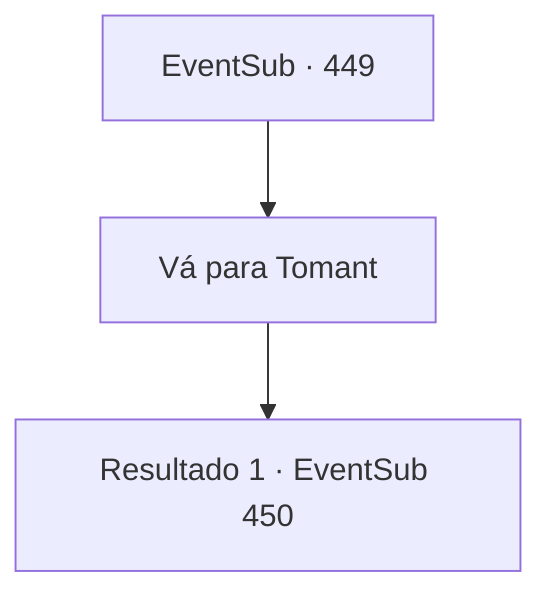

# Eventos secundários · 449

[Índice da tabela](index.md) · [Índice geral](../index.md)

ID: `pt:EventSub:449` · Fonte: `EventSub4` · Versão: 1.2.47.

Mapeamento estático dos arquivos; a disponibilidade e a execução dependem do estado da run.

## Texto do evento

*Sem texto no arquivo.*

## Dados de entrada

```json
{
  "id": 449,
  "grade": 1,
  "subEvent": "",
  "required": ""
}
```

## Mapa das escolhas



## Escolhas e resultados

### Escolha 1

Vá para Tomant

Requisitos e outros campos da escolha:

```json
{
  "required": ""
}
```

#### Resultado 1.1

Você vai para Tomant com o garoto druida. Então você encontra os corpos dos druidas. Os cadáveres estão pendurados do lado de fora das paredes da cidade, com cordas enroladas no pescoço. Um pôr do sol escarlate cai nos cadáveres, enquanto os corvos pairam acima deles. Lorutu não suporta olhar para a cena e procurar em outro lugar. Você tem Lorutu escondido em um arbusto próximo e se aproxima da parede onde os corpos estão pendurados. |drawing_hangingDruid|

Continuação registrada: [Evento 450](0450.md) na mesma tabela.

```json
{
  "required": "",
  "chance": "1",
  "nextEvent": 450,
  "type": 2,
  "reward": ""
}
```

## Referências que chegam a este evento

- [Evento 448 · escolha 1 · resultado 1](0448.md#escolha-1)
