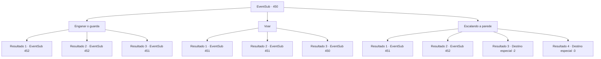

# Eventos secundários · 450

[Índice da tabela](index.md) · [Índice geral](../index.md)

ID: `pt:EventSub:450` · Fonte: `EventSub4` · Versão: 1.2.47.

Mapeamento estático dos arquivos; a disponibilidade e a execução dependem do estado da run.

## Texto do evento

*Sem texto no arquivo.*

## Dados de entrada

```json
{
  "id": 450,
  "grade": 1,
  "subEvent": "",
  "required": ""
}
```

## Mapa das escolhas



## Escolhas e resultados

### Escolha 1

Enganar o guarda

Requisitos e outros campos da escolha:

```json
{
  "required": ""
}
```

#### Resultado 1.1

Você se aproxima de um guarda parado no portão. Você franze a testa e pergunta sobre os corpos pendurados na parede. O guarda responde perplexo. 

 "Oh... Eu, Isso... Eles são alguns bárbaros chamados druidas. Peço desculpas, mas..."

 Interrompendo o soldado, que está prestes a perguntar quem você é, você junta as mãos e finge rezar. Você diz que Deus não gosta desse tipo de comportamento e que um padre deve realizar o funeral, que é você. 

 "Oh, Isso... Isso é..."

 Enquanto o guarda hesita, você pergunta gentilmente se ele não tem medo de Deus. Ele se dirige às muralhas da cidade, como se não tivesse escolha. O guarda derruba os corpos dos druidas com a ajuda de seus colegas. Eles até carregam os corpos na carroça para você. Você retorna a Lorutu com a carroça carregando os corpos dos druidas. 

 "Muito obrigado! Pelo menos agora posso realizar um funeral para eles..!"

 Ele se curva tão baixo que sua cabeça pequena toca o chão.

Continuação registrada: [Evento 452](0452.md) na mesma tabela.

```json
{
  "required": "",
  "chance": "1|0_12_1",
  "nextEvent": 452,
  "type": 0,
  "reward": ""
}
```

#### Resultado 1.2

Você se aproxima de um guarda parado no portão. Você franze a testa e pergunta sobre os corpos pendurados na parede. O guarda responde perplexo. 

 "Oh... Eu, Isso... Eles são alguns bárbaros chamados druidas. Peço desculpas, mas..."

 Interrompendo o soldado, que está prestes a perguntar quem você é, você junta as mãos e finge rezar. Você diz que Deus não gosta desse tipo de comportamento e que um padre deve realizar o funeral, que é você. 

 "Oh, Isso... Isso é..."

 Enquanto o guarda hesita, você pergunta gentilmente se ele não tem medo de Deus. Ele se dirige às muralhas da cidade, como se não tivesse escolha. O guarda derruba os corpos dos druidas com a ajuda de seus colegas. Eles até carregam os corpos na carroça para você. Você retorna a Lorutu com a carroça carregando os corpos dos druidas. 

 "Muito obrigado! Pelo menos agora posso realizar um funeral para eles..!"

 Ele se curva tão baixo que sua cabeça pequena toca o chão.

Continuação registrada: [Evento 452](0452.md) na mesma tabela.

```json
{
  "required": "20_4_2",
  "chance": "1|0_12_1",
  "nextEvent": 452,
  "type": 0,
  "reward": ""
}
```

#### Resultado 1.3

Você se aproxima de um guarda parado no portão. Você franze a testa e pergunta sobre os corpos pendurados na parede. O guarda responde perplexo. 

 "Oh... Eu, Isso... Eles são alguns bárbaros chamados druidas. Peço desculpas, mas..."

 Interrompendo o soldado, que está prestes a perguntar quem você é, você junta as mãos e finge rezar. Você diz que Deus não gosta desse tipo de comportamento e um padre deve realizar o funeral, que é você. No entanto, a reação do guarda está longe do que você esperava. 

 "Ha! Se você é um padre, eu sou Deus, seu bastardo!!"

 Sua atuação desajeitada provocou o guarda. Ele se agacha com sua lança.

Continuação registrada: [Evento 451](0451.md) na mesma tabela.

```json
{
  "required": "",
  "chance": "26",
  "nextEvent": 451,
  "type": 1,
  "reward": "6_3_135",
  "place": 4
}
```

### Escolha 2

Voar

Requisitos e outros campos da escolha:

```json
{
  "required": "5_338_0"
}
```

#### Resultado 2.1

Você silenciosamente lançou um feitiço e levita. Então você se aproxima dos corpos, amarrado com cordas. O soldado na parede está aparentemente concordando. Você o deixa soprando e cortou silenciosamente as cordas. 

 Enquanto você libera o último corpo, o guarda abre os olhos e encontra seus olhos. 

 "O que .. o que você está fazendo?!"

 Ele aumenta os olhos, chega aos seus sentidos e compra sua lança.

Continuação registrada: [Evento 451](0451.md) na mesma tabela.

```json
{
  "required": "20_0_1",
  "chance": "1",
  "nextEvent": 451,
  "type": 2,
  "reward": "6_0_135",
  "place": 4
}
```

#### Resultado 2.2

Você silenciosamente lançou um feitiço e levita. Então você se aproxima dos corpos, amarrado com cordas. O soldado na parede está aparentemente concordando. Você o deixa soprando e cortou silenciosamente as cordas. 

 Enquanto você libera o último corpo, o guarda abre os olhos e encontra seus olhos. 

 "O que .. o que você está fazendo?!"

 Ele aumenta os olhos, chega aos seus sentidos e compra sua lança.

Continuação registrada: [Evento 451](0451.md) na mesma tabela.

```json
{
  "required": "20_10_1",
  "chance": "1",
  "nextEvent": 451,
  "type": 2,
  "reward": "6_0_135",
  "place": 4
}
```

#### Resultado 2.3

Você deseja poder voar e libertar os corpos, mas não pode fazer isso. Você decide encontrar outra solução.

Continuação registrada: [Evento 450](0450.md) na mesma tabela.

```json
{
  "required": "21_0_1|21_10_1",
  "chance": "1",
  "nextEvent": 450,
  "type": 2,
  "reward": "5_338_1"
}
```

### Escolha 3

Escalando a parede

Requisitos e outros campos da escolha:

```json
{
  "required": ""
}
```

#### Resultado 3.1

Silenciosamente e rapidamente, você escala a parede da cidade. Então você se aproxima dos corpos, amarrado com cordas.  O soldado na parede está aparentemente concordando.  Você o deixa soprando e cortou silenciosamente as cordas.  

  Enquanto você libera o último corpo, o guarda abre os olhos e encontra seus olhos.  

 "O que .. o que você está fazendo?!"

  Ele aumenta os olhos, chega aos seus sentidos e compra sua lança.

Continuação registrada: [Evento 451](0451.md) na mesma tabela.

```json
{
  "required": "",
  "chance": "1|0_5_1|0_6_1",
  "nextEvent": 451,
  "type": 0,
  "reward": "6_0_135",
  "place": 4
}
```

#### Resultado 3.2

Silenciosamente e rapidamente, você escala a parede da cidade. Então você se aproxima dos corpos, amarrado com cordas. O soldado na parede está aparentemente concordando. Você o deixa soprando e cortou silenciosamente as cordas. 

 Você corta as cordas e liberta os corpos.  Você carrega os quatro cadáveres em um vagão que estava próximo e retorna a Lorutu.  

 "Muito obrigado! Pelo menos agora eu posso segurar um funeral para eles ..!"

  Ele se inclina tão baixo que sua cabeça pequena toca o chão.

Continuação registrada: [Evento 452](0452.md) na mesma tabela.

```json
{
  "required": "20_5_2",
  "chance": "1|0_5_1|0_6_1",
  "nextEvent": 452,
  "type": 0,
  "reward": ""
}
```

#### Resultado 3.3

Você sobe a parede, mas perde a aderência. Você cai e colide com o chão. 'Thud-!!' O barulho é grande o suficiente para atrair os guardas. Você se levanta apressadamente e foge.

Continuação registrada: [Destino especial `-2`](../destinos-especiais.md).

```json
{
  "required": "1_0_2",
  "chance": "40",
  "nextEvent": -2,
  "type": 1,
  "reward": "12_8_-1|14_8_1|0_0_-1"
}
```

#### Resultado 3.4

Você escala a parede, mas perde a aderência. Você cai e colide com o chão. 'Thud-!!' O barulho é grande o suficiente para atrair os guardas. No entanto, você não consegue se levantar.

Continuação registrada: [Destino especial `-3`](../destinos-especiais.md).

```json
{
  "required": "2_0_2",
  "chance": "40",
  "nextEvent": -3,
  "type": 1,
  "reward": "0_0_-1"
}
```

## Referências que chegam a este evento

- [Evento 449 · escolha 1 · resultado 1](0449.md#escolha-1)
- [Evento 450 · escolha 2 · resultado 3](0450.md#escolha-2)
